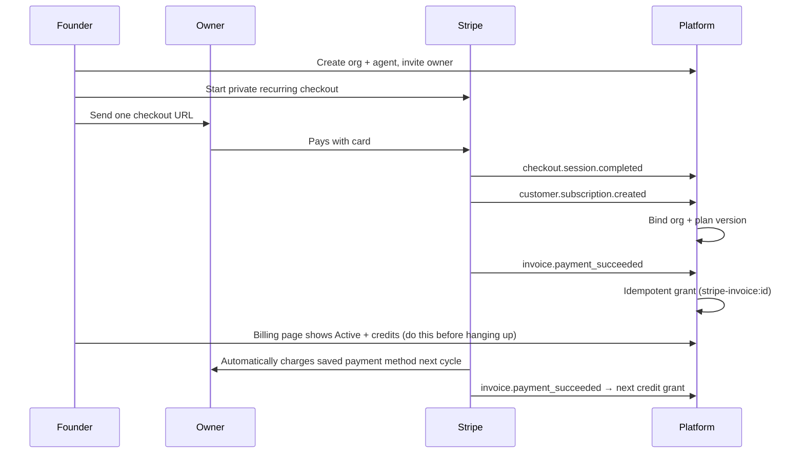

# Pilot Billing Runbook — Founder-operated Stripe Path (Epic C1)

**Status:** active procedure for the first ~25 concierge pilots.
**Principle:** fixed tiers only (Starter $79 / Growth $179 / Scale $399);
custom amounts go through Stripe Invoices as exceptions. No public self-serve
checkout links are published during the concierge phase.

The founder sends one private checkout link per customer. A recurring Stripe
Price creates a Subscription, and Stripe attempts the saved payment method on
each billing cycle. You do **not** send a new payment link every month.

## One-time setup (test mode first, then live)

1. In the platform admin **Plan Catalog**, create and publish the paid plan
   versions first. Each paid version must have:
   - its recurring Stripe Price ID;
   - an included-credit entitlement; and
   - the correct current-for-signup status.
2. Stripe Dashboard → **Test mode** → Products → create or verify:
   - `24x7 AI Starter` — $79/mo recurring
   - `24x7 AI Growth` — $179/mo recurring
   - `24x7 AI Scale` — $399/mo recurring
3. Prefer the platform’s authenticated plan-selection checkout for each
   invited organization. It writes `organization_id` and `plan_version_id`
   onto both the Checkout Session and the underlying Subscription, which is
   the binding the webhook processor expects.
4. If you use a Stripe Payment Link instead, configure
   `subscription_data.metadata.organization_id` and
   `subscription_data.metadata.plan_version_id` on the recurring Payment Link.
   Top-level Payment Link metadata alone is not enough for this application:
   it reaches `checkout.session.completed`, but that event does not activate a
   subscription here. Do not use a link until you have verified the nested
   Subscription metadata in Stripe test mode.
5. Rehearse end-to-end in test mode with `4242…`. Confirm all three events in
   Developers → Webhooks:
   `checkout.session.completed`, `customer.subscription.created`, and
   `invoice.payment_succeeded`. Confirm the org flips to Active and receives
   the expected credit grant in the platform billing page.
6. Repeat the verified setup in **Live mode**. Never send a test-mode link to
   a customer.

## Per pilot (after the owner approves on the setup call)

1. Create the organization and agent, configure the agent, and invite the
   owner. Keep the agent disabled for paid traffic until billing is confirmed.
2. Start the private recurring checkout using the platform flow, or send a
   Payment Link that has been verified to write nested Subscription metadata.
3. Stay on the call: open the org billing page, confirm **Active + the first
   credit grant**, and place the first test call together.
4. Log the pilot row: organization, plan version, Stripe customer ID,
   subscription ID, first invoice ID, and minutes baseline.

## What happens on renewal

Stripe creates the next invoice and automatically charges the saved payment
method for a recurring subscription. The webhook handler records the invoice
and grants the plan’s credits using `stripe-invoice:<invoice_id>` as an
idempotency key, so webhook retries do not double-credit the organization.

You only need to intervene when:

- a payment fails or requires customer action;
- the customer changes or cancels the plan;
- a refund or dispute occurs; or
- the platform’s webhook/entitlement check shows an unexpected state.

Enable Stripe’s Smart Retries and customer payment-failure emails. A failed
invoice moves the platform subscription to `past_due`; paid-plan entitlements
are then withheld by the voice gate until Stripe reports recovery. The founder
should follow up with the customer rather than manually granting credits.

## When something looks wrong

| Symptom | Cause (usual) | Fix |
|---|---|---|
| Paid, org still unselected/old plan | Subscription metadata missing, price not mapped to a published plan version, or webhook failed | Do not grant credits in the DB. Inspect the Stripe Subscription metadata and price mapping, fix the configuration, then use a reviewed repair/replay procedure before enabling calls |
| Customer charged twice | Double-click / resent link paid twice | Refund the duplicate in Dashboard (manual refunds only — no auto path exists) |
| Downgrade requested | — | Cancel at period end in Dashboard; access continues to `current_period_end` by design |
| Payment fails at renewal | Card decline, expired card, or authentication required | Let Stripe retry; send the Stripe payment-update link. The platform marks the subscription `past_due` and blocks paid entitlements until recovery |
| Custom one-time setup fee | — | Use a Stripe **Invoice** as a separate setup charge. It does not create a platform subscription or monthly credit grant; keep the recurring plan checkout as the source of subscription state |

## Never do this

- Publish Payment Links on the website, in demos, or in email templates.
- Create prices/coupons during a live sales call (rehearse in test mode).
- Grant entitlements manually in the DB to "fix" billing — fix the webhook
  path; manual grants are unauditable and strand on migration.
