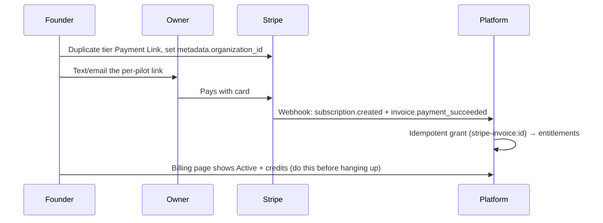

# Pilot Billing Runbook — Manual Stripe Path (Epic C1)

**Status:** active procedure for the first ~25 concierge pilots.
**Principle:** fixed tiers only (Starter $79 / Growth $179 / Scale $399);
custom amounts go through Stripe Invoices as exceptions. No self-serve
checkout links are published anywhere until Epic C2 (approved catalog).

## One-time setup (test mode first, then live)

1. Stripe Dashboard → **Test mode** → Products → create:
   - `24x7 AI Starter` — $79/mo recurring
   - `24x7 AI Growth` — $179/mo recurring
   - `24x7 AI Scale` — $399/mo recurring
2. For each product → **Create payment link** → open **Metadata** →
   add key `organization_id` with a placeholder value (you replace it
   per pilot in step 4). Copy the 3 links into your private pilot sheet.
3. Rehearse end-to-end in test mode: pay with `4242…`, confirm the
   `checkout.session.completed` + `invoice.payment_succeeded` events in
   Developers → Webhooks, and confirm the org flips to Active with the
   grant in the platform billing page.
4. Repeat in **Live mode**. Never send a test-mode link to a customer.

## Per pilot (after the owner approves on the setup call)

1. Duplicate the tier's Payment Link → set
   `metadata.organization_id = <org uuid>` (and `organization_slug` for
   human readability) → send the **duplicated** link (never the template).
2. Stay on the call: open the org billing page, confirm Active + credit
   grant, place the first test call together.
3. Log the pilot row: org, tier, link id, invoice id, minutes baseline.

## When something looks wrong

| Symptom | Cause (usual) | Fix |
|---|---|---|
| Paid, org still on old plan | Webhook delayed/failed, or link sent was the template (no org metadata) | Developers → Webhooks → replay; if metadata missing, match `customer.email` to the invite email and confirm the org manually |
| Customer charged twice | Double-click / resent link paid twice | Refund the duplicate in Dashboard (manual refunds only — no auto path exists) |
| Downgrade requested | — | Cancel at period end in Dashboard; access continues to `current_period_end` by design |
| Custom deal (setup fee, multi-location) | — | Stripe **Invoice** with any amount + same metadata rule; same webhook path grants the subscription |

## Never do this

- Publish Payment Links on the website, in demos, or in email templates.
- Create prices/coupons during a live sales call (rehearse in test mode).
- Grant entitlements manually in the DB to "fix" billing — fix the webhook
  path; manual grants are unauditable and strand on migration.
