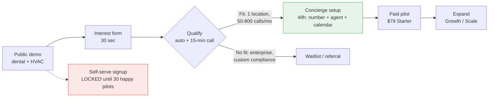
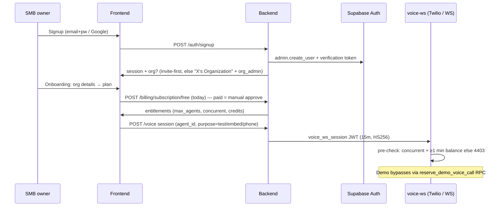
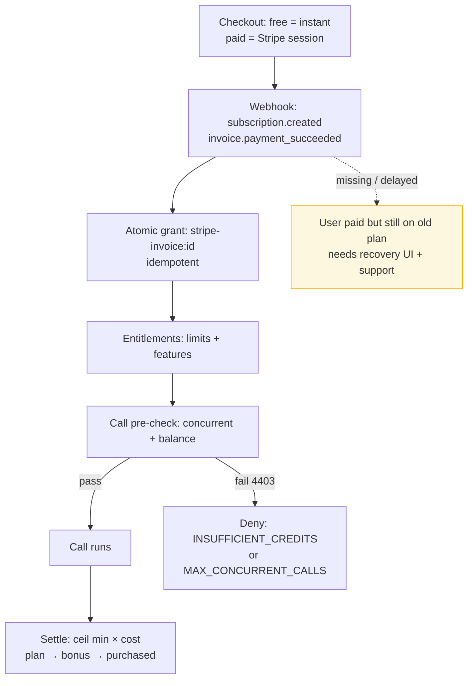
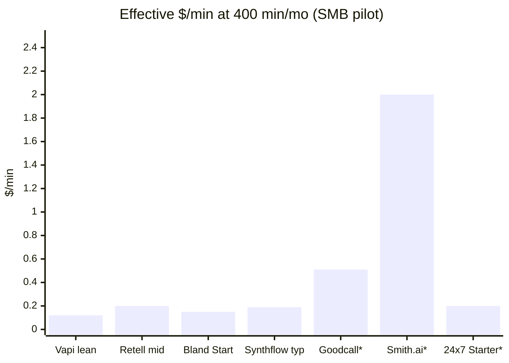
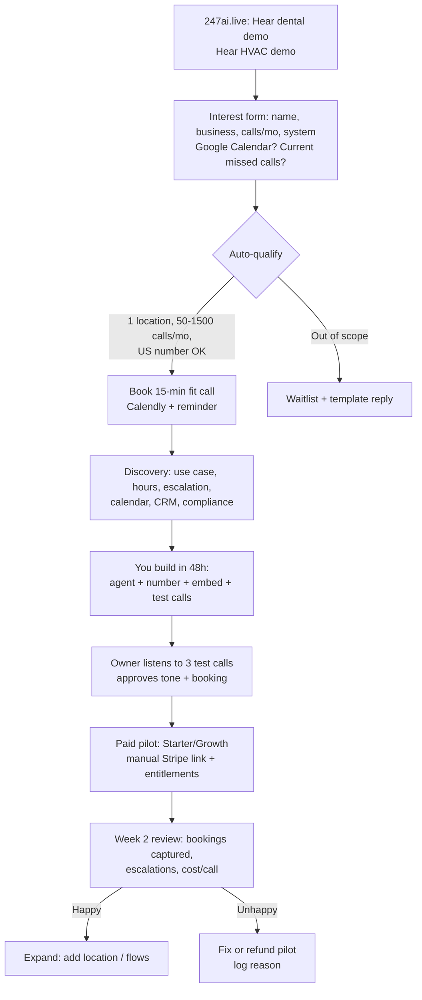
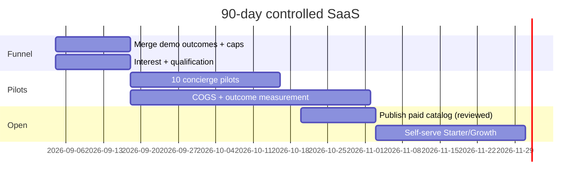

# 24x7 AI — Launch Strategy Report: Controlled SaaS, Not Open SaaS, Not Custom Agency

> **Historical pricing analysis (2026-09-03).** Its proposed $79/$179/$399
> package is superseded by the approved pilot package in
> [05-pilot-billing-runbook.md](05-pilot-billing-runbook.md) and
> [06-plan-publish-spec.md](06-plan-publish-spec.md). Keep the market
> observations as historical research; use those two documents for current
> price, minutes, phone-number, and billing policy.

**Date:** 2026-09-03 | **Market:** US SMBs first | **Team constraint:** tiny / low-touch | **Pricing:** rethought from scratch
**Question answered:** Should we launch as open SaaS with pre-configured plans, or as gated / concierge onboarding with discovery calls?
**Recommendation up front:** Launch as **Controlled SaaS (gated self-serve)** — public demos + interest form → 15-min qualification → concierge setup for first 20–30 customers → then progressively open self-serve. Do **not** open Stripe self-serve on day one. Do **not** sell pure-custom quotes either.

> This report is grounded in your actual codebase (`main` branch, Sep 2026) + competitive pricing verified July–Sep 2026. Sources are cited at the bottom.

---

## 1. TL;DR — What to do and why

| Decision | Recommendation | One-line reason |
| ------------- | ------------------------------------------------------------------------- | ------------------------------------------------------------------------------------------------------------------- |
| Launch motion | **Controlled SaaS** (Option C below) | Tiny team can't support open-SaaS abuse + telephony misconfig; pure-custom doesn't scale |
| Auth | **Good enough for gated launch, not for open signup** | Core flows solid; abuse/MFA/audit gaps make open signup risky |
| Billing | **Do not publish paid plans yet** | Only `free` (100 credits = ~10 min) is seeded; paid tiers are still hypotheses, no overage/PAYG, async webhook gaps |
| Pricing | **Per-outcome bundles, not per-minute dev pricing** | SMBs buy "missed calls answered," not "$0.0x/min + LLM pass-through" |
| Demos | **Merge `codex/demo-agents` outcome + lead-capture path to `main` first** | That's your funnel; without it demos don't convert |
| Price anchor | **$79 / $179 / $399 + overage + $5/number** (details in §7) | Undercuts human answering 10x, sits between Goodcall and Bland, holds ≥70% margin |

**What "controlled" means in practice:**

- Anyone can **try demos** (no login, time-boxed, lead-captured).
- Signup exists but **paid activation requires your approval** (manual Stripe link or admin plan assign). During concierge provisioning, the platform admin chooses the initial published plan while creating the organization.
- You do **10–15 concierge setups yourself** to learn failure modes before automating them.

---

## 2. What you actually have today (no fluff)

Verified from `backend/src`, `shared/`, `voice-ws/src`, `frontend/src`, Alembic migrations.

| Capability | Status | Evidence |
| ----------------------------------------------------------------------------------------------- | ------------------------------------------------------------------------------- | -------------------------------------------------------------------------------- |
| Agent builder (persona, tone, instructions, presets, templates, clone) | ✅ Ready | `shared/voice_agents/service.py`, `frontend/src/app/(dashboard)/agents/` |
| SMB skills: dental booking/FAQ/intake/recall, restaurant reservation/menu, HVAC dispatch/triage | ✅ Ready (skills-only, no order-cart/payment tool) | `backend/src/voice_agents/skill_seeds.py` (1651 lines) |
| Twilio: US search, purchase, assign, release, BYO, transfer, outbound, signed webhooks | ✅ Ready | `backend/src/phone_numbers/service.py`, `voice-ws/src/twilio_session.py` |
| Web embed: per-agent config, `<script>` button, `/embed/call`, domain allowlist, daily limit | ✅ Ready | `frontend/public/embed/call-button.js`, `shared/voice_agents/embed_service.py` |
| Tools: Google Calendar, CalCom, Gmail, Sheets, Resend; MCP client; per-agent attach | ✅ Ready | `shared/voice_agents/tools/implementations/` |
| Call logs + recordings (dual 16kHz, R2/Supabase), transcripts, analytics | ✅ Ready | `backend/src/call_logs/`, `voice-ws/src/call_tracking.py` |
| Multi-tenancy + RBAC (`platform_admin` / `org_admin` / `regular_user`) | ✅ Ready | `91759229c32b_add_initial_rbac_tables.py`, `dependencies.py` |
| Public demos (`demo/[slug]`, trial limits, reservation RPCs) | ✅ Partial — lead-capture outcome path lives on `codex/demo-agents`, not `main` | `backend/src/voice_agents/demo_public_routes.py` vs `76b5eb3 feat(demos)` branch |
| Billing enforcement (concurrency + credit pre-check 4403, atomic settle, phone-rental grace) | ✅ Ready for free tier | `shared/billing/voice_session_entitlement.py`, `20260812*` RPCs |
| Stripe paid catalog | ❌ Not seeded | Only `free` seeded; paid = docs hypothesis; `plan_catalog: seedable=False` |

**Bottom line:** product can run paid pilots today via manual setup + free-plan credits + top-ups. It cannot safely run unattended open signup at scale.

---

## 3. Auth audit — genuine product-owner feedback

### 3.1 What works well (better than most MVPs)

- Email+password with strong policy (8–128, upper+lower+digit+special) + `check-email` + 409 guidance.
- Backend-brokered Google + LinkedIn OAuth (secret never leaves backend), signed `state` JWT, verified-email requirement, one-time handoff JWT.
- Invitation-before-provisioning (no dummy-org fallback) + founder onboarding (`OrgDetails → PlanSelection → completeOnboarding` idempotent). During controlled launch, platform admins choose any currently published plan when creating an organization and can invite the customer directly as `org_admin` or `regular_user`.
- Separate short-lived `voice_ws_session` JWT (15m, `agent_id` + `purpose`) shared via `JWT_SECRET_KEY` — correct boundary between app auth and call auth.
- Rate limits: signup 5/min, signin 10/min, resend 3/min + custom email-verification tokens (32B, 24h, Resend template).

### 3.2 Gaps that block OPEN SaaS (but not gated launch)

| Gap | Risk if open signup | Effort | Required for |
| ---------------------------------------------------------------------------------------------------------------------------- | -------------------------------------------------------------------- | ------------ | ------------------- |
| No CAPTCHA / Turnstile, no lockout/backoff, `check-email` enables enumeration | Bot signups, credential stuffing, Twilio/Stripe abuse | S (1–2 days) | Open SaaS |
| Password reset is frontend-only (`resetPasswordForEmail`), weaker Zod `min(8)` vs backend regex, no backend rate-limit/audit | Account takeover support load | S | Open SaaS |
| No MFA / TOTP / passkey, no session allowlist/revoke beyond Supabase `sign_out` | SMBs handling patient/client data will ask; no enterprise SSO either | M | Growth, not day one |
| `_find_auth_user_by_email` paginates `list_users x10` — breaks past ~2k users | Silent auth failures at scale | S | Open SaaS |
| No auth audit table (only OTel counters) | Can't investigate "who invited whom / who reset what" | S | Both (want it) |
| Single active email-verification token reused | Minor, acceptable for gated | XS | Polish |

**Verdict:**

- **Gated launch (you approve each org): current auth is shippable.** Add audit log + Turnstile on signup/demo in week one.
- **Open launch (anyone with a card gets a number): do not ship.** You will eat bot traffic, enumeration, and telephony fraud before you learn anything about fit.

---

## 4. Billing / Stripe audit — why paid self-serve isn't ready

| Fact (code-grounded) | Implication |
| ----------------------------------------------------------------------------------------------------------------------------------------------------------------------------------------------------------------------------------------------------------------------------------------------------- | ------------------------------------------------------------------------------------------------------------------------------------------------------------------- |
| Only `free` v1 seeded: `max_agents=1`, `max_members=1`, 100 credits/mo recurring, `billing_mode=free` (`20260808000011`) | Every new org gets ~10 min/mo. Enough for trial, not for production. |
| Paid tiers ($49/2000cr, $149/8000cr, $399/25000cr @ 10cr/min) exist only in `master_data_launch_strategy.md` + `definitions.py` (`seedable=False, requires_review=True`) | Publishing them = manual Stripe Product/Price creation + admin publish + margin review. Not a flag flip. |
| Metering: `ceil(sec/60, min 1) × 10cr/min`; settle order plan → admin bonus → purchased; admitted calls may go negative, next call blocked | Correct for pilots; no partial-credit proration on upgrades, no overage/PAYG (removed in `20260807000004`), no annual, no tax/invoice-download, manual refunds only |
| Paid activation is async: browser return ≠ paid; must wait `customer.subscription.created + invoice.payment_succeeded` webhooks | Abandoned checkout leaves old plan; retryable but no auto-recovery UI beyond `payment=cancelled/failed` alert |
| System pricing: voice calls 10 credits/minute, additional US local 80 credits/month, toll-free 120 credits/month, and existing legacy non-US local/mobile 200 credits/month; top-ups 200/$5, 500/$12, 1,000/$23, and 2,000/$44 are code-owned in `credit_catalog.py` and synced by the Stripe manager | Customer-facing phone rental and credit-pack terms must match the current pilot catalog; see the [plan publish spec](06-plan-publish-spec.md)                       |
| E2E billing is mocked; cloud Stripe + staging PSTN gate still required | Don't declare "billing done" from green CI |

**Verdict:** keep `free` for trials + manually assign paid entitlements / send Stripe payment links for first pilots. Automate paid self-serve only after 20–30 clean settlements.

---

## 5. Market 2026 — what SMBs actually pay

All figures from vendor pages + independent breakdowns verified July–Sep 2026. "All-in" = platform + STT/LLM/TTS + telephony where disclosed.

### 5.1 Developer / platform layer (you compete here on cost, win on simplicity)

| Platform | Model (2026) | Headline | Realistic all-in | Catch |
| --------------------- | ---------------------------------------------------------------------------------------------- | --------------- | --------------------------- | -------------------------------------------------------------- |
| **Vapi** | $0.05/min orchestration + STT/LLM/TTS/tele passes at cost; HIPAA +$2k/mo | $0.05/min | **$0.10–$0.30/min** | Cheapest floor, but you assemble + tune the stack |
| **Retell AI** | Component bundles; 20 concurrent free | $0.07/min | **$0.13–$0.31/min** | Transparent, dev-friendly; premium voice pushes top end |
| **Bland AI** | Bundled LLM/STT/TTS, telephony separate; Start $0/$0.14, Build $299/$0.12, Scale $499/$0.11 | $0.14/min | **$0.12–$0.16 + telephony** | Break-even on Build ≈ 14,950 min/mo; Start cheapest under that |
| **Synthflow** | PAYG modular (voice $0.09 + LLM $0.02–0.04 + telephony); Enterprise from $30k/yr (10k+ min/mo) | ~$0.08–0.09/min | **$0.15–$0.24/min typical** | Legacy $29–$449 bundles retired; no permanent free tier |
| **ElevenLabs Agents** | Plan minutes + $0.08/min + LLM/tele separate; burst $0.16 | $0.08/min | **$0.08 + LLM + tele** | Best voice quality; same stacking problem |

### 5.2 SMB-finished layer (you position here — outcome, not components)

| Product | Model (2026) | Entry | How they charge | Lesson for 24x7 AI |
| ---------------------------------- | -------------------------------------------------------- | ------------------------------------------------------------------------------------------ | ----------------------- | ------------------------------------------------------------------------------------------------ |
| **Goodcall** | Bundled unlimited minutes; cap on unique callers + flows | **$79/mo** (100 callers, 1 flow) / $129 (250, 3 flows) / $249 (500) + $0.50/caller overage | Per-caller, not per-min | SMBs love "unlimited minutes"; hate caller-cap gotcha at busy weeks |
| **Smith.ai AI Receptionist** | Per-call, human backup, month-to-month | **Free** 25 calls → **$150/mo** 75 calls ($2.00/call) → **$500/mo** 300 calls ($1.67/call) | Per-call | Proves SMBs pay **$1.67–$3.00 per handled call** when qualification + human fallback is included |
| **Rosie (home services)** | Flat-rate | $49 / $149 / $299 | Flat | Cheapest flat anchor; bilingual included |
| **Human answering (Ruby/PATLive)** | Bundled minutes | ~$235–$319/mo ≈ 50 min → **$2.00–$4.70/min effective** | Per-min | Your 10–20x cost advantage — use it in ROI math, not as price umbrella to match |

### 5.3 Your COGS (so pricing holds margin)

| Layer | US benchmark | Your stack |
| ------------------------------------------------------------------------------------------------------------------------------------------------------------ | ------------------------------- | --------------------------------------------------------------------------------------------- |
| Telephony (Twilio local inbound $0.0085/min, outbound $0.014/min, number $1.15/mo local / $2.15 toll-free, Media Streams $0.0044/min, recording $0.0025/min) | ~$0.015–0.025/min + $1–2/number | Same (you pass through Twilio) |
| STT+LLM+TTS (Gemini 2.5 Flash $0.30/$2.50 per 1M; realtime audio tokens dominate) | ~$0.04–0.09/min tuned | Pipecat + Gemini Realtime — measure per-agent; assume **$0.06–0.10/min** until you meter live |
| **All-in COGS target** | — | **$0.08–0.12/min** typical SMB call (3–4 min, standard voice, lean prompt) |

> Rule: hold **≥70% gross margin** on every tier at assumed utilization (60–70% of bundled minutes used). Overage must price ≥3x COGS.

`* Goodcall/Smith/24x7 converted from bundle at 400 min for illustration; they don't sell per-min. Goodcall $79/100 callers ≈ $0.51/min at 155 min; Smith $150/75 calls ≈ $2.00/call. Your Starter $79/400 min ≈ $0.20/min — deliberately between Bland and Goodcall.`

---

## 6. Positioning — where you win with a tiny team

Don't fight Vapi/Retell on "lowest $/min for developers." Don't fight Smith.ai on "humans in the loop."

**Win on: "Missed-call recovery for single-location US SMBs, live in 48h, with booking actually working."**

| Segment (start here) | Pain | Your wedge |
| ---------------------------------------------- | -------------------------------------- | -------------------------------------------------------------------------------------------------- |
| **Dental (1–3 chairs, Peoria-style)** | 30–50% after-hours missed; no-show 15% | Appointment receptionist + Google Calendar double-book guard + SMS confirm (you already seed this) |
| **HVAC / trades (dispatch)** | After-hours emergency triage, recall | Diagnosis-triage + escalation + transfer-after-hours (on `codex/human-call-transfer`) |
| **Restaurant (reservations + takeout intent)** | Weekend rush, no-shows | Reservation skill + special-request handoff; do NOT promise cart/payment yet — skills-only today |

**Differentiation checklist (say this on the site, mean it in the product):**

- [ ] One number + embed button + test-call in one setup (competitors split these).
- [ ] Calendar booking with timezone validation, not just "message taking."
- [ ] Call log + recording + outcome receipt the owner can read in 30 sec.
- [ ] Human transfer / escalation path, not a dead end.
- [ ] Domain allowlist + daily caps on embed (spam control SMBs don't know they need).

---

## 7. Historical pricing research (superseded)

> The tier prices, minutes, overage assumptions, annual discount, and top-up
> examples in this research section are historical and are no longer the launch
> proposal. Use the [current plan publish spec](06-plan-publish-spec.md) for the
> Free, Starter, Pro, and Scale catalog, annual terms, and credit packages.

Keep `credits` internally (you already meter 10cr/min) but **sell minutes + outcomes**. SMBs don't think in credits.

### 7.1 Trial (no card, abuse-capped)

- **30 min free / 14 days**, 1 agent, 1 number (local, you own it), embed enabled, demo reservation limits inherited.
- Hard caps: 10-min max/call, 5 concurrent? No — 1 concurrent on trial (matches `max_concurrent_calls=1` today).
- Require Turnstile + email verification + domain allowlist for embed.

### 7.2 Paid tiers (monthly, USD, local numbers included as noted)

| Tier | Price | Minutes incl. | Effective | Overage | Numbers | Best for |
| ----------- | ------------------------- | ------------------------------- | --------- | --------- | ---------------------------- | ---------------------------------------------------- |
| **Starter** | **$79/mo** ($63 annual) | **400 min** (~100–130 calls) | $0.20/min | $0.19/min | 1 local incl. (+$5/extra) | Solo dental / salon / contractor missing after-hours |
| **Growth** | **$179/mo** ($143 annual) | **1,200 min** (~300–400 calls) | $0.15/min | $0.15/min | 2 local incl. | Steady HVAC / multi-chair dental |
| **Scale** | **$399/mo** ($319 annual) | **3,200 min** (~800–1000 calls) | $0.12/min | $0.12/min | 3 local incl., toll-free +$8 | Multi-location / high inbound |
| Top-ups | — | 500 min $75 / 1500 min $180 | — | — | — | Prevents forced upgrade on spike weeks |

**Why this works:**

- Starter $79 matches Goodcall Starter ($79) but gives **minutes transparency** (Goodcall hides overage behind $0.50/caller; you charge $0.19/min ≈ $0.66 per 3.5-min call).
- Growth $179 undercuts Smith.ai Pro effective ($150/75 calls = $2.00/call → your ~350 calls at $179 = **$0.51/call**).
- Scale $399 matches your old Pro anchor but with **3,200 min vs old 2,500 min** — margin still ≥70% at $0.10 COGS ($320 COGS on $399 at 100% use; ~$224 at 70% use → 44% margin at full burn, 72% at expected burn — gate with overage, not hard stop).
- Phone rental at system rate (200cr = ~$?? — republish as $5 local / $8 toll-free in marketing; keep credit mapping internal).

> Old draft ($49/200min, $149/800min, $399/2500min) underpriced Starter (would attract high-support micro-users at $0.245/min with no room for concierge cost) and left a gap between $149 and $399 where most SMBs live. New ladder centers on **$179 as the "just right" tier**.

### 7.3 Packaging rules

- Minutes expire monthly (no rollover in v1 — keeps margin clean; add 20% rollover as later loyalty lever).
- Overage = same as tier rate (no penalty pricing; SMBs hate gotchas).
- Annual = 20% off, paid upfront, minutes still monthly.
- Toll-free + recording-transcription premium: pass through + small markup, disclosed.
- No per-seat pricing in v1 (your `max_org_members=1` on free already signals seat logic — keep paid at 3/5/10 seats, don't meter it aggressively).

---

## 8. Funnel + onboarding (controlled SaaS in detail)

**Time budget (tiny-team safe):** 5–8 pilots/week × 1.5h setup + 0.5h review = ~10–16h/week. Cap at 25 active pilots before opening self-serve.

### What to instrument from day one (per pilot)

- Calls, avg duration, containment (no human needed), bookings created, no-show delta, cost/call, CSAT on outcome receipt.
- You need **cost per booked appointment** ($1.04–$1.91 in market data) — beat $1.50 and you have a headline.

---

## 9. 90-day plan — what to build vs what to gate

### Days 0–14: Merge the funnel, lock the gates

- [ ] Merge `codex/demo-agents` outcome receipts + Sheets/HubSpot lead capture to `main` (or cherry-pick `demo_outcome_service.py` + `demo/[slug]/outcome`).
- [ ] Public demo hardening: per-IP/day caps, max duration, Turnstile on interest form, domain allowlist already exists — verify.
- [ ] Add `auth_audit` table (signup, invite, reset, OAuth link) + backend rate-limit on reset + align reset Zod to backend regex.
- [ ] Publish **only** Trial + waitlist; paid via manual Stripe payment links + admin entitlement assign. No public paid checkout.
- [ ] Write ROI one-pager per vertical (dental/HVAC/restaurant) with "missed call = $X" math.

### Days 15–45: 10 concierge pilots

- [ ] Concierge checklist: number search → purchase → assign → calendar OAuth → 3 test calls → embed snippet → owner sign-off → pilot billing.
- [ ] Weekly review: why did calls escalate? Prompt fix or skill fix? Log it.
- [ ] Meter real COGS per pilot (Twilio + Gemini tokens per min). Adjust overage if COGS >$0.12/min.
- [ ] Add abandoned-checkout recovery + `payment=cancelled/failed` deep link (already partially there).

### Days 46–90: Open the smallest self-serve that can succeed

- [ ] Publish Starter/Growth/Scale to `plan_versions` + Stripe Products/Prices via Plan Catalog admin (reviewed migration, `new_signups_only`).
- [ ] Enable overage (prepaid wallet draw, not postpaid surprise) + low-credit outbox already exists — wire UI banner.
- [ ] Gate self-serve by: Turnstile, email-verified required, 1 concurrent on Trial, manual review for 2nd number / toll-free.
- [ ] Keep Scale + multi-location + HIPAA-adjacent (dental PHI) as **sales-assisted** (you approve).

---

## 10. Risks if you ignore this and open SaaS now

| Risk | Likelihood | Impact | Mitigation in controlled plan |
| -------------------------------------------------------------------------------- | ------------------------------------- | ---------------------------- | ------------------------------------------------------------------------------ |
| Bot signup → Twilio toll fraud / Gemini burn | High (no CAPTCHA, enumeration) | $$ + number blacklisting | Turnstile + manual approve + 1-concurrent trial |
| SMB misconfigures calendar/timezone → missed bookings → "AI doesn't work" review | High (calendar OAuth + tz edge cases) | Churn + bad G2 | You configure first 25; template the rest |
| Async webhook confusion ("I paid, still free") | Medium | Support tickets, chargebacks | Manual links + status polling + recovery UI before self-serve |
| Per-minute dev comparison ("Bland is $0.11, why are you $0.19 overage?") | High | Lost deals | Sell per-booked-appointment + unlimited-minutes framing; never lead with $/min |
| Single `free` plan + no overage → hard 4403 mid-month → angry owner | Medium | Churn | Top-ups + grace banner before hard block |

---

## 11. What I'd say as product owner (blunt)

1. **Your auth is honestly good for a worktree-built MVP** — better RBAC + OAuth hygiene than most SaaS week-ones. Don't rewrite it. Harden abuse edges and move on.
2. **Your billing engine is over-built for where you are and under-published for what you need.** Atomic RPCs, grace schedulers, migration service — excellent. But none of it matters if the catalog is still `free`-only and demos don't capture leads. Finish the last mile (catalog + overage + recovery UI), not another entitlement kind.
3. **Don't let Stripe plans decide positioning.** $49/$149/$399 was a cost-plus guess. SMBs don't buy credits; they buy "no missed calls + calendar full." Price the outcome, meter the minutes.
4. **With a tiny team, concierge isn't a compromise — it's the moat.** Goodcall + Smith win on "we set it up for you." Vapi/Retell win on "you wire it yourself." You win in the middle: **live in 48h without hiring an engineer.**
5. **Merge the demo branch before any pricing debate.** If a dentist can't hear the appointment agent book a cleaning in 60 seconds and leave an email, pricing is irrelevant.

---

## Appendix A. Files to touch for controlled launch (small diff, big leverage)

- `backend/src/auth/` — add Turnstile verify on `signup` + `check-email`, backend `POST /auth/password-reset` with rate-limit + audit, fix `list_users` pagination.
- `backend/src/master_data/definitions.py` + `admin_plan_catalog_service.py` — publish Trial/Starter/Growth/Scale via reviewed migration (not ad-hoc seed).
- `backend/src/billing/routes.py` + `webhook_handler.py` — checkout recovery banner, idempotent grant already there — add user-visible "payment pending" state.
- `frontend/src/app/demo/[slug]/` + `demo_outcome_service.py` (from branch) — outcome receipt + Sheets/HubSpot capture.
- `frontend/src/components/onboarding/step-plan-selection.tsx` — replace generic plan cards with outcome copy ("400 min ≈ 120 bookings") + overage explainer.
- `docs/SUMMARY.md` + `docs/DATABASE_SCHEMA.md` — record new plans, entitlements, RLS notes when catalog publishes.

## Appendix B. Sources (verified dates)

- Vapi pricing + $0.05 platform + pass-through, HIPAA $2k/mo — vapi.ai/pricing; AI Agent Square 2026-06-16; Layer3 Labs 2026-07-16.
- Retell $0.07 base, $0.13–$0.31 all-in, 20 concurrent — Retell docs; Quiq 2026-07-06; Scored.tools 2026-08-06.
- Bland Start $0/$0.14, Build $299/$0.12, Scale $499/$0.11, telephony separate, break-even ~14,950 min — bland.ai/pricing; Bland billing docs; Layer3 2026-07-16; UsagePricing 2026-07-21.
- Synthflow PAYG ~$0.15–$0.24 typical, Enterprise $30k/yr, legacy bundles retired — synthflow.ai/pricing; CloudTalk 2026-08-06; Quiq 2026-07-06.
- Goodcall $79 (100 callers/1 flow) / $129 (250/3) / $249 (500) + $0.50 overage, unlimited minutes — CloudTalk 2026-07-29; Dialora 2026-01-15.
- Smith.ai Free 25 calls, Pro $150/75 calls $2.00/call, Enterprise $500/300 calls $1.67/call, per-call billing — smith.ai/pricing; G2 2026-07-29.
- Twilio US local inbound $0.0085/min, outbound $0.014/min, numbers $1.15 local / $2.15 toll-free, Media Streams $0.0044/min — twilio.com voice pricing; Quiq 2026-08-02; Edesy 2026-06-10.
- Gemini 2.5 Flash $0.30/$2.50 per 1M, Flash-Lite $0.10/$0.40 — ai.google.dev pricing; Kunavo/CostGoat Sep 2026 guides.
- All-in market $0.085–$0.31/min; human answering $2.00–$4.70/min — Morgan Systems 2026-07-19; MessageMind 2026-05-25.
- Codebase facts — `backend/alembic/versions/20260807*`, `20260808*`, `20260811*`, `shared/billing/voice_session_entitlement.py`, `backend/src/billing/*`, `backend/src/auth/*`, `docs/05_operations/master_data_launch_strategy.md`, `codex/demo-agents 76b5eb3`.

---

_Next step if you approve: I can draft the exact Trial/Starter/Growth/Scale `plan_versions` + Stripe mapping + onboarding copy as a follow-up change (code + docs), capped to gated launch — no open checkout until pilots validate COGS._
