# Database Schema

This document provides a comprehensive overview of the AI Voice Agent Platform database schema. The database uses PostgreSQL with Supabase and includes Row Level Security (RLS) for multi-tenant data isolation.

## Table of Contents

- [Database Overview](#database-overview)
- [Core Tables](#core-tables)
- [Voice Agent Tables](#voice-agent-tables)
- [Data API security boundary](#data-api-security-boundary)
- [Demo Outcome Tables](#demo-outcome-tables)
- [Embed Button Tables](#embed-button-tables)
- [Billing Tables](#billing-tables)
- [Plan Versioning & Entitlements Tables](#plan-versioning--entitlements-tables)
- [Notification Tables](#notification-tables)
- [Platform Settings Tables](#platform-settings-tables)
- [Legal Document Tables](#legal-document-tables)
- [Platform Skills Tables](#platform-skills-tables)
- [Master Data Seed Tables](#master-data-seed-tables)
- [Supabase Auth Tables](#supabase-auth-tables)
- [Indexes](#indexes)
- [Row Level Security (RLS)](#row-level-security-rls)
- [Entity Relationships](#entity-relationships)
- [Migration History](#migration-history)

---

## Data API security boundary

Migrations `20261019000001`–`20261019000005` require coordinated backend,
frontend and voice-ws deployment. Migration `20261031000001` adds encrypted
platform voice-provider credentials and requires coordinated backend, frontend,
and voice-ws code that understands the new table. All public application tables
have RLS enabled;
`anon` and `authenticated` have no direct table/sequence access or function
execution, except authenticated SELECT on `agent_change_events` and execution
of its tenant-check helper. Backend authorization remains authoritative because
service-role database clients bypass RLS. Supabase Auth and Storage schemas are
unchanged. Global **and** schema default privileges are revoked for the migration
owner; future migrations must retain these ACLs and explicitly enable RLS.

### agent_change_events

| Column | Type | Contract |
| --- | --- | --- |
| agent_id | UUID primary key | Invalidation identifier; deliberately no agent FK so deletion can invalidate a cached agent |
| organization_id | UUID, non-null, FK organizations ON DELETE CASCADE | Tenant boundary |
| revision | BIGINT, non-null, default 1 | Incremented on agent/tool writes |
| changed_at | TIMESTAMPTZ, non-null, default now() | Invalidation timestamp |

AFTER INSERT/UPDATE/DELETE triggers on `voice_agents` and `agent_tools` upsert
this row. It contains no prompts, configuration, credential ciphertext, or user
content. `can_read_agent_change(uuid)` is a SECURITY DEFINER helper with empty
search_path: current `auth.uid()` must hold a role in that organization or the
platform-admin role. Only authenticated SELECT is allowed; clients cannot write.
`publish_agent_change()` is service-only. The Realtime publication removes the
private agent/tool tables and publishes the invalidation table. The frontend
refetches permitted metadata through the backend API.

The read-only release gate is `scripts/deploy/verify_data_api_security.py`.
Do not use the historical manual Realtime setup script to grant table access.

## Database Overview

The database is designed as a multi-tenant SaaS platform with the following key characteristics:

- **Multi-tenancy**: Organizations are isolated tenants with their own users, agents, and data
- **RBAC**: Role-Based Access Control with platform admin, org admin, and regular user roles
- **RLS**: Row Level Security ensures users can only access data they're authorized to see
- **Real-time**: Supabase Realtime enabled on selected tables for live UI updates
- **OAuth Integration**: Secure storage of OAuth tokens for third-party tool integrations

### Key Design Decisions

1. **UUID Primary Keys**: All tables use UUIDs for primary keys for security and scalability
2. **Timestamps**: All tables include `created_at` and `updated_at` with timezone support
3. **Soft Deletes**: No soft deletes used - hard deletes with CASCADE are enforced
4. **JSONB Storage**: Flexible JSONB columns for configuration and metadata
5. **Encrypted Sensitive Data**: OAuth tokens and API keys are encrypted in `sensitive_config` columns

---

## Core Tables

### organizations

Stores tenant organization information. Each organization represents a separate customer/tenant.

| Column                            | Type         | Constraints             | Description                                                                                                                                                                                                                                                                                                                                                                                                                                                                                                                    |
| --------------------------------- | ------------ | ----------------------- | ------------------------------------------------------------------------------------------------------------------------------------------------------------------------------------------------------------------------------------------------------------------------------------------------------------------------------------------------------------------------------------------------------------------------------------------------------------------------------------------------------------------------------ |
| id                                | UUID         | PRIMARY KEY             | Unique organization identifier                                                                                                                                                                                                                                                                                                                                                                                                                                                                                                 |
| name                              | VARCHAR(100) | NOT NULL, UNIQUE        | Organization display name                                                                                                                                                                                                                                                                                                                                                                                                                                                                                                      |
| description                       | TEXT         | NULLABLE                | Organization description                                                                                                                                                                                                                                                                                                                                                                                                                                                                                                       |
| slug                              | VARCHAR(100) | NOT NULL, UNIQUE        | URL-friendly identifier; also used for the public page at `/o/{slug}`                                                                                                                                                                                                                                                                                                                                                                                                                                                          |
| is_active                         | BOOLEAN      | NOT NULL, DEFAULT TRUE  | Organization active status                                                                                                                                                                                                                                                                                                                                                                                                                                                                                                     |
| credit_balance                    | INTEGER      | NOT NULL, DEFAULT 0     | Available plan credits for the current billing period (expire at period end — migration 20260807000005)                                                                                                                                                                                                                                                                                                                                                                                                                        |
| admin_credit_balance              | INTEGER      | NOT NULL, DEFAULT 0     | Non-expiring platform-admin bonus credits; consumed after plan credits and before purchased credits (migration 20260809000003)                                                                                                                                                                                                                                                                                                                                                                                                 |
| purchased_credit_balance          | INTEGER      | NOT NULL, DEFAULT 0     | Purchased top-up credits; never expire and are drained after plan and platform bonus credits (migration 20260807000005, precedence updated by 20260809000003)                                                                                                                                                                                                                                                                                                                                                                  |
| low_credit_threshold_notified     | INTEGER      | NULLABLE                | Highest low-balance threshold (20/10/5) already emailed this billing cycle; NULL = re-armed (migration 20260807000005)                                                                                                                                                                                                                                                                                                                                                                                                         |
| website                           | VARCHAR(255) | NULLABLE                | Organization website URL                                                                                                                                                                                                                                                                                                                                                                                                                                                                                                       |
| industry                          | VARCHAR(100) | NULLABLE                | Organization industry (e.g. Real Estate)                                                                                                                                                                                                                                                                                                                                                                                                                                                                                       |
| location                          | VARCHAR(255) | NULLABLE                | Physical address or location                                                                                                                                                                                                                                                                                                                                                                                                                                                                                                   |
| business_details                  | TEXT         | NULLABLE                | Comprehensive business context for AI agents (hours, services, policies...)                                                                                                                                                                                                                                                                                                                                                                                                                                                    |
| google_api_key                    | TEXT         | NULLABLE                | Legacy compatibility column. Migration `20260922000002` moves any remaining value into `provider_credentials` and clears it; retained temporarily so older rolling application instances do not fail writes. It must remain NULL until a later cleanup migration drops the column.                                                                                                                                                                                                                                             |
| provider_credentials              | TEXT         | NULLABLE                | Fernet-encrypted JSON of all per-org provider keys via `encrypt_data`/`decrypt_data` (`shared/common/security.py`): `{google, deepgram, openai, cartesia, cerebras, …}` (only the set keys present). The `key_resolver` decrypts this to build the `api_keys` map for `voice-ws/src/speech/factory.py`. Legacy `livekit` entries may exist in older rows but are unused after the Pipecat cutover. Backfilled from `google_api_key` by migration `20260729000001`; remaining plaintext values are cleared by `20260922000002`. |
| provider_credentials_descriptions | JSONB        | NULLABLE                | Non-secret per-provider reference notes entered on the API Credentials screen. Stored separately from encrypted keys and returned as `provider_credentials_descriptions`; migration `20260923000001`.                                                                                                                                                                                                                                                                                                                          |
| public_page_enabled               | BOOLEAN      | NOT NULL, DEFAULT FALSE | Master toggle for the public org showcase at `/o/{slug}` — migration 20260731000001                                                                                                                                                                                                                                                                                                                                                                                                                                            |
| public_page_passphrase_enabled    | BOOLEAN      | NOT NULL, DEFAULT FALSE | When true, visitors must submit a passphrase before listing agents — migration 20260731000001                                                                                                                                                                                                                                                                                                                                                                                                                                  |
| public_page_passphrase_hash       | TEXT         | NULLABLE                | PBKDF2-SHA256 hash of the org passphrase (never returned to clients) — migration 20260731000001                                                                                                                                                                                                                                                                                                                                                                                                                                |
| created_at                        | TIMESTAMPTZ  | NOT NULL, DEFAULT NOW() | Creation timestamp                                                                                                                                                                                                                                                                                                                                                                                                                                                                                                             |
| updated_at                        | TIMESTAMPTZ  | NOT NULL, DEFAULT NOW() | Last update timestamp                                                                                                                                                                                                                                                                                                                                                                                                                                                                                                          |

**Foreign Keys**: None
**RLS**: Enabled

**Indexes**: Unique on `name`, `slug`

**Derived (not a column):** `provider_credentials_status` — a per-provider
boolean map (`{google, deepgram, openai, cartesia, cerebras, …}`) computed
in `backend/src/organization/service.py` from the decrypted
`provider_credentials` blob on the org GET path and attached to the response
(Phase 4). It is **not** a database column — booleans only, never decrypted
values. Drives the Configured/Not-configured pills on the org-settings page. The
Per-provider flags reflect which keys exist in the decrypted blob. Legacy `livekit`
entries are ignored by `voice-ws` after the Pipecat cutover.

**Derived response metadata:** `provider_credentials_descriptions` is a sparse
map of provider name to the user's optional reference note. It contains no
credential material and is stored in the separate JSONB column above. Empty
notes are removed rather than persisted.

---

### roles

Defines available roles in the system for RBAC.

| Column         | Type        | Constraints             | Description                                 |
| -------------- | ----------- | ----------------------- | ------------------------------------------- |
| id             | UUID        | PRIMARY KEY             | Unique role identifier                      |
| name           | VARCHAR(50) | NOT NULL, UNIQUE        | Role name (e.g., platform_admin, org_admin) |
| description    | TEXT        | NULLABLE                | Role description                            |
| is_system_role | BOOLEAN     | NOT NULL, DEFAULT FALSE | System roles cannot be deleted              |
| created_at     | TIMESTAMPTZ | NOT NULL, DEFAULT NOW() | Creation timestamp                          |
| updated_at     | TIMESTAMPTZ | NOT NULL, DEFAULT NOW() | Last update timestamp                       |

**Foreign Keys**: None
**RLS**: Enabled

**Predefined System Roles**:

- `platform_admin`: Full control over the entire platform
- `org_admin`: Administrator for a specific organization
- `regular_user`: Standard user with limited permissions

---

### permissions

Defines individual permissions that can be assigned to roles.

| Column      | Type         | Constraints             | Description                                      |
| ----------- | ------------ | ----------------------- | ------------------------------------------------ |
| id          | UUID         | PRIMARY KEY             | Unique permission identifier                     |
| name        | VARCHAR(100) | NOT NULL, UNIQUE        | Permission name (e.g., user:create)              |
| description | TEXT         | NULLABLE                | Permission description                           |
| resource    | VARCHAR(50)  | NOT NULL                | Resource type (e.g., user, organization)         |
| action      | VARCHAR(50)  | NOT NULL                | Action type (e.g., create, read, update, delete) |
| created_at  | TIMESTAMPTZ  | NOT NULL, DEFAULT NOW() | Creation timestamp                               |
| updated_at  | TIMESTAMPTZ  | NOT NULL, DEFAULT NOW() | Last update timestamp                            |

**Foreign Keys**: None
**RLS**: Enabled

---

### role_permissions

Junction table mapping roles to their permissions.

| Column        | Type        | Constraints                   | Description                       |
| ------------- | ----------- | ----------------------------- | --------------------------------- |
| id            | UUID        | PRIMARY KEY                   | Unique junction record identifier |
| role_id       | UUID        | NOT NULL, FK → roles.id       | Role identifier                   |
| permission_id | UUID        | NOT NULL, FK → permissions.id | Permission identifier             |
| created_at    | TIMESTAMPTZ | NOT NULL, DEFAULT NOW()       | Creation timestamp                |

**Foreign Keys**:

- `role_id` → `roles.id` (CASCADE)
- `permission_id` → `permissions.id` (CASCADE)

**RLS**: Enabled
**Unique Constraint**: `(role_id, permission_id)`

---

### user_roles

Junction table mapping users to roles within organizations.

| Column          | Type        | Constraints                     | Description                       |
| --------------- | ----------- | ------------------------------- | --------------------------------- |
| id              | UUID        | PRIMARY KEY                     | Unique junction record identifier |
| user_id         | UUID        | NOT NULL, FK → auth.users.id    | User identifier (Supabase Auth)   |
| role_id         | UUID        | NOT NULL, FK → roles.id         | Role identifier                   |
| organization_id | UUID        | NULLABLE, FK → organizations.id | Organization identifier           |
| created_at      | TIMESTAMPTZ | NOT NULL, DEFAULT NOW()         | Creation timestamp                |
| updated_at      | TIMESTAMPTZ | NOT NULL, DEFAULT NOW()         | Last update timestamp             |

**Foreign Keys**:

- `user_id` → `auth.users.id` (CASCADE)
- `role_id` → `roles.id` (CASCADE)
- `organization_id` → `organizations.id` (CASCADE)

**RLS**: Enabled
**Unique Constraint**: `(user_id, organization_id)`

---

### invitations

Stores organization membership invitations sent to users.

| Column          | Type         | Constraints                     | Description                                   |
| --------------- | ------------ | ------------------------------- | --------------------------------------------- |
| id              | UUID         | PRIMARY KEY                     | Unique invitation identifier                  |
| email           | TEXT         | NOT NULL                        | Email address of invited user                 |
| organization_id | UUID         | NOT NULL, FK → organizations.id | Organization identifier                       |
| invited_by      | UUID         | NOT NULL, FK → auth.users.id    | User ID who sent invitation                   |
| token           | VARCHAR(255) | NOT NULL, UNIQUE                | Unique invitation token                       |
| status          | VARCHAR(20)  | NOT NULL, DEFAULT 'pending'     | Status: pending, accepted, expired, cancelled |
| expires_at      | TIMESTAMPTZ  | NOT NULL                        | Invitation expiration time                    |
| created_at      | TIMESTAMPTZ  | NOT NULL, DEFAULT NOW()         | Creation timestamp                            |
| accepted_at     | TIMESTAMPTZ  | NULLABLE                        | Acceptance timestamp                          |
| role_id         | UUID         | NULLABLE, FK → roles.id         | Organization role granted when claimed        |

**Foreign Keys**:

- `organization_id` → `organizations.id` (CASCADE)
- `invited_by` → `auth.users.id` (CASCADE)
- `role_id` → `roles.id` (RESTRICT); only `regular_user` and `org_admin` are valid invitation roles

**RLS**: Enabled
**Check Constraint**: `status IN ('pending', 'accepted', 'expired', 'cancelled')`

**Indexes**:

- `idx_invitations_email`
- `idx_invitations_token`
- `idx_invitations_organization_id`
- `idx_invitations_status`
- `idx_invitations_expires_at`
- `idx_invitations_role_id`

Invitation claiming is performed by the service-role-only
`claim_invitation(text, uuid, text)` PostgreSQL function. The function locks
the invitation row, matches the normalized invited email, requires a pending
and unexpired invitation, inserts an idempotent `user_roles` membership using
the stored organization-scoped role (defaulting legacy rows to
`regular_user`), and marks the invitation accepted in one transaction.
Repeated claims by the same user are safe; a failed claim does not fall back
to a personal organization.

---

## Voice Agent Tables

### voice_agents

Stores voice agent configurations for each organization.

| Column                         | Type          | Constraints                                              | Description                                                                                                                                                                                                                                                                                                                                                                                                                                                                                                                 |
| ------------------------------ | ------------- | -------------------------------------------------------- | --------------------------------------------------------------------------------------------------------------------------------------------------------------------------------------------------------------------------------------------------------------------------------------------------------------------------------------------------------------------------------------------------------------------------------------------------------------------------------------------------------------------------- |
| id                             | UUID          | PRIMARY KEY                                              | Unique voice agent identifier                                                                                                                                                                                                                                                                                                                                                                                                                                                                                               |
| organization_id                | UUID          | NOT NULL, FK → organizations.id                          | Organization identifier                                                                                                                                                                                                                                                                                                                                                                                                                                                                                                     |
| name                           | VARCHAR(100)  | NOT NULL                                                 | Voice agent display name                                                                                                                                                                                                                                                                                                                                                                                                                                                                                                    |
| phone_number                   | VARCHAR(20)   | NULLABLE                                                 | Associated phone number                                                                                                                                                                                                                                                                                                                                                                                                                                                                                                     |
| persona                        | TEXT          | NULLABLE                                                 | Agent role/character definition                                                                                                                                                                                                                                                                                                                                                                                                                                                                                             |
| tone                           | VARCHAR(100)  | NULLABLE                                                 | Communication style (Professional, etc)                                                                                                                                                                                                                                                                                                                                                                                                                                                                                     |
| mission                        | TEXT          | NULLABLE                                                 | Primary goals for this agent                                                                                                                                                                                                                                                                                                                                                                                                                                                                                                |
| custom_instructions            | TEXT          | NULLABLE                                                 | Agent-specific context (policies, USPs, FAQs, protocols)                                                                                                                                                                                                                                                                                                                                                                                                                                                                    |
| instructions_markdown          | TEXT          | NULLABLE                                                 | Full agent instructions in markdown (replaces field-based prompt building when set). Supports template variables: `{{org.name}}`, `{{org.industry}}`, `{{org.location}}`, `{{org.business_details}}`, `{{agent.name}}`                                                                                                                                                                                                                                                                                                      |
| use_platform_credits           | BOOLEAN       | NOT NULL, DEFAULT FALSE                                  | Use platform credits instead of org API key                                                                                                                                                                                                                                                                                                                                                                                                                                                                                 |
| preset_id                      | UUID          | NULLABLE, FK → pipeline_presets.id                       | Voice-engine preset reference. voice-ws loads this preset **live on every call** (no versioning — admin edits take effect on the next call). NULL = legacy agent, or one whose preset was deleted via the FK `ON DELETE SET NULL` → resolves to the current published platform preset (`pipeline_presets.is_default=true`, promoted by migration 20261030000001); if missing/unparseable voice-ws falls back to the hardcoded `default_realtime_config()`. Migrations 20260729000001 (column) + 20260729000002 (initial default) + 20261030000001 (selectable platform default) |
| is_active                      | BOOLEAN       | NOT NULL, DEFAULT TRUE                                   | Agent active status                                                                                                                                                                                                                                                                                                                                                                                                                                                                                                         |
| is_published_on_public_page    | BOOLEAN       | NOT NULL, DEFAULT FALSE                                  | Explicit publish flag for the org public page (`/o/{slug}`). Distinct from `is_active`; both must be true for public listing/calls — migration 20260731000001                                                                                                                                                                                                                                                                                                                                                               |
| call_recording_enabled         | BOOLEAN       | NOT NULL, DEFAULT FALSE                                  | Explicit per-agent opt-in for call recordings. Runtime recording gates must also allow recording — migration 20260814000001                                                                                                                                                                                                                                                                                                                                                                                                 |
| is_demo                        | BOOLEAN       | NOT NULL, DEFAULT FALSE                                  | When true, this agent is a demo agent that bypasses credit and concurrency checks and is available on a dedicated public page at `/demo/{demo_slug}`. Platform-admin only; defaults to false — migration 20260820000001                                                                                                                                                                                                                                                                                                     |
| demo_slug                      | VARCHAR(100)  | NULLABLE, UNIQUE (partial `WHERE demo_slug IS NOT NULL`) | Unique slug for the demo public page (e.g. `acme-dental-demo`); required when `is_demo` is true, must be lowercase alphanumeric plus hyphens. Only demo agents use this column — migration 20260820000001                                                                                                                                                                                                                                                                                                                   |
| public_description             | TEXT          | NULLABLE                                                 | Customer-facing description shown on the public demo page (`/demo/{demo_slug}`). Distinct from LLM prompt fields (`persona`/`mission`/`custom_instructions`); this is marketing copy explaining what the agent does and its scope. UI gated under `is_demo` (platform-admin only) with fallback `public_description → mission → persona` on the page — migration 20260820000002                                                                                                                                             |
| demo_public_result_url         | VARCHAR(2048) | NULLABLE                                                 | Optional HTTPS destination configured by a platform admin for the demo receipt's external-result CTA. Returned only for successful actions in the signed outcome response; never included in public landing-page metadata — migration 20260901000001                                                                                                                                                                                                                                                                        |
| demo_calls_remaining           | INTEGER       | NOT NULL, DEFAULT -1, CHECK >= -1                        | Remaining demo call reservations. `0` disables new demo calls; positive values decrement atomically at token issuance; `-1` means unlimited — migration 20260827000001                                                                                                                                                                                                                                                                                                                                                      |
| demo_max_call_duration_seconds | INTEGER       | NOT NULL, DEFAULT -1, CHECK = -1 OR > 0                  | Maximum duration captured for each new demo reservation. `-1` means unlimited; active calls keep the duration captured at reservation — migration 20260827000001                                                                                                                                                                                                                                                                                                                                                            |
| created_at                     | TIMESTAMPTZ   | NOT NULL, DEFAULT NOW()                                  | Creation timestamp                                                                                                                                                                                                                                                                                                                                                                                                                                                                                                          |
| updated_at                     | TIMESTAMPTZ   | NOT NULL, DEFAULT NOW()                                  | Last update timestamp                                                                                                                                                                                                                                                                                                                                                                                                                                                                                                       |

**Foreign Keys**:

- `organization_id` → `organizations.id` (CASCADE)
- `preset_id` → `pipeline_presets.id` (SET NULL) — migration 20260729000001 (deleting a preset clears the selection so agents use the current platform default — migration 20260729000002)
  **Indexes**:

- `ix_voice_agents_preset_id` on `preset_id` — migration 20260729000001
- `ix_voice_agents_organization_active` on `(organization_id, is_active)` —
  migration `20260812000009`
- `ix_voice_agents_is_demo` on `(is_demo) WHERE is_demo = true` — migration 20260820000001
- `uq_voice_agents_demo_slug` unique partial on `(demo_slug) WHERE demo_slug IS NOT NULL` — migration 20260820000001
- `ix_demo_call_reservations_agent_created_at` on `(agent_id, created_at)` — migration 20260827000001
  **RLS**: Enabled
  **Real-time**: Enabled

---

### demo_call_reservations

Internal one-time reservations for public demo voice sessions. A reservation is
created by the service-role `reserve_demo_voice_call` RPC while locking the
demo agent row, then changed from `reserved` to `consumed` by
`consume_demo_voice_call` when `voice-ws` admits the signed session. The table
has no public RLS policy; direct access is restricted to the service role.

| Column      | Type         | Constraints                                                  | Description                                              |
| ----------- | ------------ | ------------------------------------------------------------ | -------------------------------------------------------- |
| id          | UUID         | PRIMARY KEY, DEFAULT `gen_random_uuid()`                     | Reservation identifier embedded in the voice-session JWT |
| agent_id    | UUID         | NOT NULL, FK → voice_agents.id (CASCADE)                     | Demo agent whose budget was reserved                     |
| session_id  | VARCHAR(100) | NOT NULL, UNIQUE                                             | Voice-session id; makes token issuance idempotent        |
| status      | VARCHAR(20)  | NOT NULL, DEFAULT `reserved`, CHECK `reserved` or `consumed` | One-time reservation state                               |
| created_at  | TIMESTAMPTZ  | NOT NULL, DEFAULT NOW()                                      | Reservation timestamp                                    |
| consumed_at | TIMESTAMPTZ  | NULLABLE                                                     | WebSocket admission timestamp                            |

**RLS**: Enabled; service-role RPCs only.

**Migration**: `20260827000001_add_demo_call_limits.py` (merge migration from
`20260820000002` and `20260821000001`).

## Demo Outcome Tables

### demo_outcome_receipts

Short-lived, visitor-facing receipts for allowlisted actions completed during
a public demo call. The table is not a CRM mirror and is not used as an
intermediate queue: demo tools continue to write directly to their configured
provider, then the voice runtime records a minimal presentation-safe summary
after a tool result.

| Column          | Type         | Constraints                                                                                     | Description                                                                                   |
| --------------- | ------------ | ----------------------------------------------------------------------------------------------- | --------------------------------------------------------------------------------------------- |
| id              | UUID         | PRIMARY KEY, DEFAULT `gen_random_uuid()`                                                        | Receipt row identifier                                                                        |
| session_id      | VARCHAR(100) | NOT NULL                                                                                        | Voice session identifier; never returned by the public endpoint                               |
| agent_id        | UUID         | NOT NULL, FK → voice_agents.id (CASCADE)                                                        | Demo agent that performed the action                                                          |
| organization_id | UUID         | NOT NULL, FK → organizations.id (CASCADE)                                                       | Owning organization                                                                           |
| demo_slug       | VARCHAR(100) | NOT NULL                                                                                        | Demo URL slug bound into the signed receipt                                                   |
| action_type     | VARCHAR(40)  | NOT NULL, CHECK `lead_capture`, `appointment_booking`, `email_delivery`, or `sheet_row_created` | Publicly allowlisted action category                                                          |
| provider        | VARCHAR(40)  | NOT NULL                                                                                        | Provider label, currently `hubspot`, `google_sheets`, `google_calendar`, `gmail`, or `resend` |
| status          | VARCHAR(20)  | NOT NULL, CHECK `succeeded`, `failed`, or `pending`                                             | Visitor-safe action state                                                                     |
| error_code      | VARCHAR(80)  | NULLABLE                                                                                        | Stable safe error code when the action needs attention                                        |
| captured_fields | JSONB        | NOT NULL, DEFAULT `{}`                                                                          | Allowlisted user-supplied fields, with sensitive values redacted or summarized                |
| provider_result | JSONB        | NOT NULL, DEFAULT `{}`                                                                          | Provider-safe identifiers/status/message; never raw responses                                 |
| created_at      | TIMESTAMPTZ  | NOT NULL, DEFAULT NOW()                                                                         | Receipt creation timestamp                                                                    |
| expires_at      | TIMESTAMPTZ  | NOT NULL, DEFAULT `NOW() + 7 days`                                                              | Storage retention boundary                                                                    |

**RLS**: Enabled with no public or authenticated-user policies; the service
role is the only database reader/writer. Public access requires a signed,
session-bound token validated by the backend. The endpoint also filters
expired rows and returns `Cache-Control: private, no-store`.

**Indexes**: `(session_id, created_at)` for receipt lookup and `(expires_at)`
for retention cleanup.

**Migrations**: `20260830000001_add_demo_outcome_receipts.py`,
`20260901000002_add_demo_email_outcome_action.py`, and
`20260920000001_generic_google_sheets_rows.py`.

---

### demo_feedback

PII-free visitor star ratings for public demo calls (demo slug plus a 1-5
score, never names or contact details). One row per voice session: repeat
taps update the same row. Visitors write through the signed receipt-token
endpoint (`POST /api/v1/public/demo/{slug}/feedback`); platform admins read
aggregates and recent rows through the service-role API
(`GET /api/v1/leads/demo-feedback`). The PostHog funnel event remains the
analytics copy.

| Column          | Type         | Constraints                               | Description                                      |
| --------------- | ------------ | ----------------------------------------- | ------------------------------------------------ |
| id              | UUID         | PRIMARY KEY, DEFAULT `gen_random_uuid()`  | Rating row identifier                            |
| session_id      | VARCHAR(100) | NOT NULL, UNIQUE                          | Voice session identifier; one rating per session |
| agent_id        | UUID         | NOT NULL, FK → voice_agents.id (CASCADE)  | Demo agent that was rated                        |
| organization_id | UUID         | NOT NULL, FK → organizations.id (CASCADE) | Owning organization                              |
| demo_slug       | VARCHAR(100) | NOT NULL                                  | Demo URL slug                                    |
| rating          | SMALLINT     | NOT NULL, CHECK 1–5                       | Star value                                       |
| created_at      | TIMESTAMPTZ  | NOT NULL, DEFAULT NOW()                   | First rating timestamp                           |
| updated_at      | TIMESTAMPTZ  | NOT NULL, DEFAULT NOW()                   | Last update timestamp                            |

**RLS**: Enabled with no public or authenticated-user policies; the service
role is the only database reader/writer.

**Indexes**: `(demo_slug, created_at)` for per-demo aggregates and recency.

**Migrations**: `9f2c4a7b1e3d_add_demo_feedback.py`.

---

### interest_leads

Private interest-lead capture for the controlled-SaaS funnel
(`POST /api/v1/public/leads`, `/request-demo` page, outcome-form fallback).
The source of truth for follow-up; demo-safe subsets are forwarded to public
proof destinations (shared Sheet/Calendar) by the demo workflow, never the
reverse. Distinct from `demo_outcome_receipts` (short-lived visitor receipts):
leads persist until converted/dropped and are never shown to visitors.

| Column        | Type         | Constraints                                                                                                      | Description                                                |
| ------------- | ------------ | ---------------------------------------------------------------------------------------------------------------- | ---------------------------------------------------------- |
| id            | UUID         | PRIMARY KEY, DEFAULT `gen_random_uuid()`                                                                         | Lead row identifier                                        |
| name          | VARCHAR(120) | NOT NULL                                                                                                         | Contact name                                               |
| business_name | VARCHAR(160) | NULLABLE                                                                                                         | Business name                                              |
| email         | VARCHAR(320) | NOT NULL                                                                                                         | Contact email (indexed, never probed publicly)             |
| phone         | VARCHAR(32)  | NULLABLE                                                                                                         | Callback number                                            |
| vertical      | VARCHAR(40)  | NULLABLE                                                                                                         | Business vertical slug selected on the public request form |
| message       | TEXT         | NULLABLE                                                                                                         | What the business needs                                    |
| source        | VARCHAR(40)  | NOT NULL, DEFAULT `'request-demo'`, CHECK `request-demo`, `outcome-form`, `contact-us`, `demo-call`, or `manual` | Capture channel                                            |
| demo_slug     | VARCHAR(100) | NULLABLE                                                                                                         | Demo agent slug when captured post-demo                    |
| status        | VARCHAR(20)  | NOT NULL, DEFAULT `'new'`, CHECK `new`, `contacted`, `invited`, `converted`, or `dropped`                        | Follow-up state                                            |
| created_at    | TIMESTAMPTZ  | NOT NULL, DEFAULT NOW()                                                                                          | Submission timestamp                                       |
| contacted_at  | TIMESTAMPTZ  | NULLABLE                                                                                                         | First outreach timestamp (set by operator tooling)         |

**RLS**: Enabled with no public or authenticated-user policies; the service
role is the only database reader/writer. Reads and status changes require
the `platform_admin` role at the API boundary. Public submission returns a
fixed ack envelope so submitters cannot probe which emails already exist.

**Indexes**: `(status, created_at)` for the follow-up queue and `(email)`
for duplicate review.

**Migrations**: `20260903000001_add_interest_leads.py`.

### interest_lead_notification_outbox

One retryable platform-admin alert record is created in the same transaction
as each new `interest_leads` row by an `AFTER INSERT` trigger. It references
the lead instead of copying its personal details. Email, Telegram, and
WhatsApp have independent delivery state, so a retry does not resend a channel
already acknowledged as sent. Disabled Telegram/WhatsApp channels are marked
skipped; enabled but incomplete or failing channels remain pending for retry.

| Column                                                 | Type               | Constraints                                                        | Description                                          |
| ------------------------------------------------------ | ------------------ | ------------------------------------------------------------------ | ---------------------------------------------------- |
| id                                                     | UUID               | PRIMARY KEY, DEFAULT `gen_random_uuid()`                           | Queue row identifier                                 |
| lead_id                                                | UUID               | UNIQUE, NOT NULL, FK → interest_leads.id (CASCADE)                 | Submitted lead                                       |
| email_state / telegram_state / whatsapp_state          | TEXT               | NOT NULL, DEFAULT 'pending', CHECK `pending`, `sent`, or `skipped` | Independent channel delivery state                   |
| email_attempts / telegram_attempts / whatsapp_attempts | INTEGER            | NOT NULL, DEFAULT 0, CHECK >= 0                                    | Channel attempt counters                             |
| available_at                                           | TIMESTAMPTZ        | NOT NULL, DEFAULT NOW()                                            | Earliest retry time                                  |
| lease_claim / lease_until                              | TEXT / TIMESTAMPTZ | NULLABLE                                                           | Worker claim and crash-recovery lease                |
| last_error_code                                        | TEXT               | NULLABLE                                                           | Safe generic configuration/provider error categories |
| created_at / updated_at                                | TIMESTAMPTZ        | NOT NULL, DEFAULT NOW()                                            | Queue timestamps                                     |
| delivered_at                                           | TIMESTAMPTZ        | NULLABLE                                                           | Set when all channels are sent or skipped            |

**RLS**: Enabled with no client policies; backend service role only. The
insert trigger makes lead capture and durable alert enqueue atomic.
`claim_interest_lead_notification_outbox` uses `FOR UPDATE SKIP LOCKED`;
failed channels retry with bounded exponential backoff. Provider delivery is
at-least-once if a provider accepts a message but its database acknowledgment
is lost.

**Migration**: `20261001000004_durable_interest_lead_alerts.py`.

---

### callback_escalations

Owner-visible callback requests from soft escalation. Production voice
calls (never demos) record one row per accepted `request_human_callback`
tool result through the voice runtime hook
(`record_callback_tool_outcome`, next to the demo-outcome hook); the
owner alert email is sent by the tool itself at call time. The dashboard
Callbacks page drives the `new → acknowledged → resolved` follow-up.
Org admins may also log rows manually for callbacks arriving on other
channels.

| Column          | Type         | Constraints                                                           | Description                                               |
| --------------- | ------------ | --------------------------------------------------------------------- | --------------------------------------------------------- |
| id              | UUID         | PRIMARY KEY, DEFAULT `gen_random_uuid()`                              | Escalation row identifier                                 |
| organization_id | UUID         | NOT NULL, FK → organizations.id (CASCADE)                             | Owning organization                                       |
| agent_id        | UUID         | NULLABLE, FK → voice_agents.id (SET NULL)                             | Agent on the call, when known                             |
| session_id      | VARCHAR(100) | NULLABLE                                                              | Voice session identifier, when known                      |
| caller_phone    | VARCHAR(32)  | NOT NULL                                                              | Callback number (E.164-ish, validated by the tool)        |
| caller_name     | VARCHAR(100) | NULLABLE                                                              | Caller name when known                                    |
| reason          | VARCHAR(500) | NOT NULL                                                              | One factual sentence: what the callback is about          |
| urgency         | VARCHAR(20)  | NOT NULL, DEFAULT `'normal'`, CHECK `normal` or `urgent`              | Callback urgency                                          |
| status          | VARCHAR(20)  | NOT NULL, DEFAULT `'new'`, CHECK `new`, `acknowledged`, or `resolved` | Follow-up state                                           |
| notified        | BOOLEAN      | NOT NULL, DEFAULT FALSE                                               | Owner alert email went out at call time                   |
| created_at      | TIMESTAMPTZ  | NOT NULL, DEFAULT NOW()                                               | Request timestamp                                         |
| acknowledged_at | TIMESTAMPTZ  | NULLABLE                                                              | First acknowledgement timestamp (set by operator tooling) |

**RLS**: Enabled with no public or authenticated-user policies; the
service role is the only database reader/writer. Reads require org
membership; writes and status changes require `org_admin` (platform
admins bypass) at the API boundary, and status updates match on both
row id and organization to prevent cross-tenant writes.

**Indexes**: `(organization_id, status, created_at)` for the owner queue.

**Migrations**: `20260904000001_add_callback_escalations.py`.

---

### auth_audit_events

Append-only authentication audit trail. Backend auth routes record
security-relevant events; rows are never updated or deleted by
application code. Investigation fields only — no tokens, passwords, or
request bodies.

| Column     | Type         | Constraints                              | Description                           |
| ---------- | ------------ | ---------------------------------------- | ------------------------------------- |
| id         | UUID         | PRIMARY KEY, DEFAULT `gen_random_uuid()` | Event row identifier                  |
| user_id    | UUID         | NULLABLE                                 | Account id when known                 |
| email      | VARCHAR(320) | NULLABLE                                 | Account email when known (indexed)    |
| event      | VARCHAR(60)  | NOT NULL, CHECK nine audited event names | Event category                        |
| ip         | VARCHAR(64)  | NULLABLE                                 | Caller IP                             |
| user_agent | VARCHAR(500) | NULLABLE                                 | Caller user agent (bounded)           |
| metadata   | JSONB        | NOT NULL, DEFAULT `{}`                   | Small extras (provider, reason codes) |
| created_at | TIMESTAMPTZ  | NOT NULL, DEFAULT NOW()                  | Event timestamp                       |

**RLS**: Enabled with no public or authenticated-user policies; the
service role is the only writer. Reads require the `platform_admin`
role at the `GET /api/v1/auth/audit` boundary.

**Indexes**: `(email, created_at)` for account investigation and
`(event, created_at)` for abuse review.

**Migrations**: `20260906000001_add_auth_audit_events.py`.

---

### voice_templates

Global, platform-admin-managed reusable starting points for agent setup. The
table is shared across organizations and is read by the public voice-template
service; no organization foreign key or RLS policy is used.

| Column              | Type         | Constraints             | Description                                        |
| ------------------- | ------------ | ----------------------- | -------------------------------------------------- |
| id                  | UUID         | PRIMARY KEY             | Unique template identifier                         |
| name                | VARCHAR(100) | NOT NULL                | Template name shown in agent setup                 |
| industry            | VARCHAR(100) | NOT NULL                | Industry grouping used for browsing                |
| description         | TEXT         | NULLABLE                | Short catalog description                          |
| persona             | TEXT         | NULLABLE                | Starting agent persona                             |
| tone                | VARCHAR(100) | NULLABLE                | Starting communication style                       |
| mission             | TEXT         | NULLABLE                | Markdown mission section source                    |
| greeting            | TEXT         | NULLABLE                | Markdown greeting section source                   |
| custom_instructions | TEXT         | NULLABLE                | Markdown-capable instructions, lists, and policies |
| is_active           | BOOLEAN      | NOT NULL, DEFAULT TRUE  | Whether the template appears in agent pickers      |
| created_at          | TIMESTAMPTZ  | NOT NULL, DEFAULT NOW() | Creation timestamp                                 |
| updated_at          | TIMESTAMPTZ  | NOT NULL, DEFAULT NOW() | Last update timestamp                              |

**RLS**: Not enabled. The public read service filters `is_active=true`; all
create, update, and delete operations are restricted by the backend
`platform_admin` role check at `/api/v1/platform/voice-templates`.

**Markdown**: `mission`, `greeting`, and `custom_instructions` are composed by
`frontend/src/lib/agent-instructions.ts` into the canonical Markdown stored on
the agent. Deleting a catalog row does not alter previously inserted agent
instructions.

---

### platform_tools

System-wide tools available for integration with voice agents.

| Column                        | Type          | Constraints                     | Description                                                                                                                                                                                                                                                                                                                                                                                                                                              |
| ----------------------------- | ------------- | ------------------------------- | -------------------------------------------------------------------------------------------------------------------------------------------------------------------------------------------------------------------------------------------------------------------------------------------------------------------------------------------------------------------------------------------------------------------------------------------------------- |
| id                            | UUID          | PRIMARY KEY                     | Unique platform tool identifier                                                                                                                                                                                                                                                                                                                                                                                                                          |
| name                          | VARCHAR(100)  | NOT NULL, UNIQUE                | Tool name (e.g., Gmail, Google_calendar_appointment)                                                                                                                                                                                                                                                                                                                                                                                                     |
| description                   | TEXT          | NULLABLE                        | Tool description                                                                                                                                                                                                                                                                                                                                                                                                                                         |
| config_schema                 | JSONB         | NULLABLE                        | JSON schema for tool configuration                                                                                                                                                                                                                                                                                                                                                                                                                       |
| tool_functions_schema         | JSONB         | NULLABLE                        | JSON schema for available functions                                                                                                                                                                                                                                                                                                                                                                                                                      |
| is_active                     | BOOLEAN       | NOT NULL, DEFAULT TRUE          | Tool active status                                                                                                                                                                                                                                                                                                                                                                                                                                       |
| is_premium                    | BOOLEAN       | NOT NULL, DEFAULT FALSE         | Premium tools require the plan's `premium_tools` feature to attach. Visible in the catalog with a badge; attach gated at the API (403) — migration 20260807000006                                                                                                                                                                                                                                                                                        |
| is_published                  | BOOLEAN       | NOT NULL, DEFAULT FALSE         | Publish lifecycle: FALSE = draft (platform-admin-only); TRUE + is_active = available to every organization subject to its visibility override. Backfilled TRUE for existing rows — migration 20260726000001                                                                                                                                                                                                                                              |
| auth_type                     | VARCHAR(50)   | NULLABLE                        | Authentication type (e.g., 'oauth2', 'api_key') — migration 20260111000001                                                                                                                                                                                                                                                                                                                                                                               |
| requires_auth                 | BOOLEAN       | NOT NULL, DEFAULT FALSE         | Whether the tool requires authentication — migration 20260111000001                                                                                                                                                                                                                                                                                                                                                                                      |
| auth_config                   | JSONB         | NULLABLE                        | Non-secret auth metadata (OAuth URLs, scopes, provider, refresh capability) — migration 20260111000001                                                                                                                                                                                                                                                                                                                                                   |
| tool_source                   | VARCHAR(20)   | NOT NULL, DEFAULT 'legacy'      | 'legacy' (in-tree BaseTool) or 'mcp' (remote MCP server) — migration 20260715000001                                                                                                                                                                                                                                                                                                                                                                      |
| mcp_server_url                | VARCHAR(1024) | NULLABLE                        | Streamable HTTP endpoint of the MCP server (tool_source='mcp' only)                                                                                                                                                                                                                                                                                                                                                                                      |
| mcp_server_headers            | JSONB         | NULLABLE                        | Static per-request headers (server-level auth) — tool_source='mcp' only                                                                                                                                                                                                                                                                                                                                                                                  |
| mcp_server_name               | VARCHAR(200)  | NULLABLE                        | Human-readable MCP server name for logging — tool_source='mcp' only                                                                                                                                                                                                                                                                                                                                                                                      |
| organization_id               | UUID          | NULLABLE, FK → organizations.id | DORMANT: the org-scoped custom MCP tier is retired (RFC §6.6, 2026-07-26). All published MCP servers are global catalog rows (NULL); the org-scoped read/create code paths are removed. The column is kept for a future org-private-publish tier — migration 20260725000001                                                                                                                                                                              |
| mcp_server_secret_headers     | TEXT          | NULLABLE                        | Fernet-encrypted JSON of server-level secret headers. Under the publish-lifecycle model this is a **template**: a value containing `{{KEY}}` is filled at runtime with the attaching org admin's API key (`agent_tools.sensitive_config["api_key"]`); a literal value (no `{{KEY}}`) passes through as a fixed shared header. Never returned to the frontend (a `mcp_secret_headers_configured` bool flag is exposed instead) — migration 20260725000001 |
| oauth_client_secret_encrypted | TEXT          | NULLABLE                        | Fernet-encrypted confidential OAuth client secret; write-only admin input, never included in `auth_config` or API responses — migration 20260814000003                                                                                                                                                                                                                                                                                                   |
| created_at                    | TIMESTAMPTZ   | NOT NULL, DEFAULT NOW()         | Creation timestamp                                                                                                                                                                                                                                                                                                                                                                                                                                       |
| updated_at                    | TIMESTAMPTZ   | NOT NULL, DEFAULT NOW()         | Last update timestamp                                                                                                                                                                                                                                                                                                                                                                                                                                    |

**Foreign Keys**:

- `organization_id` → `organizations.id` (CASCADE) — added migration 20260725000001 (dormant; MCP creates force NULL)

**Indexes**:

- `ix_platform_tools_organization_id` on `organization_id` — migration 20260725000001
- `ix_platform_tools_is_published` on `is_published` — migration 20260726000001 (org-user catalog listing filters on it)

**RLS**: Not enabled (system-wide tools). Catalog visibility is enforced at the service layer (`get_platform_tools` filters `is_published=true AND is_active=true`; `get_organization_tools` applies organization overrides). RLS hardening is a follow-up TODO.

**Visibility / publish lifecycle** (RFC §6.6):

- `is_published=false` → **draft**: visible only to platform admins (authoring/management view).
- `is_published=true` + `is_active=true` → **published**: visible in every organization's **Organization Tools** catalog by default; an organization admin can hide it from new agent connections. Org admins attach visible tools and supply their own API key (the `{{KEY}}` template is substituted with `agent_tools.sensitive_config["api_key"]` at runtime — no platform test-key fallback).
- `organization_id` is **dormant** (org-scoped custom tier retired); MCP rows are forced to NULL on create.
- Server-level secret headers (`mcp_server_secret_headers`) are encrypted at rest via Fernet (`shared/common/security.py`); the decrypted values never leave voice-ws dispatch path.

### organization_tool_visibility

Sparse organization-level overrides for the global `platform_tools` catalog.
There is no row when a published tool is using the default visible state, so a
newly published tool appears in every organization without a backfill. A row
with `is_visible=false` removes the tool from that organization's new-agent
catalog and is enforced by the attach API. Restoring visibility updates the
same override. Existing `agent_tools` rows are intentionally preserved and
remain available to the runtime; the agent page marks them as hidden.

| Column          | Type        | Constraints                                | Description                                       |
| --------------- | ----------- | ------------------------------------------ | ------------------------------------------------- |
| id              | UUID        | PRIMARY KEY, DEFAULT gen_random_uuid()     | Visibility override identifier                    |
| organization_id | UUID        | NOT NULL, FK → organizations.id (CASCADE)  | Organization receiving the override               |
| tool_id         | UUID        | NOT NULL, FK → platform_tools.id (CASCADE) | Published platform tool being overridden          |
| is_visible      | BOOLEAN     | NOT NULL, DEFAULT TRUE                     | Effective catalog visibility for the organization |
| created_at      | TIMESTAMPTZ | NOT NULL, DEFAULT NOW()                    | Creation timestamp                                |
| updated_at      | TIMESTAMPTZ | NOT NULL, DEFAULT NOW()                    | Last update timestamp                             |

**Unique constraint**: `(organization_id, tool_id)` named
`uq_organization_tool_visibility`.

**Indexes**: `ix_organization_tool_visibility_organization_id` and
`ix_organization_tool_visibility_tool_id`.

**RLS**: Enabled; accessed through the backend service role.

**Migration**: `20260905000001_add_organization_tool_visibility.py`.

**OAuth metadata and client credentials**:

- `auth_config` contains only public OAuth metadata: endpoints, scopes, client ID,
  resource indicators, token-endpoint authentication method, and refresh-support
  declarations. Bearer tokens, refresh tokens, authorization codes, PKCE
  verifiers, and client secrets are removed before a platform-tool response is
  built.
- Confidential client secrets are accepted through the write-only
  `oauth_client_secret_input` field and stored in
  `oauth_client_secret_encrypted` using authenticated Fernet encryption. The
  backend performs an idempotent startup migration for historical rows that
  still contain a client secret in `auth_config`; startup fails closed if that
  migration cannot complete.
- Native providers may continue to use deployment-managed credentials from the
  provider registry. Generic native and MCP providers use the dedicated
  encrypted column or a public-client flow; unsupported client-auth schemes are
  reported as manual reauthorization rather than guessed.

**OAuth Configuration in `config_schema`**:

```json
{
  "type": "object",
  "properties": {
    "requires_auth": { "type": "boolean" },
    "auth_type": { "type": "string", "enum": ["oauth2"] },
    "oauth_provider": { "type": "string", "enum": ["google"] },
    "scopes": { "type": "array", "items": { "type": "string" } }
  }
}
```

---

### pipeline_presets

Global, platform-admin-managed catalog of named voice-engine **presets** (Phase 3 of the modular voice engine — see `docs/01_architecture/voice_engine_pipeline_design.md`). Mirrors the `platform_tools` catalog pattern: no RLS, `is_published` lifecycle, `(result, error)` service contract, `assert_platform_role("platform_admin")` gating on CRUD.

| Column            | Type         | Constraints                            | Description                                                                                                                                                                                                                                                                                            |
| ----------------- | ------------ | -------------------------------------- | ------------------------------------------------------------------------------------------------------------------------------------------------------------------------------------------------------------------------------------------------------------------------------------------------------ |
| id                | UUID         | PRIMARY KEY, DEFAULT gen_random_uuid() | Unique preset identifier                                                                                                                                                                                                                                                                               |
| name              | VARCHAR(100) | NOT NULL, UNIQUE                       | Preset name (upsert key)                                                                                                                                                                                                                                                                              |
| description       | TEXT         | NULLABLE                               | Preset description                                                                                                                                                                                                                                                                                     |
| preset_type       | VARCHAR(20)  | NOT NULL                               | Denormalized from `config.engine_mode` on every write (`realtime`\|`pipeline`). Filter column for listings; the service keeps it in sync — **never set by hand**.                                                                                                                                      |
| config            | JSONB        | NOT NULL                               | Validated `SpeechConfig` (realtime or pipeline discriminated union — `shared/voice_agents/speech_config.py`). Carries **no secrets**.                                                                                                                                                                |
| credential_source | VARCHAR(20)  | NOT NULL, DEFAULT `organization`       | `platform` uses platform provider keys; `organization` requires keys configured for that org unless the agent explicitly opts into platform credits. CHECK allows only these two values.                                                                                                                |
| is_published      | BOOLEAN      | NOT NULL, DEFAULT FALSE                | Publish lifecycle: FALSE = draft (platform-admin-only); TRUE = visible to all org users for assignment.                                                                                                                                                                                              |
| is_default        | BOOLEAN      | NOT NULL, DEFAULT FALSE                | TRUE for the one published platform-credential preset used when `preset_id` is NULL. Response-only; the service selects it atomically and never accepts it as create/update input. A database CHECK requires a default to be platform-managed and published.                                              |
| created_at        | TIMESTAMPTZ  | NOT NULL, DEFAULT NOW()                | Creation timestamp                                                                                                                                                                                                                                                                                     |
| updated_at        | TIMESTAMPTZ  | NOT NULL, DEFAULT NOW()                | Last update timestamp                                                                                                                                                                                                                                                                                  |

**Foreign Keys**: None (referenced _by_ `voice_agents.preset_id`)
**Indexes**:

- `ix_pipeline_presets_is_published` on `is_published` — migration 20260729000001
- `ux_pipeline_presets_is_default` UNIQUE PARTIAL on `is_default` WHERE `is_default = true` — migration 20260729000002. Enforces **at most one** selected default preset (a partial unique index; the many `is_default=false` rows are unconstrained).
- `ck_pipeline_presets_credential_source` — migration 20261030000001; allows only `platform` and `organization`.
- `ck_pipeline_presets_default_platform_published` — migration 20261030000001; a default must be published and use platform credentials.

**RLS**: Not enabled (global platform catalog). Visibility is enforced at the service layer (`get_presets` filters `is_published=true` for org users; `include_drafts=True` for platform admins).

**Platform default**: migration `20261030000001` adds `credential_source` and promotes the seeded `System Default` row to a published platform preset. Platform admins can create multiple platform-managed profiles and choose a published one with `POST /api/v1/presets/{id}/default`. The service calls the service-role-only `set_default_pipeline_preset(uuid)` RPC, which serializes selection and updates the default within one transaction. The default remains published, platform-managed, and undeletable; it can be renamed and edited through the normal preset API. Org-facing catalog responses show its current name, description, and readiness on the `preset_id = null` option, while other published platform and organization-key profiles appear as choices.

**No versioning**: voice-ws fetches the preset row live on every call (`preset_service.get_preset_by_id` for an explicit preset, `preset_service.get_default_preset` for the `preset_id` NULL case), so an admin's edit to a preset takes effect on the next call. The agent stores only `preset_id` (FK) — no `preset_version`, no snapshot.

**Preset types**: only `realtime` and `pipeline`. Pipeline stages use direct
providers (`deepgram`, `openai`, `cartesia`, `cerebras`, `openrouter`, `fish`,
etc.). The deprecated preset provider slug **`livekit_inference`** (removed provider
name, not the LiveKit product) was removed in migration
`20260803000001_remove_livekit_inference_from_presets`.

**RBAC**: preset CRUD = `platform_admin`; assigning a preset to an agent = existing `agent:update` (org admin, validated in the agent routes — must exist + be published).

---

### agent_tools

Junction table mapping voice agents to platform tools with configuration.

| Column                   | Type           | Constraints                      | Description                                                                                                       |
| ------------------------ | -------------- | -------------------------------- | ----------------------------------------------------------------------------------------------------------------- |
| id                       | UUID           | PRIMARY KEY                      | Unique agent tool identifier                                                                                      |
| agent_id                 | UUID           | NOT NULL, FK → voice_agents.id   | Voice agent identifier                                                                                            |
| tool_id                  | UUID           | NOT NULL, FK → platform_tools.id | Platform tool identifier                                                                                          |
| config                   | JSONB          | NULLABLE                         | Non-sensitive tool configuration                                                                                  |
| sensitive_config         | TEXT           | NULLABLE                         | Encrypted OAuth tokens and API keys                                                                               |
| unselected_functions     | ARRAY(VARCHAR) | NULLABLE                         | Functions excluded from tool                                                                                      |
| is_enabled               | BOOLEAN        | NOT NULL, DEFAULT TRUE           | Tool enabled for this agent                                                                                       |
| last_refreshed_at        | TIMESTAMPTZ    | NULLABLE                         | Last OAuth token refresh time                                                                                     |
| oauth_credential_version | BIGINT         | NOT NULL, DEFAULT 0              | Credential generation used to fence refresh writes                                                                |
| oauth_refresh_status     | TEXT           | NOT NULL, DEFAULT 'ready'        | Lifecycle state: ready, refreshing, outcome_unknown, reauth_required, configuration_error, credentials_unreadable |
| oauth_refresh_started_at | TIMESTAMPTZ    | NULLABLE                         | Start time for a provider refresh with an ambiguous result                                                        |
| oauth_refresh_error_code | TEXT           | NULLABLE                         | Safe failure category for admin recovery guidance                                                                 |
| created_at               | TIMESTAMPTZ    | NOT NULL, DEFAULT NOW()          | Creation timestamp                                                                                                |
| updated_at               | TIMESTAMPTZ    | NOT NULL, DEFAULT NOW()          | Last update timestamp                                                                                             |

**Foreign Keys**:

- `agent_id` → `voice_agents.id` (CASCADE)
- `tool_id` → `platform_tools.id` (CASCADE)

**RLS**: Enabled
**Unique Constraint**: `(agent_id, tool_id)` named `uq_agent_tool`
**Check Constraint**: `ck_agent_tools_oauth_refresh_status` restricts refresh lifecycle values.
**Real-time**: Enabled

The `trg_reset_oauth_refresh_state_on_credentials_change` trigger increments
`oauth_credential_version` and clears refresh failure state whenever a user
reauthorizes or another service replaces `sensitive_config`. A refresh write
must present its lease claim and the generation it read, so stale workers cannot
overwrite a newer authorization.

**Visibility behavior**: an existing attachment is not deleted or disabled
when its platform tool is unpublished or hidden by its organization. The
service continues to load it for the agent runtime and the agent UI shows the
corresponding `Unpublished` or `Hidden` status. The attach API rejects only a
new connection to a tool that is no longer published or is hidden for the
organization.

**Delete guardrails (RFC §6.6)**: the `tool_id → platform_tools.id (CASCADE)` FK
means a `platform_tools` delete silently strips the tool from every using agent on
its next call (graceful degradation — the LLM just no longer sees the tool). The
service layer (`tool_service.delete_platform_tool`) gates this so the CASCADE is
never hit by accident:

- A **legacy** (`tool_source = "legacy"`) tool is refused (400) — it is code-backed
  and re-seeded by voice-ws on startup; admins unpublish instead.
- An **MCP** tool referenced by any `agent_tools` row is refused (409 `in_use`,
  body `{error, count, agents[]}`) unless `force=true`, in which case the
  `agent_tools` rows are deleted explicitly first (count + agent ids audited via
  structured log + OpenTelemetry span attrs), then the `platform_tools` row.
- The platform admin UI pre-fetches usage (`GET /tools/platform/{id}/usage`) and
  type-to-confirms before sending `force = count > 0`.

**OAuth Token Storage in `sensitive_config`**:

```json
{
  "access_token": "encrypted_access_token",
  "refresh_token": "encrypted_refresh_token",
  "expires_at": 1234567890.0,
  "token_type": "Bearer",
  "scope": "https://www.googleapis.com/auth/gmail.readonly"
}
```

---

### maintenance_runs

Durable ownership records for externally triggered maintenance jobs. Each job
has at most one record. `running` claims survive process interruption; `failed`
claims remain until an operator reconciles the outcome. Claims have no automatic
expiry because an external provider mutation may still be in flight.

| Column | Type | Constraints | Description |
| --- | --- | --- | --- |
| job | TEXT | PRIMARY KEY | Maintenance job name |
| claim | TEXT | NOT NULL | Unique owner token |
| state | TEXT | NOT NULL, `idle`, `running` or `failed` | Run state |
| started_at | TIMESTAMPTZ | NOT NULL, default `now()` | Claim time |
| finished_at | TIMESTAMPTZ | Nullable | Completion, release, or reconciliation time |
| last_succeeded_at | TIMESTAMPTZ | Nullable | Most recent successful completion |
| last_failed_at | TIMESTAMPTZ | Nullable | Most recent failed completion |
| last_reconciled_at | TIMESTAMPTZ | Nullable | Most recent operator reconciliation |

`ix_maintenance_runs_active` indexes state and start time for non-idle claims.
RLS is enabled; table access and the atomic claim, complete, retry, guard-release,
and reconcile functions are restricted to the service role. Completion requires
the matching owner token. Success marks the record idle; failure retains it for
reconciliation. The retry function releases ownership only for known-safe retries.
Per-organization phone guards use the `phone-org:<uuid>` job key and share the
same fenced functions. Guard release preserves scheduled-run timestamps.
Reconciliation requires the exact claim and must occur only after the prior
worker and provider outcome are known.

### token_refresh_leases

Per-agent_tool refresh lease used by `TokenRefreshService` to guarantee only one
backend instance refreshes a given OAuth token at a time (multi-instance safety).
One row exists per tool **only while a refresh is in flight**; it is deleted on
release. A crashed holder's lease auto-expires via the `claim_token_refresh` TTL,
so refresh is not blocked forever.

| Column        | Type        | Constraints                                | Description                                   |
| ------------- | ----------- | ------------------------------------------ | --------------------------------------------- |
| agent_tool_id | UUID        | PRIMARY KEY, FK → agent_tools.id (CASCADE) | The agent tool whose token is being refreshed |
| locked_at     | TIMESTAMPTZ | NOT NULL, DEFAULT NOW()                    | When the lease was acquired (used for TTL)    |
| claim         | TEXT        | NOT NULL                                   | Unique claim id from the acquiring instance   |

**RLS**: Enabled (no policies — only the backend service role, which bypasses RLS, accesses it).

**SQL functions** (created by the same migration):

- `claim_token_refresh(p_tool_id uuid, p_claim text, p_lease_seconds int DEFAULT 120) → jsonb`
  — atomic `INSERT ... ON CONFLICT DO UPDATE ... WHERE locked_at < now()-lease`. Returns `{"claimed": bool, "claim": text}`.
- `release_token_refresh(p_tool_id uuid, p_claim text) → jsonb`
  — deletes the lease row only if `claim` matches this caller. Returns `{"released": bool}`.
- `begin_token_refresh(p_tool_id uuid, p_claim text, p_expected_version bigint, p_lease_seconds int) → jsonb`
  — marks a refresh in progress only for the current lease and credential generation.
- `complete_token_refresh(p_tool_id uuid, p_claim text, p_expected_version bigint, p_encrypted_config text, p_refreshed_at timestamptz, p_lease_seconds int) → jsonb`
  — atomically writes rotated credentials only while both fences remain current.
- `update_token_refresh_status(...) → jsonb`
  — stores a classified outcome under the active lease.
- `mark_oauth_credentials_unreadable(p_tool_id uuid, p_expected_version bigint) → jsonb`
  — marks decryption failure only if the credential generation has not changed.
- `recover_oauth_credentials_unreadable(p_tool_id uuid, p_expected_version bigint) → jsonb`
  — clears the decryption failure state only after the same credential generation
  has successfully decrypted in the application.

Statuses `outcome_unknown`, `reauth_required`, `configuration_error`, and
`credentials_unreadable` stop automatic reuse of the old grant and trigger
immediate admin notification. A new OAuth callback increments the generation
and resets the status to `ready`; restoring a compatible encryption key also
clears `credentials_unreadable` after the next successful application decrypt.

---

## Embed Button Tables

### agent_embed_configs

Stores embed button configuration for voice agents, enabling them to be embedded on external websites.

| Column               | Type        | Constraints                      | Description                                                                   |
| -------------------- | ----------- | -------------------------------- | ----------------------------------------------------------------------------- |
| id                   | UUID        | PRIMARY KEY                      | Unique embed config identifier                                                |
| agent_id             | UUID        | NOT NULL, FK → voice_agents.id   | Voice agent identifier                                                        |
| button_text          | VARCHAR(50) | NOT NULL, DEFAULT 'Call Us'      | Text displayed on the button                                                  |
| button_color         | VARCHAR(7)  | NOT NULL, DEFAULT '#3b82f6'      | Button background/border color (hex)                                          |
| button_text_color    | VARCHAR(7)  | NOT NULL, DEFAULT '#ffffff'      | Button text color (hex)                                                       |
| button_border_radius | INTEGER     | NOT NULL, DEFAULT 8              | Corner roundness in pixels (0-50)                                             |
| button_size          | VARCHAR(20) | NOT NULL, DEFAULT 'medium'       | Size: small, medium, large                                                    |
| button_position      | VARCHAR(20) | NOT NULL, DEFAULT 'bottom-right' | Position on page (e.g., bottom-right, top-left)                               |
| button_style         | VARCHAR(20) | NOT NULL, DEFAULT 'filled'       | Style: filled or outline                                                      |
| allowed_domains      | ARRAY(TEXT) | NULLABLE                         | Canonical domains allowed to use embed (empty = all); subdomains are accepted |
| custom_css           | TEXT        | NULLABLE                         | Custom CSS for button styling                                                 |
| is_active            | BOOLEAN     | NOT NULL, DEFAULT TRUE           | Embed active status                                                           |
| daily_call_limit     | INTEGER     | NOT NULL, DEFAULT 100            | Maximum calls per day                                                         |
| created_at           | TIMESTAMPTZ | NOT NULL, DEFAULT NOW()          | Creation timestamp                                                            |
| updated_at           | TIMESTAMPTZ | NOT NULL, DEFAULT NOW()          | Last update timestamp                                                         |

**Foreign Keys**: `agent_id` → `voice_agents.id` (CASCADE)
**RLS**: Enabled

The public token endpoint validates the browser's top-level `Origin` (falling
back to `Referer` where a browser omits `Origin`) against `allowed_domains`.
The embed script requests the token from the host page before creating the
platform iframe, so a configured domain cannot be bypassed by calling the
iframe URL directly. The top-level page URL is sanitized and copied into the
corresponding `call_logs` source metadata.
**Unique Constraint**: `(agent_id)` - one config per agent

---

### embed_call_logs

Tracks usage of embed call buttons for analytics and rate limiting.

| Column           | Type         | Constraints                           | Description                        |
| ---------------- | ------------ | ------------------------------------- | ---------------------------------- |
| id               | UUID         | PRIMARY KEY                           | Unique log identifier              |
| embed_config_id  | UUID         | NOT NULL, FK → agent_embed_configs.id | Embed configuration identifier     |
| domain           | VARCHAR(255) | NULLABLE                              | Domain that initiated the call     |
| ip_address       | VARCHAR(45)  | NULLABLE                              | Visitor IP address                 |
| user_agent       | TEXT         | NULLABLE                              | Browser user agent                 |
| status           | VARCHAR(20)  | NOT NULL, DEFAULT 'started'           | Status: started, completed, failed |
| duration_seconds | INTEGER      | NULLABLE                              | Call duration in seconds           |
| ended_at         | TIMESTAMPTZ  | NULLABLE                              | Call end timestamp                 |
| started_at       | TIMESTAMPTZ  | NOT NULL, DEFAULT NOW()               | Call start timestamp               |

**Foreign Keys**: `embed_config_id` → `agent_embed_configs.id` (CASCADE)
**RLS**: Enabled

**Indexes**:

- `idx_embed_call_logs_config_id`
- `idx_embed_call_logs_started_at`
- `idx_embed_call_logs_status`

---

### phone_numbers

Stores both platform-purchased and customer-owned Twilio numbers. This table is
the sole source of truth for phone-to-agent routing; the legacy
`voice_agents.phone_number` field is not used by inbound call handling.

| Column                       | Type          | Constraints                        | Description                                                                                                                                                     |
| ---------------------------- | ------------- | ---------------------------------- | --------------------------------------------------------------------------------------------------------------------------------------------------------------- |
| id                           | UUID          | PRIMARY KEY                        | Number record                                                                                                                                                   |
| organization_id              | UUID          | NOT NULL, FK → organizations.id    | Owning organization                                                                                                                                             |
| phone_number                 | VARCHAR(20)   | NOT NULL                           | E.164 number                                                                                                                                                    |
| provider                     | VARCHAR(20)   | NOT NULL, DEFAULT twilio           | Provider name                                                                                                                                                   |
| provider_sid                 | VARCHAR(255)  | NULLABLE, UNIQUE                   | Twilio phone-number SID when platform-managed                                                                                                                   |
| phone_number_type            | VARCHAR(20)   | NOT NULL                           | local, mobile, or toll_free                                                                                                                                     |
| country_code                 | VARCHAR(2)    | NOT NULL, DEFAULT US               | ISO country code; `ZZ` means legacy geography requires review                                                                                                   |
| area_code                    | VARCHAR(10)   | NULLABLE                           | Provider/catalog area code                                                                                                                                      |
| monthly_cost_credits         | INTEGER       | NOT NULL, >= 0                     | Current system monthly rate                                                                                                                                     |
| is_included_in_plan          | BOOLEAN       | NOT NULL, DEFAULT FALSE            | True for the organization's single included platform-managed US local line while the paid plan allowance applies; the line uses 0 credits during that allowance |
| status                       | VARCHAR(30)   | NOT NULL                           | provisioning, purchased, active, verification_required, release_pending, disconnected, or cancelled                                                             |
| assigned_agent_id            | UUID          | NULLABLE, FK → voice_agents.id     | Agent receiving calls from this number                                                                                                                          |
| is_incoming_enabled          | BOOLEAN       | NOT NULL, DEFAULT TRUE             | Whether inbound routing is enabled                                                                                                                              |
| is_outgoing_enabled          | BOOLEAN       | NOT NULL, DEFAULT FALSE            | Whether outbound use is enabled                                                                                                                                 |
| billing_status               | VARCHAR(20)   | NOT NULL, DEFAULT active           | active or past_due                                                                                                                                              |
| billing_mode                 | VARCHAR(30)   | NOT NULL, DEFAULT platform_rental  | platform_rental for platform-owned numbers; none for customer-owned numbers                                                                                     |
| provisioning_source          | VARCHAR(20)   | NOT NULL, DEFAULT platform         | platform or customer                                                                                                                                            |
| management_mode              | VARCHAR(30)   | NOT NULL, DEFAULT platform_managed | Whether the platform may call Twilio purchase/release APIs                                                                                                      |
| configuration_status         | VARCHAR(30)   | NOT NULL, DEFAULT configured       | pending, configured, verification_required, or failed                                                                                                           |
| next_billing_at              | TIMESTAMPTZ   | NULLABLE                           | Next monthly rental due date                                                                                                                                    |
| billing_grace_ends_at        | TIMESTAMPTZ   | NULLABLE                           | Past-due release deadline                                                                                                                                       |
| connection_token_hash        | VARCHAR(64)   | NULLABLE, UNIQUE                   | Hash of the customer webhook connection token used for verification                                                                                             |
| connection_token_encrypted   | TEXT          | NULLABLE                           | Fernet-encrypted token retained only while customer webhook setup is pending                                                                                    |
| provisioning_idempotency_key | VARCHAR(255)  | NULLABLE                           | Organization-scoped retry key for platform purchase                                                                                                             |
| configuration_error          | VARCHAR(1000) | NULLABLE                           | Last provisioning or verification error                                                                                                                         |
| last_verified_at             | TIMESTAMPTZ   | NULLABLE                           | Last verified webhook timestamp                                                                                                                                 |
| purchased_at                 | TIMESTAMPTZ   | NOT NULL, DEFAULT NOW()            | Purchase timestamp                                                                                                                                              |
| cancelled_at                 | TIMESTAMPTZ   | NULLABLE                           | Release timestamp                                                                                                                                               |
| created_at                   | TIMESTAMPTZ   | NOT NULL, DEFAULT NOW()            | Record creation timestamp                                                                                                                                       |
| updated_at                   | TIMESTAMPTZ   | NOT NULL, DEFAULT NOW()            | Last record update timestamp                                                                                                                                    |

The phone-rental scheduler checks platform-rental rows daily (both the billing
cadence and release-retry cadence are configurable), disables inbound calls
when a renewal debit fails, retries during the configurable seven-day default
grace period, and releases the Twilio number after grace expiry. A provider
release failure remains `release_pending` for the next retry. One active
platform-managed US local line per organization is marked included, renews at
zero credits, and is reassigned to the oldest remaining eligible US local line
when released. Other platform rentals use the configured system-pricing rate.
Customer-owned rows are never billed or released; disconnecting one only
disables routing.

Platform purchases send the canonical voice and status callback URLs to Twilio
in the same purchase request. Customer-owned rows receive tokenized URLs for
the initial verification flow; the token hash is used for validation and the
token is retained encrypted only until the first valid verification callback.

---

### platform_phone_number_settings

Singleton platform-admin configuration for phone-number rental billing and
provider-release retry scheduling. Environment variables provide deployment
defaults if the settings row cannot be read during startup or a transient
database failure occurs.

| Column                       | Type          | Constraints               | Description                                               |
| ---------------------------- | ------------- | ------------------------- | --------------------------------------------------------- |
| id                           | UUID          | PRIMARY KEY               | Fixed singleton ID `00000000-0000-0000-0000-000000000002` |
| billing_grace_period_days    | INTEGER       | NOT NULL, > 0, DEFAULT 7  | Days to keep incoming calls disabled before release       |
| billing_check_interval_hours | NUMERIC(10,2) | NOT NULL, > 0, DEFAULT 24 | Rental billing scheduler cadence                          |
| release_retry_interval_hours | NUMERIC(10,2) | NOT NULL, > 0, DEFAULT 24 | Provider release retry cadence                            |
| updated_by                   | UUID          | NULLABLE                  | Platform admin who last changed settings                  |
| created_at                   | TIMESTAMPTZ   | NOT NULL, DEFAULT NOW()   | Creation timestamp                                        |
| updated_at                   | TIMESTAMPTZ   | NOT NULL, DEFAULT NOW()   | Last update timestamp                                     |

**Indexes**:

- `ix_phone_numbers_organization_id` on `organization_id`
- `ix_phone_numbers_phone_number` on `phone_number`
- `ix_phone_numbers_organization_status` on `(organization_id, status)`
- `ix_phone_numbers_assigned_agent_id` on `assigned_agent_id`
- `ix_phone_numbers_next_billing_at` on `next_billing_at`
- `uq_phone_numbers_one_included_us_local_per_org` on `organization_id` for one active included platform-managed US local line
- `ix_phone_numbers_organization_agent_active` on
  `(organization_id, assigned_agent_id)` for non-terminal rows — migration
  `20260812000009`
- Unique/partial indexes protect active provider numbers, connection-token
  hashes, idempotency keys, and release-pending retries.

The agent editor uses the organization/assigned-agent index to load only the
current assignment. Inbound routing uses the phone-number index together with
the active-agent join and lifecycle predicates, so it does not read the
legacy `voice_agents.phone_number` field or issue a second agent lookup.

Only the service role accesses this singleton. The platform-admin API is
`GET/PUT /api/v1/phone-numbers/admin/settings`.

---

## Platform Settings Tables

### platform_voice_provider_credentials

One row per platform-managed provider credential (currently used by voice
presets). Values are Fernet-encrypted by the backend and decrypted only by
backend readiness checks and the voice-ws runtime. The platform-admin UI/API
returns configured flags and environment-fallback flags, never key values. A saved platform key takes
precedence over that provider's environment variable; the environment value is
used only when no stored key exists.

| Column               | Type        | Constraints                                     | Description                                                                     |
| -------------------- | ----------- | ----------------------------------------------- | ------------------------------------------------------------------------------- |
| provider             | VARCHAR(32) | PRIMARY KEY, CHECK allowed voice-provider names | Provider key: google, deepgram, openai, cartesia, cerebras, openrouter, or fish |
| credential_encrypted | TEXT        | NOT NULL                                        | Fernet-encrypted JSON containing the provider API key                           |
| updated_by           | UUID        | NULLABLE                                        | Platform admin who last changed the key                                         |
| created_at           | TIMESTAMPTZ | NOT NULL, DEFAULT NOW()                         | Creation timestamp                                                              |
| updated_at           | TIMESTAMPTZ | NOT NULL, DEFAULT NOW()                         | Last update timestamp                                                           |

**Indexes**: The provider primary key is the lookup index; separate provider
rows make concurrent updates independent.

**RLS**: Enabled; only `service_role` has table privileges and a matching RLS
policy. Anonymous and authenticated roles have no direct access.

**API**: `GET /api/v1/platform/api-credentials/` returns status only;
`PUT` and `DELETE /api/v1/platform/api-credentials/{provider}` are
platform-admin-only write operations. Key input is write-only.

---

### call_logs

Tracks voice sessions for organization reporting and concurrent-call limits.

| Column                | Type          | Constraints                           | Description                                                                                   |
| --------------------- | ------------- | ------------------------------------- | --------------------------------------------------------------------------------------------- |
| id                    | UUID          | PRIMARY KEY                           | Unique call log identifier                                                                    |
| call_sid              | VARCHAR(100)  | NOT NULL, UNIQUE                      | Provider/session identifier                                                                   |
| organization_id       | UUID          | NOT NULL, FK → organizations.id       | Owning organization                                                                           |
| agent_id              | UUID          | NULLABLE, FK → voice_agents.id        | Agent used by the call                                                                        |
| source_type           | VARCHAR(30)   | NULLABLE                              | Stable source category: `phone`, `web_test`, `web_embed`, `web_demo`, or `web_public`         |
| source_url            | VARCHAR(2048) | NULLABLE                              | Sanitized HTTP(S) page URL for browser-originated calls; query and fragment removed           |
| source_domain         | VARCHAR(255)  | NULLABLE                              | Canonical hostname for the browser source                                                     |
| status                | VARCHAR(50)   | NOT NULL, DEFAULT `initiated`         | Session status                                                                                |
| failure_code          | VARCHAR(100)  | NULLABLE                              | Stable, non-sensitive runtime failure classification (for example `model_reasoning_required`) |
| failure_message       | VARCHAR(1000) | NULLABLE                              | Safe admin-facing explanation of the failure; raw provider diagnostics are not stored         |
| duration              | INTEGER       | NOT NULL, DEFAULT `0`                 | Duration in seconds                                                                           |
| credits_consumed      | INTEGER       | NOT NULL, DEFAULT `0`                 | Credits billed at teardown                                                                    |
| billing_status | TEXT | NOT NULL, default `legacy`; check `legacy`, `pending`, `settled` | Durable settlement marker; only newly admitted runtime calls become pending |
| voice_session_id | TEXT | NULLABLE, partial UNIQUE | Single-use voice session claim |
| voice_last_seen_at | TIMESTAMPTZ | NULLABLE | Last confirmed worker lease renewal |
| voice_lease_expires_at | TIMESTAMPTZ | NULLABLE | Active slot expires after 90 seconds without renewal |
| credit_transaction_id | UUID          | NULLABLE, FK → credit_transactions.id | Ledger row explaining the call charge                                                         |
| caller_number         | VARCHAR(30)   | NULLABLE                              | Caller number; mask in UI                                                                     |
| called_number         | VARCHAR(30)   | NULLABLE                              | Destination number                                                                            |
| started_at            | TIMESTAMPTZ   | NULLABLE                              | Session start                                                                                 |
| ended_at              | TIMESTAMPTZ   | NULLABLE                              | Session end                                                                                   |
| created_at            | TIMESTAMPTZ   | NOT NULL, DEFAULT NOW()               | Creation timestamp                                                                            |
| updated_at            | TIMESTAMPTZ   | NOT NULL, DEFAULT NOW()               | Last update timestamp                                                                         |

**Indexes**: organization, agent, created_at, status, credit_transaction_id,
`ix_call_logs_failure_code`, `ix_call_logs_source_type`,
`ix_call_logs_source_domain`.

Runtime failures are finalized as `status=failed` by voice-ws when Pipecat
reports a pipeline error or the runner raises. Twilio status callbacks preserve
an existing failure classification instead of replacing it with a later
`completed` event. The failure fields are intentionally generic and safe for
the authenticated call-log UI; detailed provider exceptions stay in the
runtime logging/telemetry boundary. Added by migration
`20260902000001_add_call_failure_details`.

`settle_voice_call(uuid)` resolves the authoritative call, demo exemption,
voice rate and rounded minutes. It locks organization then call, debits through
`consume_voice_call_credits`, and links the original ledger amount in the same
transaction. The debit RPC now locks the organization **before** checking
idempotency. Historical/default `legacy` calls are never back-billed. Pending
terminal calls are retried in batches of 100 by the backend scheduler. Existing
minimum-minute and final overdraft policies are preserved.

`admit_voice_call(...)` is service-only, validates agent ownership, serializes the
active-count check and slot claim under the organization lock, and rejects a
replayed session. The runtime resolves the plan limit; the fast precheck remains
an early response only. Triggers initialize a 90-second lease. `touch_voice_call`
renews only an unexpired matching session; workers renew every 20 seconds and
cancel provider work on renewal failure. `reconcile_expired_voice_calls(uuid)`
finalizes at most 100 abandoned active rows using the last confirmed activity,
then the settlement worker retries billing. Admission also reconciles expired
slots for its organization. Old calls without a lease are excluded.

Indexes: `ix_call_logs_pending_billing`, `ux_call_logs_voice_session`, and
`ix_call_logs_expiring_voice`. New RPCs/trigger functions explicitly deny
PUBLIC/anon/authenticated EXECUTE and grant service_role only.

### call_artifacts

Stores organization-scoped metadata for recordings, transcripts, and summaries.
Audio bytes live in the private local recording directory in development or an
environment-specific Cloudflare R2 bucket in staging/production. The database
stores the bucket/path and text artifacts, never public audio URLs.

| Column               | Type         | Constraints                                  | Description                                 |
| -------------------- | ------------ | -------------------------------------------- | ------------------------------------------- |
| id                   | UUID         | PRIMARY KEY                                  | Artifact identifier                         |
| call_log_id          | UUID         | NOT NULL, FK → call_logs.id                  | Related call                                |
| organization_id      | UUID         | NOT NULL, FK → organizations.id              | Tenant boundary                             |
| artifact_type        | VARCHAR(30)  | NOT NULL, CHECK recording/transcript/summary | Artifact kind                               |
| status               | VARCHAR(30)  | NOT NULL, DEFAULT `pending`                  | Processing state                            |
| encryption_mode      | VARCHAR(30)  | NOT NULL, DEFAULT `provider_managed`         | Key-management strategy used for the object |
| storage_bucket       | VARCHAR(120) | NULLABLE                                     | Private object bucket                       |
| storage_path         | TEXT         | NULLABLE                                     | `{org_id}/{call_id}/recording.wav`          |
| mime_type            | VARCHAR(120) | NULLABLE                                     | Audio or text MIME type                     |
| size_bytes           | BIGINT       | NULLABLE                                     | Stored object size                          |
| duration_seconds     | INTEGER      | NULLABLE                                     | Recording duration                          |
| text_content         | TEXT         | NULLABLE                                     | Transcript or summary text                  |
| metadata             | JSONB        | NULLABLE                                     | Provider/model/version/audit metadata       |
| retention_expires_at | TIMESTAMPTZ  | NULLABLE                                     | Earliest safe cleanup time for the object   |
| created_at           | TIMESTAMPTZ  | NOT NULL, DEFAULT NOW()                      | Creation timestamp                          |
| updated_at           | TIMESTAMPTZ  | NOT NULL, DEFAULT NOW()                      | Last update timestamp                       |

**Unique Constraint**: `(call_log_id, artifact_type)`.
**Indexes**: organization_id, call_log_id, retention_expires_at.

## Billing Tables

### subscription_plans

Defines available subscription tiers.

| Column            | Type         | Constraints             | Description                              |
| ----------------- | ------------ | ----------------------- | ---------------------------------------- |
| id                | UUID         | PRIMARY KEY             | Unique plan identifier                   |
| name              | VARCHAR(100) | NOT NULL, UNIQUE        | Plan name (e.g., Basic, Pro, Enterprise) |
| description       | TEXT         | NULLABLE                | Plan description                         |
| stripe_price_id   | VARCHAR(255) | NOT NULL, UNIQUE        | Stripe price identifier                  |
| stripe_product_id | VARCHAR(255) | NOT NULL, UNIQUE        | Stripe product identifier                |
| price_amount      | INTEGER      | NOT NULL                | Price in cents                           |
| currency          | VARCHAR(3)   | NOT NULL, DEFAULT 'USD' | Currency code                            |
| interval          | VARCHAR(20)  | NOT NULL                | Billing interval: monthly, annual        |
| interval_count    | INTEGER      | NOT NULL, DEFAULT 1     | Number of intervals per billing cycle    |
| included_credits  | INTEGER      | NOT NULL, DEFAULT 0     | Credits included per period              |
| max_users         | INTEGER      | NULLABLE                | Maximum users allowed                    |
| features          | JSONB        | NULLABLE                | Plan features object                     |
| is_active         | BOOLEAN      | NOT NULL, DEFAULT TRUE  | Plan active status                       |
| trial_period_days | INTEGER      | NULLABLE                | Trial duration in days                   |
| created_at        | TIMESTAMPTZ  | NOT NULL, DEFAULT NOW() | Creation timestamp                       |
| updated_at        | TIMESTAMPTZ  | NOT NULL, DEFAULT NOW() | Last update timestamp                    |

**Foreign Keys**: None
**RLS**: Enabled

---

### organization_subscriptions

Tracks organization subscription status.

| Column                  | Type         | Constraints                          | Description                                                                |
| ----------------------- | ------------ | ------------------------------------ | -------------------------------------------------------------------------- |
| id                      | UUID         | PRIMARY KEY                          | Unique subscription identifier                                             |
| organization_id         | UUID         | NOT NULL, FK → organizations.id      | Organization identifier                                                    |
| subscription_plan_id    | UUID         | NULLABLE, FK → subscription_plans.id | Plan identifier                                                            |
| plan_version_id         | UUID         | NULLABLE, FK → plan_versions.id      | Immutable plan version selected for the subscription                       |
| stripe_subscription_id  | VARCHAR(255) | NULLABLE, UNIQUE                     | Stripe subscription identifier                                             |
| stripe_customer_id      | VARCHAR(255) | NULLABLE                             | Stripe customer identifier; null for free plans                            |
| status                  | VARCHAR(50)  | NOT NULL                             | Status: trial, active, past_due, cancelled, expired                        |
| current_period_start    | TIMESTAMPTZ  | NULLABLE                             | Current billing period start                                               |
| current_period_end      | TIMESTAMPTZ  | NULLABLE                             | Current billing period end                                                 |
| trial_start             | TIMESTAMPTZ  | NULLABLE                             | Trial start time                                                           |
| trial_end               | TIMESTAMPTZ  | NULLABLE                             | Trial end time                                                             |
| cancel_at_period_end    | BOOLEAN      | NOT NULL, DEFAULT FALSE              | Auto-renewal flag                                                          |
| cancelled_at            | TIMESTAMPTZ  | NULLABLE                             | Cancellation timestamp                                                     |
| metadata                | JSONB        | NULLABLE                             | Additional metadata                                                        |
| pending_plan_transition | JSONB        | NULLABLE                             | Atomic plan-change claim; held through interval-reset invoice credit grant |
| created_at              | TIMESTAMPTZ  | NOT NULL, DEFAULT NOW()              | Creation timestamp                                                         |
| updated_at              | TIMESTAMPTZ  | NOT NULL, DEFAULT NOW()              | Last update timestamp                                                      |

**Foreign Keys**:

- `organization_id` → `organizations.id` (CASCADE)
- `subscription_plan_id` → `subscription_plans.id` (SET NULL)
- `plan_version_id` → `plan_versions.id` (SET NULL)

**RLS**: Enabled
**Unique Constraints**: `(organization_id)`, `(stripe_subscription_id)`

**Indexes**:

- `idx_org_subscriptions_org_id`
- `idx_org_subscriptions_stripe_sub_id`

---

### credit_events

Defines platform activities and the credit rate/usage interval used when they
are metered. Platform admins edit this catalog in the Plan Catalog → Usage
pricing tab; the catalog is not organization-specific.

| Column       | Type         | Constraints             | Description                                                                   |
| ------------ | ------------ | ----------------------- | ----------------------------------------------------------------------------- |
| id           | UUID         | PRIMARY KEY             | Unique event identifier                                                       |
| name         | VARCHAR(100) | NOT NULL, UNIQUE        | Event name                                                                    |
| description  | TEXT         | NULLABLE                | Event description                                                             |
| credit_cost  | INTEGER      | NOT NULL, >= 0          | Credits per configured usage unit; zero means free                            |
| category     | VARCHAR(50)  | NOT NULL                | Category: voice or phone_number for supported system pricing                  |
| is_active    | BOOLEAN      | NOT NULL, DEFAULT TRUE  | Whether the activity is available for charging                                |
| meter_type   | VARCHAR(20)  | NOT NULL, DEFAULT count | Runtime-owned measure: count, duration, or storage — migration 20260811000001 |
| billing_unit | VARCHAR(20)  | NOT NULL, DEFAULT event | Charge interval: event, minute, day, or month — migration 20260811000001      |
| metadata     | JSONB        | NULLABLE                | Additional metadata                                                           |
| created_at   | TIMESTAMPTZ  | NOT NULL, DEFAULT NOW() | Creation timestamp                                                            |
| updated_at   | TIMESTAMPTZ  | NOT NULL, DEFAULT NOW() | Last update timestamp                                                         |

**Meter/unit compatibility:** `count` uses `event` or `month`, `duration` uses
`minute`, and `storage` uses `day` or `month`. The active system catalog
contains `voice_call_minute` (duration/minute) plus local, mobile, and
toll-free phone-number rentals (count/month). Generic API, compute, export, and
recording-storage rows are not active system prices. Recording retention is
currently a free plan feature.

**Foreign Keys**: None
**RLS**: Enabled

---

### credit_transactions

Tracks all credit movements.

| Column                   | Type         | Constraints                     | Description                                                                                                                                                                                                                                 |
| ------------------------ | ------------ | ------------------------------- | ------------------------------------------------------------------------------------------------------------------------------------------------------------------------------------------------------------------------------------------- |
| id                       | UUID         | PRIMARY KEY                     | Unique transaction identifier                                                                                                                                                                                                               |
| organization_id          | UUID         | NOT NULL, FK → organizations.id | Organization identifier                                                                                                                                                                                                                     |
| transaction_type         | VARCHAR(50)  | NOT NULL                        | Type: earned, purchased, consumed, expired                                                                                                                                                                                                  |
| amount                   | INTEGER      | NOT NULL                        | Positive for credits added, negative for consumed                                                                                                                                                                                           |
| balance_after            | INTEGER      | NOT NULL                        | Balance after transaction                                                                                                                                                                                                                   |
| source                   | VARCHAR(50)  | NOT NULL                        | Source: subscription, purchase, event_consumption, expiry, admin_adjustment, referral                                                                                                                                                       |
| source_id                | UUID         | NULLABLE                        | Reference to source record                                                                                                                                                                                                                  |
| credit_event_id          | UUID         | NULLABLE, FK → credit_events.id | Event identifier (for consumption)                                                                                                                                                                                                          |
| expires_at               | TIMESTAMPTZ  | NULLABLE                        | Expiration timestamp for plan (subscription) credits; **NULL for purchased credits** (never expire) — the two-pool backfill in migration 20260807000005 keys on `source='purchase'` + `transaction_type='purchased'` + `expires_at IS NULL` |
| stripe_payment_intent_id | VARCHAR(255) | NULLABLE                        | Stripe payment intent identifier                                                                                                                                                                                                            |
| description              | TEXT         | NULLABLE                        | Transaction description                                                                                                                                                                                                                     |
| metadata                 | JSONB        | NULLABLE                        | Source/policy/period metadata; subscription grants include a stable `grant_key` for idempotency                                                                                                                                             |
| created_at               | TIMESTAMPTZ  | NOT NULL, DEFAULT NOW()         | Creation timestamp                                                                                                                                                                                                                          |

**Foreign Keys**:

- `organization_id` → `organizations.id` (CASCADE)
- `credit_event_id` → `credit_events.id` (SET NULL)

**RLS**: Enabled

**Indexes**:

- `idx_credit_transactions_org_id`
- `idx_credit_transactions_created_at`

### credit_notification_outbox

Durable low-credit evaluation work created after a successful credit debit. The
row is processed by the notification scheduler and remains pending when a
provider or database failure requires retry.

| Column                | Type        | Constraints                                   | Description                                                                                 |
| --------------------- | ----------- | --------------------------------------------- | ------------------------------------------------------------------------------------------- |
| id                    | UUID        | PRIMARY KEY                                   | Outbox row identifier                                                                       |
| organization_id       | UUID        | NOT NULL, FK → organizations.id               | Organization whose balance changed                                                          |
| credit_transaction_id | UUID        | NOT NULL, UNIQUE, FK → credit_transactions.id | Idempotent source debit                                                                     |
| balance_after         | INTEGER     | NOT NULL                                      | Combined balance used for threshold evaluation; may be negative after final-call settlement |
| attempt_count         | INTEGER     | NOT NULL, DEFAULT 0                           | Outbox processing attempts                                                                  |
| last_attempt_at       | TIMESTAMPTZ | NULLABLE                                      | Most recent processing attempt                                                              |
| last_error            | TEXT        | NULLABLE                                      | Retry diagnostic                                                                            |
| created_at            | TIMESTAMPTZ | NOT NULL, DEFAULT NOW()                       | Queue insertion time                                                                        |
| processed_at          | TIMESTAMPTZ | NULLABLE                                      | Completion time; NULL means pending                                                         |

**Foreign Keys**:

- `organization_id` → `organizations.id` (CASCADE)
- `credit_transaction_id` → `credit_transactions.id` (CASCADE)

**RLS**: Enabled; service-role workers process rows after route-level access
checks.

**Indexes**: `ix_credit_notification_outbox_pending` on `(processed_at,
created_at)` and `ix_credit_notification_outbox_organization_id` on
`organization_id`.

**Atomic grant function**:

- `grant_subscription_credits(organization_id, credits, subscription_id, expires_at, metadata, description, idempotency_key)` locks the organization row, reuses an existing grant with the same `metadata.grant_key`, expires leftover plan credits when a recurring grant is applied, updates the plan pool, and inserts the new ledger row in one transaction.
- `grant_admin_credits(organization_id, credits, created_by, reason, idempotency_key)` locks the organization row, increments only `admin_credit_balance`, and inserts the ledger and audit rows atomically. A repeated organization/idempotency key returns the original grant.
- `debit_organization_credits(organization_id, credits_needed)` consumes plan → platform bonus → purchased credits under the organization row lock.

---

### platform_credit_grants

Immutable audit record for a platform administrator allocation. The table is
not a customer purchase and does not represent an entitlement or plan change.

| Column          | Type         | Constraints                                   | Description                        |
| --------------- | ------------ | --------------------------------------------- | ---------------------------------- |
| id              | UUID         | PRIMARY KEY                                   | Grant identifier                   |
| organization_id | UUID         | NOT NULL, FK → organizations.id               | Target organization                |
| transaction_id  | UUID         | NOT NULL, UNIQUE, FK → credit_transactions.id | Matching ledger row                |
| amount          | INTEGER      | NOT NULL, CHECK > 0                           | Bonus credits allocated            |
| reason          | TEXT         | NOT NULL                                      | Required support/business reason   |
| created_by      | UUID         | NOT NULL                                      | Authenticated platform-admin actor |
| idempotency_key | VARCHAR(120) | NULLABLE, UNIQUE per organization             | Retry key                          |
| created_at      | TIMESTAMPTZ  | NOT NULL, DEFAULT NOW()                       | Allocation time                    |

**RLS**: Enabled. Writes are performed by the backend service role after the
route-level `platform_admin` check.

**Indexes**: `ix_platform_credit_grants_organization_id`,
`ix_platform_credit_grants_created_at`.

---

### credit_products

Defines standalone credit purchase products.

The Stripe catalog manager reconciles the approved four-pack set through the
service-role-only `sync_credit_product_catalog(jsonb)` function: 200/$5,
500/$12, 1,000/$23, and 2,000/$44. It validates all rows, serializes concurrent
syncs with a transaction-scoped advisory lock, and switches the active set and
upserts products in one transaction. An error leaves the prior active catalog
unchanged. Migration `20261007000001` changes the RPC validation contract;
the catalog rows are updated only by the explicit Stripe-manager sync.
The migration and sync do not change organization credit balances or the
credit transaction ledger.

| Column            | Type         | Constraints             | Description               |
| ----------------- | ------------ | ----------------------- | ------------------------- |
| id                | UUID         | PRIMARY KEY             | Unique product identifier |
| name              | VARCHAR(100) | NOT NULL, UNIQUE        | Product name              |
| description       | TEXT         | NULLABLE                | Product description       |
| stripe_price_id   | VARCHAR(255) | NOT NULL, UNIQUE        | Stripe price identifier   |
| stripe_product_id | VARCHAR(255) | NOT NULL, UNIQUE        | Stripe product identifier |
| credit_amount     | INTEGER      | NOT NULL                | Credits included          |
| price_amount      | INTEGER      | NOT NULL                | Price in cents            |
| currency          | VARCHAR(3)   | NOT NULL, DEFAULT 'USD' | Currency code             |
| is_active         | BOOLEAN      | NOT NULL, DEFAULT TRUE  | Product active status     |
| created_at        | TIMESTAMPTZ  | NOT NULL, DEFAULT NOW() | Creation timestamp        |
| updated_at        | TIMESTAMPTZ  | NOT NULL, DEFAULT NOW() | Last update timestamp     |

**Foreign Keys**: None
**RLS**: Enabled

---

### billing_history

Tracks payment history and invoices.

| Column                   | Type         | Constraints                     | Description                                             |
| ------------------------ | ------------ | ------------------------------- | ------------------------------------------------------- |
| id                       | UUID         | PRIMARY KEY                     | Unique billing record identifier                        |
| organization_id          | UUID         | NOT NULL, FK → organizations.id | Organization identifier                                 |
| stripe_invoice_id        | VARCHAR(255) | NULLABLE, UNIQUE                | Stripe invoice identifier                               |
| stripe_payment_intent_id | VARCHAR(255) | NULLABLE                        | Stripe payment intent identifier                        |
| amount                   | INTEGER      | NOT NULL                        | Amount in cents                                         |
| currency                 | VARCHAR(3)   | NOT NULL, DEFAULT 'USD'         | Currency code                                           |
| status                   | VARCHAR(50)  | NOT NULL                        | Status: pending, paid, failed, refunded                 |
| description              | TEXT         | NULLABLE                        | Transaction description                                 |
| invoice_url              | TEXT         | NULLABLE                        | Stripe invoice URL                                      |
| receipt_url              | TEXT         | NULLABLE                        | Stripe receipt URL                                      |
| billing_reason           | VARCHAR(50)  | NULLABLE                        | Reason: subscription_create, subscription_cycle, manual |
| metadata                 | JSONB        | NULLABLE                        | Additional metadata                                     |
| paid_at                  | TIMESTAMPTZ  | NULLABLE                        | Payment timestamp                                       |
| created_at               | TIMESTAMPTZ  | NOT NULL, DEFAULT NOW()         | Creation timestamp                                      |
| updated_at               | TIMESTAMPTZ  | NOT NULL, DEFAULT NOW()         | Last update timestamp                                   |

**Foreign Keys**: `organization_id` → `organizations.id` (CASCADE)
**RLS**: Enabled

**Indexes**:

- `idx_billing_history_org_id`
- `idx_billing_history_stripe_invoice_id`

---

### Plan Versioning & Entitlements Tables

> **Status:** Implemented through migrations `20260807000002`–`20260810000001`. These tables replace the flat `subscription_plans` model for new signups while grandfathering existing subscribers on their bound version. `billing_mode` explicitly separates free activation from paid Stripe checkout; `credit_grant_policy` separates recurring from one-time grants; and `plan_version_entitlements.display_order` controls the customer-facing card sequence without changing entitlement values.

Replaces the edit-in-place pattern of `subscription_plans` with **immutable plan versions** and **sparse entitlements** per version.

| Table                                             | Purpose                                                                                                                                   |
| ------------------------------------------------- | ----------------------------------------------------------------------------------------------------------------------------------------- |
| `plan_products`                                   | Plan families (`starter`, `growth`) — marketing identity; `sort_order` is the customer-facing tier rank and does not restrict transitions |
| `plan_versions`                                   | Immutable published snapshots (v1, v2, …) with explicit `billing_mode`, `credit_grant_policy`, price, and optional Stripe Price           |
| `entitlement_definitions`                         | Platform catalog of limit/feature keys, value types, enforcement handlers                                                                 |
| `plan_version_entitlements`                       | Sparse assigned limits/features per version (`value` JSONB), with explicit `display_order` for customer-facing cards                      |
| `plan_version_publish_events`                     | Migration policy when a new version is published                                                                                          |
| `organization_subscription_migrations`            | Per-subscriber grace period and migration status                                                                                          |
| `organization_usage_counters`                     | Fast usage counts for limit enforcement                                                                                                   |
| `organization_entitlement_overrides`              | Optional enterprise per-org exceptions                                                                                                    |
| `organization_subscription_entitlement_snapshots` | Audit snapshots on subscribe/migrate/renew                                                                                                |

**Key change to `organization_subscriptions`:** add `plan_version_id` FK → `plan_versions.id` (subscription locked to version at signup). Deprecate `subscription_plan_id` after backfill.

**Billing mode:** `plan_versions.billing_mode` is constrained to `free` or `paid` and is the authoritative activation decision. Free versions may omit Stripe identifiers; paid versions require Stripe checkout metadata and a Stripe Price before checkout.

**Credit cadence:** `plan_versions.credit_grant_policy` is constrained to
`recurring` or `one_time`. Recurring plan grants expire at the current period
end and renew from Stripe invoice events for paid plans or the application
free-plan scheduler for free plans. One-time grants are issued at activation
only and do not schedule a renewal.

**Grandfathering rule:** Published `plan_versions` rows are immutable. Admin "edits" create a new draft version → publish → new signups only; existing subs keep old `plan_version_id` until migration job or self-service upgrade.

**Entitlement ordering:** `plan_version_entitlements.display_order` is a zero-based sequence scoped to each plan version. Draft saves replace rows in editor order; published plan administration may update only this column so entitlement membership and values remain immutable. The customer plan API orders rows by this column before building the plan-card response.

**Agent limit semantics:** `max_agents` defaults to unlimited. Only a positive
integer value enforces an agent cap; zero and negative integer values are
treated as unlimited. The 20261008000001 migration publishes a new Free plan
version with unlimited agents while leaving the earlier published version
immutable. Existing active and trial Free subscriptions migrate to the new
version immediately without a Stripe price change; sparse paid versions inherit
the unlimited catalog default.

#### plan_version_entitlements

Stores the sparse entitlement assignments for an immutable plan version. The
`display_order` column controls presentation only; it does not affect runtime
entitlement evaluation.

| Column          | Type         | Constraints                                                                          | Description                              |
| --------------- | ------------ | ------------------------------------------------------------------------------------ | ---------------------------------------- |
| id              | UUID         | PRIMARY KEY                                                                          | Assignment identifier                    |
| plan_version_id | UUID         | NOT NULL, FK → `plan_versions.id` CASCADE                                            | Version containing the assignment        |
| entitlement_key | VARCHAR(100) | NOT NULL, FK → `entitlement_definitions.key` RESTRICT; unique with `plan_version_id` | Assigned catalog entitlement             |
| value           | JSONB        | NOT NULL                                                                             | Immutable value for this version         |
| display_order   | INTEGER      | NOT NULL                                                                             | Zero-based customer-facing card sequence |
| created_at      | TIMESTAMPTZ  | NOT NULL, DEFAULT NOW()                                                              | Assignment creation time                 |

**Indexes:** `idx_plan_version_entitlements_display_order`

See the implementation plan for full column definitions, ER diagram, and migration steps.

---

## Notification Tables

### notification_events

Defines events that can trigger notifications.

| Column              | Type         | Constraints                              | Description                                                |
| ------------------- | ------------ | ---------------------------------------- | ---------------------------------------------------------- |
| id                  | UUID         | PRIMARY KEY                              | Unique event identifier                                    |
| name                | VARCHAR(100) | NOT NULL                                 | Event display name                                         |
| description         | TEXT         | NULLABLE                                 | Event description                                          |
| event_key           | VARCHAR(100) | NOT NULL, UNIQUE                         | Unique event key (e.g., user.signup, subscription.created) |
| category            | VARCHAR(50)  | NOT NULL                                 | Category: auth, billing, organization                      |
| is_enabled          | BOOLEAN      | NOT NULL, DEFAULT TRUE                   | Event enabled status                                       |
| default_template_id | UUID         | NULLABLE, FK → notification_templates.id | Default template                                           |
| metadata            | JSONB        | NULLABLE                                 | Additional configuration                                   |
| created_at          | TIMESTAMPTZ  | NOT NULL, DEFAULT NOW()                  | Creation timestamp                                         |
| updated_at          | TIMESTAMPTZ  | NOT NULL, DEFAULT NOW()                  | Last update timestamp                                      |

**Foreign Keys**: `default_template_id` → `notification_templates.id` (SET NULL)
**RLS**: Enabled

**Indexes**:

- `idx_notification_events_event_key`
- `idx_notification_events_category`
- `idx_notification_events_is_enabled`

---

### notification_templates

Stores email templates.

| Column             | Type         | Constraints             | Description                           |
| ------------------ | ------------ | ----------------------- | ------------------------------------- |
| id                 | UUID         | PRIMARY KEY             | Unique template identifier            |
| name               | VARCHAR(100) | NOT NULL, UNIQUE        | Template name                         |
| description        | TEXT         | NULLABLE                | Template description                  |
| subject            | VARCHAR(255) | NOT NULL                | Email subject                         |
| html_content       | TEXT         | NOT NULL                | HTML email template with placeholders |
| text_content       | TEXT         | NULLABLE                | Plain text fallback                   |
| from_email         | VARCHAR(255) | NULLABLE                | Override sender email                 |
| from_name          | VARCHAR(100) | NULLABLE                | Override sender name                  |
| template_variables | JSONB        | NULLABLE                | Available template variables          |
| is_active          | BOOLEAN      | NOT NULL, DEFAULT TRUE  | Template active status                |
| created_at         | TIMESTAMPTZ  | NOT NULL, DEFAULT NOW() | Creation timestamp                    |
| updated_at         | TIMESTAMPTZ  | NOT NULL, DEFAULT NOW() | Last update timestamp                 |

**Foreign Keys**: None
**RLS**: Enabled

**Indexes**:

- `idx_notification_templates_is_active`

---

### notification_logs

Tracks all sent notifications.

| Column                   | Type         | Constraints                              | Description                            |
| ------------------------ | ------------ | ---------------------------------------- | -------------------------------------- |
| id                       | UUID         | PRIMARY KEY                              | Unique log identifier                  |
| notification_event_id    | UUID         | NOT NULL, FK → notification_events.id    | Event identifier                       |
| notification_template_id | UUID         | NULLABLE, FK → notification_templates.id | Template identifier                    |
| organization_id          | UUID         | NULLABLE, FK → organizations.id          | Organization context                   |
| user_id                  | UUID         | NULLABLE, FK → auth.users.id             | User identifier                        |
| recipient_email          | VARCHAR(255) | NOT NULL                                 | Recipient email                        |
| recipient_name           | VARCHAR(100) | NULLABLE                                 | Recipient name                         |
| subject                  | VARCHAR(255) | NOT NULL                                 | Email subject                          |
| status                   | VARCHAR(50)  | NOT NULL                                 | Status: pending, sent, failed, bounced |
| provider                 | VARCHAR(50)  | NOT NULL, DEFAULT 'resend'               | Email provider                         |
| provider_message_id      | VARCHAR(255) | NULLABLE                                 | Provider-specific message ID           |
| error_message            | TEXT         | NULLABLE                                 | Error details                          |
| sent_at                  | TIMESTAMPTZ  | NULLABLE                                 | Sent timestamp                         |
| idempotency_key          | VARCHAR(255) | NULLABLE, UNIQUE when present            | Stable retry key                       |
| attempt_count            | INTEGER      | NOT NULL, DEFAULT 0                      | Provider attempts                      |
| last_attempt_at          | TIMESTAMPTZ  | NULLABLE                                 | Most recent provider attempt           |
| metadata                 | JSONB        | NULLABLE                                 | Additional data                        |
| created_at               | TIMESTAMPTZ  | NOT NULL, DEFAULT NOW()                  | Creation timestamp                     |

**Foreign Keys**:

- `notification_event_id` → `notification_events.id` (CASCADE)
- `notification_template_id` → `notification_templates.id` (SET NULL)
- `organization_id` → `organizations.id` (CASCADE)
- `user_id` → `auth.users.id` (implicit from auth.users)

**RLS**: Enabled

**Indexes**:

- `idx_notification_logs_event_id`
- `idx_notification_logs_organization_id`
- `idx_notification_logs_user_id`
- `idx_notification_logs_status`
- `idx_notification_logs_created_at`
- `idx_notification_logs_recipient_email`
- `uq_notification_logs_idempotency_key`

### email_verification_tokens

Stores one-time tokens for Resend-delivered email verification during signup.

| Column     | Type         | Constraints                            | Description                     |
| ---------- | ------------ | -------------------------------------- | ------------------------------- |
| id         | UUID         | PRIMARY KEY, DEFAULT gen_random_uuid() | Token row ID                    |
| user_id    | UUID         | NOT NULL, UNIQUE                       | Reference to `auth.users.id`    |
| token      | VARCHAR(255) | NOT NULL, UNIQUE                       | URL-safe verification token     |
| expires_at | TIMESTAMPTZ  | NOT NULL                               | Token expiry (default 24 hours) |
| used_at    | TIMESTAMPTZ  | NULLABLE                               | When the token was consumed     |
| created_at | TIMESTAMPTZ  | NOT NULL, DEFAULT NOW()                | Creation timestamp              |

**Indexes**:

- `idx_email_verification_tokens_user_id`
- `idx_email_verification_tokens_token`
- `idx_email_verification_tokens_expires_at`

**RLS**: Users can read/write only their own rows (`user_id = auth.uid()`).

### platform_notification_settings

Singleton table for platform-admin notification configuration (lead-alert
recipients, verification sender, and Telegram alerts).

| Column                                        | Type         | Constraints             | Description                                                         |
| --------------------------------------------- | ------------ | ----------------------- | ------------------------------------------------------------------- |
| id                                            | UUID         | PRIMARY KEY             | Fixed singleton ID (`00000000-0000-0000-0000-000000000001`)         |
| platform_admin_email                          | VARCHAR(320) | NULLABLE                | Recipient for platform-admin demo, interest-lead, and OAuth alerts  |
| platform_admin_sms_phone                      | VARCHAR(32)  | NULLABLE                | Optional platform-admin OAuth alert destination in E.164 format     |
| platform_admin_sms_notifications_enabled      | BOOLEAN      | NOT NULL, DEFAULT FALSE | Explicit platform-admin SMS opt-in for OAuth attention alerts       |
| platform_admin_whatsapp_phone                 | VARCHAR(32)  | NULLABLE                | WhatsApp destination for platform-admin lead alerts in E.164 format |
| platform_admin_whatsapp_notifications_enabled | BOOLEAN      | NOT NULL, DEFAULT FALSE | Explicit platform-admin WhatsApp opt-in for lead alerts             |
| verification_from_email                       | VARCHAR(255) | NULLABLE                | Resend sender for verification emails                               |
| verification_from_name                        | VARCHAR(100) | NULLABLE                | Display name for verification emails                                |
| telegram_bot_token_encrypted                  | TEXT         | NULLABLE                | Fernet-encrypted Telegram bot token                                 |
| telegram_chat_id                              | VARCHAR(100) | NULLABLE                | Telegram chat/group ID for admin alerts                             |
| telegram_notifications_enabled                | BOOLEAN      | NOT NULL, DEFAULT FALSE | Enable/disable Telegram signup, lead, and OAuth alerts              |
| updated_by                                    | UUID         | NULLABLE                | Last platform admin who updated settings                            |
| created_at                                    | TIMESTAMPTZ  | NOT NULL, DEFAULT NOW() | Creation timestamp                                                  |
| updated_at                                    | TIMESTAMPTZ  | NOT NULL, DEFAULT NOW() | Last update timestamp                                               |

**RLS**: Service role only (backend reads/writes via service key).

SMS delivery also requires backend Twilio credentials and
`TWILIO_SMS_FROM_NUMBER`. The API's `sms_sender_configured` status does not
expose provider credentials.

WhatsApp lead alerts require an approved Twilio Content template, the backend
Twilio credentials, `TWILIO_WHATSAPP_FROM_NUMBER`, and
`TWILIO_WHATSAPP_CONTENT_SID`. The API exposes only whether the sender is
configured; the admin recipient and opt-in are stored on this singleton row.

### organization_notification_settings

One row per organization for critical notification contacts. Organization admin
account emails receive alerts automatically; `alert_email` adds a shared inbox.
Saving an SMS phone number enables SMS, and clearing it disables SMS. Telegram
is enabled when both a chat destination and the organization's encrypted bot
token are present. The organization owns its Telegram bot; SMS sending uses the
platform's Twilio integration.

| Column                       | Type         | Constraints                                    | Description                                                              |
| ---------------------------- | ------------ | ---------------------------------------------- | ------------------------------------------------------------------------ |
| organization_id              | UUID         | PRIMARY KEY, FK → organizations.id (CASCADE)   | Owning organization                                                      |
| alert_email                  | VARCHAR(320) | NULLABLE, max length 320                       | Additional email destination                                             |
| sms_phone                    | VARCHAR(32)  | NULLABLE, E.164 check                          | SMS destination; presence enables SMS                                    |
| telegram_chat_id             | VARCHAR(100) | NULLABLE, numeric chat ID or `@username` check | Telegram destination; required with the bot token                        |
| telegram_bot_token_encrypted | TEXT         | NULLABLE                                       | Organization-owned Telegram bot token encrypted with the application key |
| updated_by                   | UUID         | NULLABLE, FK → auth.users.id (SET NULL)        | Last administrator who changed settings                                  |
| created_at / updated_at      | TIMESTAMPTZ  | NOT NULL, DEFAULT NOW()                        | Audit timestamps                                                         |

**RLS**: Enabled; only backend `service_role` has a policy. API routes authorize
the target organization admin or a platform admin. Partial updates use an
atomic SQL upsert function so simultaneous changes to separate fields do not
overwrite one another. Migration `20260925000001` removes independent channel
switches and clears destinations that were explicitly opted out before moving
to destination-driven activation. Its downgrade refuses to discard or silently
disable a saved organization Telegram destination or bot token because the
legacy schema cannot safely restore the previous channel state.

### oauth_attention_outbox

Durable platform and organization channel-delivery queue for OAuth connection alerts. Each
credential generation and alert category has a unique `event_key`. The payload
contains safe display metadata and recovery instructions; it never contains
contact destinations, OAuth tokens, client secrets, or provider response bodies.

| Column                                             | Type        | Constraints                               | Description                                                                  |
| -------------------------------------------------- | ----------- | ----------------------------------------- | ---------------------------------------------------------------------------- |
| id                                                 | UUID        | PRIMARY KEY                               | Queue row identifier                                                         |
| event_key                                          | TEXT        | UNIQUE, NOT NULL                          | Idempotency key for the connection generation and alert category             |
| agent_tool_id                                      | UUID        | NOT NULL, FK → agent_tools.id (CASCADE)   | OAuth connection requiring attention                                         |
| organization_id                                    | UUID        | NOT NULL, FK → organizations.id (CASCADE) | Owning tenant                                                                |
| payload                                            | JSONB       | NOT NULL                                  | Safe organization/agent/tool labels, status, recovery steps, and action link |
| telegram_state / organization_telegram_state       | TEXT        | NOT NULL, DEFAULT 'pending'               | Independent platform and organization Telegram states                        |
| sms_state / organization_sms_state                 | TEXT        | NOT NULL, DEFAULT 'pending'               | Independent platform and organization SMS states                             |
| telegram_attempts / organization_telegram_attempts | INTEGER     | NOT NULL, DEFAULT 0                       | Independent Telegram attempt counters                                        |
| sms_attempts / organization_sms_attempts           | INTEGER     | NOT NULL, DEFAULT 0                       | Independent SMS attempt counters                                             |
| available_at                                       | TIMESTAMPTZ | NOT NULL, DEFAULT NOW()                   | Earliest retry time                                                          |
| lease_claim                                        | TEXT        | NULLABLE                                  | Worker claim token                                                           |
| lease_until                                        | TIMESTAMPTZ | NULLABLE                                  | Claim expiration for crash recovery                                          |
| last_error_code                                    | TEXT        | NULLABLE                                  | Safe generic channel-delivery category                                       |
| created_at / updated_at                            | TIMESTAMPTZ | NOT NULL, DEFAULT NOW()                   | Queue timestamps                                                             |
| delivered_at                                       | TIMESTAMPTZ | NULLABLE                                  | Set when all configured channels are sent or skipped                         |

**RLS**: Enabled with no client policies; backend service role only.
`claim_oauth_attention_outbox` uses `FOR UPDATE SKIP LOCKED` to claim bounded
batches across backend instances. Failed sends remain pending with bounded
exponential retry. Delivery is at-least-once if a provider accepted a message
but the database acknowledgment was lost.

---

## Legal Document Tables

Versioned Terms & Conditions and Privacy Policy content plus the acceptance and
notification records created around it. `document_key` is `'terms'` or
`'privacy'` in every table. Application access uses the service-role client;
all four tables have RLS enabled with no policies.

### legal_document_versions

Immutable-on-publish version history for one legal document. At most one
`draft` and one `is_current` row may exist per `document_key`, enforced by
partial unique indexes; publishing demotes the predecessor to `deprecated`
before promoting the draft.

| Column                  | Type        | Constraints                                                                   | Description                                                                                       |
| ----------------------- | ----------- | ----------------------------------------------------------------------------- | ------------------------------------------------------------------------------------------------- |
| id                      | UUID        | PRIMARY KEY, DEFAULT gen_random_uuid()                                        | Version row identifier                                                                            |
| document_key            | VARCHAR(20) | NOT NULL, CHECK IN ('terms','privacy')                                        | Which document                                                                                    |
| version_number          | INTEGER     | NOT NULL, UNIQUE with document_key (`uq_legal_document_versions_key_version`) | Monotonic per document                                                                            |
| status                  | VARCHAR(20) | NOT NULL, CHECK IN ('draft','published','deprecated','retired')               | Lifecycle state                                                                                   |
| content_markdown        | TEXT        | NOT NULL                                                                      | Full document body as Markdown                                                                    |
| summary_of_changes      | TEXT        | NULLABLE                                                                      | What changed in this version; shown in notification emails                                        |
| is_current              | BOOLEAN     | NOT NULL, DEFAULT false                                                       | Public pages serve this row; partial unique per key (`ux_legal_document_versions_single_current`) |
| published_at            | TIMESTAMPTZ | NULLABLE                                                                      | Set on publish                                                                                    |
| published_by            | UUID        | NULLABLE                                                                      | Publishing platform admin (auth user id, no FK)                                                   |
| created_by              | UUID        | NULLABLE                                                                      | Draft author (auth user id, no FK); NULL for seed-created v1                                      |
| created_at / updated_at | TIMESTAMPTZ | NOT NULL, DEFAULT NOW()                                                       | Row timestamps                                                                                    |

**Indexes**:

- `uq_legal_document_versions_key_version` UNIQUE on `(document_key, version_number)`
- `ix_legal_document_versions_key_status` on `(document_key, status)`
- `ux_legal_document_versions_single_draft` UNIQUE on `(document_key)` WHERE `status = 'draft'`
- `ux_legal_document_versions_single_current` UNIQUE on `(document_key)` WHERE `is_current`

**RLS**: Enabled with no policies; backend service role only.

### legal_document_publish_events

One immutable audit row per publish. Records who published, whether user
notification was requested, and how many outbox rows were enqueued.

| Column                             | Type        | Constraints                                          | Description                                                           |
| ---------------------------------- | ----------- | ---------------------------------------------------- | --------------------------------------------------------------------- |
| id                                 | UUID        | PRIMARY KEY, DEFAULT gen_random_uuid()               | Event identifier                                                      |
| legal_document_version_id          | UUID        | NOT NULL, FK → legal_document_versions.id (CASCADE)  | Published version                                                     |
| document_key                       | VARCHAR(20) | NOT NULL, CHECK IN ('terms','privacy')               | Which document                                                        |
| version_number                     | INTEGER     | NOT NULL                                             | Denormalized published version number                                 |
| previous_legal_document_version_id | UUID        | NULLABLE, FK → legal_document_versions.id (SET NULL) | Demoted predecessor                                                   |
| notify_users                       | BOOLEAN     | NOT NULL, DEFAULT false                              | Publish-time "notify users" choice                                    |
| notified_count                     | INTEGER     | NULLABLE                                             | Outbox rows enqueued for this dispatch                                |
| dispatch_id                        | UUID        | NULLABLE                                             | Shared id of the enqueued notification batch; NULL when not notifying |
| published_by                       | UUID        | NULLABLE                                             | Publishing platform admin (auth user id, no FK)                       |
| published_at                       | TIMESTAMPTZ | NOT NULL, DEFAULT NOW()                              | Publish time                                                          |

**Indexes**: `ix_legal_document_publish_events_version` on
`legal_document_version_id`; `ix_legal_document_publish_events_dispatch` on
`dispatch_id`.

**RLS**: Enabled with no policies; backend service role only.

### legal_document_acceptances

Per-user acknowledgement of the legal versions in force at signup or
sign-in. Idempotent per `(user_id, document_key, version_number)`; the `source`
check constraint is `('signup','oauth','reaccept')` (`reaccept` is reserved for
a future user-facing re-acknowledgement flow).

| Column                    | Type        | Constraints                                                                                            | Description                          |
| ------------------------- | ----------- | ------------------------------------------------------------------------------------------------------ | ------------------------------------ |
| id                        | UUID        | PRIMARY KEY, DEFAULT gen_random_uuid()                                                                 | Acceptance row identifier            |
| user_id                   | UUID        | NOT NULL, UNIQUE with document_key + version_number (`uq_legal_document_acceptances_user_key_version`) | Accepting user (auth user id, no FK) |
| document_key              | VARCHAR(20) | NOT NULL, CHECK IN ('terms','privacy')                                                                 | Which document                       |
| legal_document_version_id | UUID        | NOT NULL, FK → legal_document_versions.id (CASCADE)                                                    | Accepted version row                 |
| version_number            | INTEGER     | NOT NULL                                                                                               | Accepted version number              |
| source                    | VARCHAR(20) | NOT NULL, CHECK IN ('signup','oauth','reaccept')                                                       | How acceptance was captured          |
| user_agent                | TEXT        | NULLABLE                                                                                               | Request user agent at acceptance     |
| ip_address                | VARCHAR(45) | NULLABLE                                                                                               | Request client address at acceptance |
| accepted_at               | TIMESTAMPTZ | NOT NULL, DEFAULT NOW()                                                                                | Acceptance time                      |

**Indexes**: `ix_legal_document_acceptances_user` on `user_id`;
`ix_legal_document_acceptances_version` on `legal_document_version_id`.

**RLS**: Enabled with no policies; backend service role only.

### legal_update_notification_outbox

Durable per-recipient email queue created when a platform admin publishes a
legal document with "notify users" checked. Rows stay pending
(`processed_at IS NULL`) until the notification scheduler's legal-update pass
sends them through `notification_service.send_notification`; sends use
idempotency key `legal:{document_key}:{version_number}:{user_id}` so retries
cannot double-email. `summary_of_changes` is denormalized at enqueue time so a
later draft edit cannot change an already-queued email.

| Column                    | Type        | Constraints                                                                         | Description                                   |
| ------------------------- | ----------- | ----------------------------------------------------------------------------------- | --------------------------------------------- |
| id                        | UUID        | PRIMARY KEY, DEFAULT gen_random_uuid()                                              | Outbox row identifier                         |
| dispatch_id               | UUID        | NOT NULL, UNIQUE with user_id (`uq_legal_update_notification_outbox_dispatch_user`) | Publish dispatch grouping                     |
| legal_document_version_id | UUID        | NOT NULL, FK → legal_document_versions.id (CASCADE)                                 | Published version                             |
| document_key              | VARCHAR(20) | NOT NULL, CHECK IN ('terms','privacy')                                              | Which document                                |
| version_number            | INTEGER     | NOT NULL                                                                            | Published version number                      |
| user_id                   | UUID        | NOT NULL                                                                            | Recipient (auth user id, no FK)               |
| recipient_email           | TEXT        | NOT NULL                                                                            | Delivery address                              |
| recipient_name            | TEXT        | NULLABLE                                                                            | Display name from auth user metadata          |
| summary_of_changes        | TEXT        | NULLABLE                                                                            | Denormalized "what changed" copy              |
| attempt_count             | INTEGER     | NOT NULL, DEFAULT 0                                                                 | Delivery attempts                             |
| last_attempt_at           | TIMESTAMPTZ | NULLABLE                                                                            | Last attempt; also the optimistic claim token |
| last_error                | TEXT        | NULLABLE                                                                            | Last failure diagnostic (truncated)           |
| created_at                | TIMESTAMPTZ | NOT NULL, DEFAULT NOW()                                                             | Enqueue time                                  |
| processed_at              | TIMESTAMPTZ | NULLABLE                                                                            | Completion time; NULL means pending           |

**Indexes**: `ix_legal_update_notification_outbox_pending` on `(processed_at,
created_at)`; `ix_legal_update_notification_outbox_dispatch` on `dispatch_id`.

**RLS**: Enabled with no policies; backend service role only. Claiming uses an
optimistic `last_attempt_at` conditional update with bounded exponential retry
(`attempt_count` capped) so concurrent scheduler passes do not double-send.

---

## Supabase Auth Tables

Supabase provides the following authentication tables managed by Supabase Auth:

### auth.users

| Column             | Type        | Description                                         |
| ------------------ | ----------- | --------------------------------------------------- |
| id                 | UUID        | Unique user identifier (used as FK in other tables) |
| email              | TEXT        | User email address                                  |
| email_confirmed_at | TIMESTAMPTZ | Email confirmation timestamp                        |
| encrypted_password | TEXT        | Encrypted password                                  |
| invited_at         | TIMESTAMPTZ | Invitation timestamp                                |
| recovery_sent_at   | TIMESTAMPTZ | Password recovery sent timestamp                    |
| last_sign_in_at    | TIMESTAMPTZ | Last login timestamp                                |
| raw_app_meta_data  | JSONB       | Application metadata                                |
| raw_user_meta_data | JSONB       | User metadata                                       |
| is_super_admin     | BOOLEAN     | Super admin flag                                    |
| created_at         | TIMESTAMPTZ | Creation timestamp                                  |
| updated_at         | TIMESTAMPTZ | Last update timestamp                               |

**Note**: This table is managed by Supabase Auth and should not be modified directly.

### auth.identities

Stores user identities from various authentication providers (email, OAuth, etc.).

### auth.sessions

Stores active user sessions for JWT token management.

---

## Row Level Security (RLS)

Row Level Security is enabled on most application tables to enforce multi-tenant data isolation. Below is a summary of key RLS policies:

### Organizations Table

- **Platform admins**: Can manage all organizations
- **Org admins**: Can manage their own organization
- **Users**: Can view organizations they belong to

### Voice Agents Table

- **Platform admins**: Full access to all voice agents
- **Org admins**: Full access to voice agents in their organization
- **Regular users**: Read-only access to voice agents in their organization

### Agent Tools Table

- **Platform admins**: Full access to all agent tools
- **Org admins**: Full access to tools for agents in their organization
- **Regular users**: Read-only access to tools for agents in their organization

### Embed Config Table

- **Platform admins**: Full access to all embed configurations
- **Org admins**: Full access to embed configs for agents in their organization
- **Regular users**: Read-only access to embed configs in their organization

### User Roles Table

- **Platform admins**: Can manage all user roles
- **Org admins**: Can manage roles within their organization
- **Users**: Can view their own roles

---

## Entity Relationships

```mermaid
erDiagram
    organizations {
        uuid id
        varchar name
        text description
        varchar slug
        boolean is_active
        integer credit_balance
        integer admin_credit_balance
        integer purchased_credit_balance
        integer low_credit_threshold_notified
        varchar website
        varchar industry
        varchar location
        text business_details
        text provider_credentials
        timestamptz created_at
        timestamptz updated_at
    }

    voice_agents {
        uuid id
        uuid organization_id
        varchar name
        varchar phone_number
        text persona
        varchar tone
        text mission
        text custom_instructions
        boolean is_active
        boolean call_recording_enabled
        uuid preset_id
        timestamptz created_at
        timestamptz updated_at
    }

    voice_templates {
        uuid id
        varchar name
        varchar industry
        text description
        text persona
        varchar tone
        text mission
        text greeting
        text custom_instructions
        boolean is_active
        timestamptz created_at
        timestamptz updated_at
    }

    pipeline_presets {
        uuid id
        varchar name
        text description
        varchar preset_type
        jsonb config
        varchar credential_source
        boolean is_published
        boolean is_default
        timestamptz created_at
        timestamptz updated_at
    }

    platform_tools {
        uuid id
        varchar name
        text description
        jsonb config_schema
        jsonb tool_functions_schema
        boolean is_active
        boolean is_premium
        boolean is_published
        text oauth_client_secret_encrypted
        timestamptz created_at
        timestamptz updated_at
    }

    organization_tool_visibility {
        uuid id
        uuid organization_id
        uuid tool_id
        boolean is_visible
        timestamptz created_at
        timestamptz updated_at
    }

    agent_tools {
        uuid id
        uuid agent_id
        uuid tool_id
        jsonb config
        text sensitive_config
        varchar[] unselected_functions
        boolean is_enabled
        timestamptz last_refreshed_at
        timestamptz created_at
        timestamptz updated_at
    }

    agent_change_events {
        uuid agent_id PK
        uuid organization_id FK
        bigint revision
        timestamptz changed_at
    }

    token_refresh_leases {
        uuid agent_tool_id
        timestamptz locked_at
        text claim
    }

    agent_embed_configs {
        uuid id
        uuid agent_id
        varchar button_text
        varchar button_color
        varchar button_text_color
        integer button_border_radius
        varchar button_size
        varchar button_position
        varchar button_style
        varchar[] allowed_domains
        text custom_css
        boolean is_active
        integer daily_call_limit
        timestamptz created_at
        timestamptz updated_at
    }

    embed_call_logs {
        uuid id
        uuid embed_config_id
        varchar domain
        varchar ip_address
        text user_agent
        varchar status
        integer duration_seconds
        timestamptz ended_at
        timestamptz started_at
    }

    call_logs {
        uuid id
        varchar call_sid
        uuid organization_id
        uuid agent_id
        varchar status
        varchar failure_code
        varchar failure_message
        integer duration
        integer credits_consumed
        uuid credit_transaction_id
        text billing_status
        text voice_session_id UK
        timestamptz voice_last_seen_at
        timestamptz voice_lease_expires_at
        timestamptz started_at
        timestamptz ended_at
        timestamptz created_at
        timestamptz updated_at
    }

    call_artifacts {
        uuid id
        uuid call_log_id
        uuid organization_id
        varchar artifact_type
        varchar status
        varchar storage_bucket
        text storage_path
        text text_content
        jsonb metadata
        timestamptz created_at
        timestamptz updated_at
    }

    auth {
        uuid id
        varchar email
        text encrypted_password
        timestamptz email_confirmed_at
        timestamptz last_sign_in_at
        jsonb raw_app_meta_data
        jsonb raw_user_meta_data
        boolean is_super_admin
        timestamptz created_at
        timestamptz updated_at
    }

    roles {
        uuid id
        varchar name
        text description
        boolean is_system_role
        timestamptz created_at
        timestamptz updated_at
    }

    permissions {
        uuid id
        varchar name
        text description
        varchar resource
        varchar action
        timestamptz created_at
        timestamptz updated_at
    }

    user_roles {
        uuid id
        uuid user_id
        uuid role_id
        uuid organization_id
        timestamptz created_at
        timestamptz updated_at
    }

    role_permissions {
        uuid id
        uuid role_id
        uuid permission_id
        timestamptz created_at
    }

    invitations {
        uuid id
        varchar email
        uuid organization_id
        uuid invited_by
        uuid role_id
        varchar token
        varchar status
        timestamptz expires_at
        timestamptz created_at
        timestamptz accepted_at
    }

    subscription_plans {
        uuid id
        varchar name
        text description
        varchar stripe_price_id
        varchar stripe_product_id
        integer price_amount
        varchar currency
        varchar interval
        integer included_credits
        integer max_users
        jsonb features
        boolean is_active
        integer trial_period_days
        timestamptz created_at
        timestamptz updated_at
    }

    organization_subscriptions {
        uuid id
        uuid organization_id
        uuid subscription_plan_id
        varchar stripe_subscription_id
        varchar stripe_customer_id
        varchar status
        timestamptz current_period_start
        timestamptz current_period_end
        timestamptz trial_start
        timestamptz trial_end
        boolean cancel_at_period_end
        timestamptz cancelled_at
        jsonb metadata
        timestamptz created_at
        timestamptz updated_at
    }

    credit_events {
        uuid id
        varchar name
        text description
        integer credit_cost
        varchar category
        boolean is_active
        varchar meter_type
        varchar billing_unit
        jsonb metadata
        timestamptz created_at
        timestamptz updated_at
    }

    phone_numbers {
        uuid id
        uuid organization_id
        varchar phone_number
        varchar provider
        varchar provider_sid
        varchar phone_number_type
        varchar country_code
        varchar area_code
        integer monthly_cost_credits
        varchar status
        uuid assigned_agent_id
        boolean is_incoming_enabled
        boolean is_outgoing_enabled
        varchar billing_status
        varchar billing_mode
        varchar provisioning_source
        varchar management_mode
        varchar configuration_status
        timestamptz next_billing_at
        timestamptz billing_grace_ends_at
        varchar connection_token_hash
        text connection_token_encrypted
        varchar provisioning_idempotency_key
        timestamptz purchased_at
        timestamptz cancelled_at
    }

    platform_phone_number_settings {
        uuid id
        integer billing_grace_period_days
        numeric billing_check_interval_hours
        numeric release_retry_interval_hours
        uuid updated_by
        timestamptz created_at
        timestamptz updated_at
    }

    platform_voice_provider_credentials {
        varchar provider
        text credential_encrypted
        uuid updated_by
        timestamptz created_at
        timestamptz updated_at
    }

    credit_transactions {
        uuid id
        uuid organization_id
        varchar transaction_type
        integer amount
        integer balance_after
        varchar source
        uuid source_id
        uuid credit_event_id
        timestamptz expires_at
        varchar stripe_payment_intent_id
        text description
        jsonb metadata
        timestamptz created_at
    }

    credit_notification_outbox {
        uuid id
        uuid organization_id
        uuid credit_transaction_id
        integer balance_after
        integer attempt_count
        timestamptz last_attempt_at
        text last_error
        timestamptz created_at
        timestamptz processed_at
    }

    credit_products {
        uuid id
        varchar name
        text description
        varchar stripe_price_id
        varchar stripe_product_id
        integer credit_amount
        integer price_amount
        varchar currency
        boolean is_active
        timestamptz created_at
        timestamptz updated_at
    }

    billing_history {
        uuid id
        uuid organization_id
        varchar stripe_invoice_id
        varchar stripe_payment_intent_id
        integer amount
        varchar currency
        varchar status
        text description
        text invoice_url
        text receipt_url
        varchar billing_reason
        jsonb metadata
        timestamptz paid_at
        timestamptz created_at
        timestamptz updated_at
    }

    notification_events {
        uuid id
        varchar name
        text description
        varchar event_key
        varchar category
        boolean is_enabled
        uuid default_template_id
        jsonb metadata
        timestamptz created_at
        timestamptz updated_at
    }

    notification_templates {
        uuid id
        varchar name
        text description
        varchar subject
        text html_content
        text text_content
        varchar from_email
        varchar from_name
        jsonb template_variables
        boolean is_active
        timestamptz created_at
        timestamptz updated_at
    }

    notification_logs {
        uuid id
        uuid notification_event_id
        uuid notification_template_id
        uuid organization_id
        uuid user_id
        varchar recipient_email
        varchar recipient_name
        varchar subject
        varchar status
        varchar provider
        varchar provider_message_id
        text error_message
        timestamptz sent_at
        varchar idempotency_key
        integer attempt_count
        timestamptz last_attempt_at
        jsonb metadata
        timestamptz created_at
    }

    organizations ||--o{ voice_agents : "has many"
    organizations ||--o{ agent_change_events : "owns invalidation IDs"
    pipeline_presets ||--o{ voice_agents : "references (SET NULL on delete)"
    voice_agents ||--o{ agent_tools : "has many"
    voice_agents ||--o| agent_embed_configs : "has one"
    platform_tools ||--o{ agent_tools : "used by"
    organizations ||--o{ organization_tool_visibility : "controls"
    platform_tools ||--o{ organization_tool_visibility : "overridden by"
    agent_embed_configs ||--o{ embed_call_logs : "tracks"
    organizations ||--o{ call_logs : "owns"
    voice_agents ||--o{ call_logs : "handles"
    voice_agents ||--o{ demo_outcome_receipts : "produces"
    organizations ||--o{ demo_outcome_receipts : "owns"
    voice_agents ||--o{ demo_feedback : "rated"
    organizations ||--o{ demo_feedback : "owns"
    %% interest_leads is private; its delivery outbox references each lead.
    interest_leads
    interest_lead_notification_outbox
    interest_leads ||--o| interest_lead_notification_outbox : alerts
    organizations ||--o{ callback_escalations : "owns"
    voice_agents ||--o{ callback_escalations : "handles (SET NULL on delete)"
    credit_transactions ||--o| call_logs : "explains call charge"
    organizations ||--o{ platform_credit_grants : "receives platform grants"
    credit_transactions ||--o| platform_credit_grants : "audited by"
    call_logs ||--o{ call_artifacts : "produces"
    organizations ||--o{ call_artifacts : "owns"

    organizations ||--o{ organization_skills : "has many"
    organization_skills ||--o{ organization_skill_files : "has many"
    organization_skills ||--o{ agent_skills : "assigned via"
    voice_agents ||--o{ agent_skills : "uses"
    platform_skills ||--o{ organization_skills : "forked into"
    platform_skills ||--o{ platform_skill_files : "has many"
    organization_skills ||--o{ skill_update_logs : "refreshed"

    auth ||--o{ user_roles : "has many"
    organizations ||--o{ user_roles : "has many"
    roles ||--o{ user_roles : "assigned to"
    roles ||--o{ role_permissions : "has many"
    permissions ||--o{ role_permissions : "assigned to"

    organizations ||--o{ invitations : "has many"
    auth ||--o{ invitations : "sent by"

    organizations ||--|| organization_subscriptions : "has one"
    organizations ||--o{ credit_transactions : "has many"
    organizations ||--o{ phone_numbers : "owns"
    voice_agents ||--o{ phone_numbers : "receives calls from"
    organizations ||--o{ billing_history : "has many"
    organizations ||--o{ notification_logs : "has many"
    organizations ||--o{ credit_notification_outbox : "queues warnings"
    credit_transactions ||--o| credit_notification_outbox : "creates warning task"

    subscription_plans ||--o{ organization_subscriptions : "defines"
    credit_events ||--o{ credit_transactions : "applied to"
    credit_products ||--o{ credit_transactions : "purchased"

    auth ||--o{ notification_logs : "recipient of"
    notification_events ||--o{ notification_logs : "triggers"
    notification_templates ||--o{ notification_events : "default for"
    notification_templates ||--o{ notification_logs : "used in"

    master_data_seed_runs {
        uuid id
        varchar domain
        varchar definition_version
        varchar definition_hash
        varchar operation
        varchar status
        uuid triggered_by
        jsonb details
        timestamptz started_at
        timestamptz completed_at
    }
```



---

## Migration History

### Migration Order

1. `91759229c32b` - Add initial RBAC tables (organizations, roles, permissions, etc.)
2. `20251124111200` - Simplify organization fields
3. `20250902100001` - Change organization unique constraints
4. `a1b2c3d4e5f6` - Add website field to organization
5. `b1c2d3e4f5g6` - Add billing and subscription tables
6. `c1d2e3f4g5h6` - Add notification system tables
7. `d1e2f3g4h5i6` - Add email verification tokens
8. `8275d5d05e2c4110` - Add invitations table
9. `20251220000000` - Add voice agents and tools
10. `20251230000002` - Add tool functions schema and unselected functions
11. `20260111000001` - Add auth columns to platform tools
12. `20260118000001` - Add last_refreshed_at to agent_tools
13. `20260127000001` - Enhance organization and agent models (add: industry, location, business_details, persona, tone, mission, custom_instructions; remove: system_prompt - now auto-generated via PromptBuilder)
14. `20260217004742` - Add agent_embed_configs and embed_call_logs tables for embed button feature
15. `20260222000000` - Add use_platform_credits column to voice_agents
16. `20260329000001` - Add `onboarding_completed` to organizations and create the `voice_templates` table for onboarding template selection
17. `20260329000002` - Add call_logs table for tracking voice agent calls
18. `20260331000001` - Add instructions_markdown column to voice_agents (Phase 1: markdown-based agent instructions)
19. `20260401000001` - Add skills tables: organization_skills, organization_skill_files, agent_skills (Phase 2a: skills system with progressive disclosure)
20. `20260503000001` - Add platform_skills, platform_skill_files, skill_update_logs tables. Add fork model columns (source_skill_id, source_version, is_visible) to organization_skills. Remove source_url/source_ref. Convert built_in category to custom (Phase 2c: platform skills fork/refresh model)
21. `20260623000001` - Add `token_refresh_leases` table + `claim_token_refresh`/`release_token_refresh` SQL functions (Postgres-backed per-tool lease lock to prevent the multi-instance OAuth token-refresh race)
22. `20260624000001` - Replace `platform_skills.is_active` + `is_deleted` booleans with a single `status VARCHAR(20)` enum (draft/active/deprecated/deleted). Adds a CHECK constraint and dedicated state-machine transitions in the service layer (deprecate/reactivate/delete/restore).
23. `20260705000001` - Extend `org_admin` and `regular_user` RBAC grants (data migration; no schema change).
24. `20260715000001` - Add MCP-source columns to `platform_tools` (`tool_source` default `'legacy'`, `mcp_server_url`, `mcp_server_headers`, `mcp_server_name`). Additive — existing rows default to `legacy` so the in-tree `BaseTool` path keeps working; rows marked `mcp` route through a remote MCP server over Streamable HTTP. See `docs/03_implementation/mcp_integration_rfc.md`.
25. `20260725000001` - Add org scope + encrypted secret headers to `platform_tools`: `organization_id` (UUID NULLABLE, FK→`organizations.id` CASCADE, + index) for org-scoped custom MCP servers vs the global curated catalog, and `mcp_server_secret_headers` (TEXT NULLABLE, Fernet-encrypted JSON) for server-level API keys. Additive; existing rows (NULL org, NULL secrets) are unaffected. See `docs/03_implementation/mcp_integration_rfc.md`. (Note: the org-scoped custom tier was subsequently **retired** by 20260726000001; `organization_id` is now dormant and MCP creates force NULL.)
26. `20260726000001` - Add `is_published BOOLEAN NOT NULL DEFAULT FALSE` + `ix_platform_tools_is_published` to `platform_tools`, and backfill `UPDATE platform_tools SET is_published = TRUE` so the live catalog is unaffected. Implements the publish lifecycle (RFC §6.6 revision 2026-07-26): platform admins author/test/publish MCP servers to the global catalog; org admins attach published servers with their own API key (`{{KEY}}` template). The org-scoped custom tier is retired (the `organization_id` column from 20260725000001 is kept dormant).
27. `20260729000001` - Phase 3 of the modular voice engine. Add the `pipeline_presets` table (global platform-admin catalog, no RLS, `is_published` lifecycle, `preset_type` derived from `config.engine_mode`), `voice_agents.preset_id` (NULLABLE FK→`pipeline_presets.id` ON DELETE SET NULL + `ix_voice_agents_preset_id`), and `organizations.provider_credentials` (TEXT NULLABLE, Fernet-encrypted JSON of all per-org provider keys via `encrypt_data`). Backfill existing plaintext `google_api_key` into `provider_credentials['google']`; the `google_api_key` column is retained but no longer the source of truth (dropped in a follow-up migration). No versioning — voice-ws fetches the preset row live each call. See `docs/01_architecture/voice_engine_pipeline_design.md`.
28. `20260729000002` - Phase 4 of the modular voice engine. Promotes the previously-hardcoded realtime fallback into a **managed system default preset**: add `pipeline_presets.is_default` (BOOLEAN NOT NULL DEFAULT FALSE) + a **partial unique index** `ux_pipeline_presets_is_default` on `is_default` WHERE `is_default = true` (at-most-one default row), and **seed** the single system-default row (`name='System Default'`, `is_default=true`, `is_published=false`, `preset_type='realtime'`, `config = default_realtime_config().model_dump()`) so out-of-box behavior is identical. At this migration, the default was platform-admin-managed through config-only `GET`/`PUT /api/v1/presets/default` routes and was not publishable. Migration `20261030000001` later promoted it to a published platform preset, enabled additional platform profiles, and added selectable default behavior. The worker's `preset_id`-NULL resolution reads the current default row (hardcoded realtime fallback remains the ultimate safety net). See `docs/01_architecture/voice_engine_pipeline_design.md`.
29. `20260731000001` - Public organization page: add `organizations.public_page_enabled`, `public_page_passphrase_enabled`, `public_page_passphrase_hash`, and `voice_agents.is_published_on_public_page`. Enables `/o/{slug}` visitor showcase (using the existing unique `organizations.slug`) with optional passphrase gate and explicit per-agent publish (distinct from `is_active`). See `backend/src/organization/public_routes.py`.
30. `20260804000001` - Add `organizations.timezone` (VARCHAR(64) NULLABLE) for org-scoped IANA timezone used by `voice-ws` to anchor the CURRENT DATE AND TIME section in agent prompts. Resolution order: org timezone → platform `AGENT_DEFAULT_TIMEZONE` env → `UTC`. Validated on org update via `shared/organization/timezone.py`.
31. `20260806000001` - Data migration: rewrite seeded `voice_templates` greetings/personas to use `[Agent Name]` instead of hard-coded names (Alex/Jordan/Taylor/Morgan/Casey) so onboarding can substitute the user-chosen agent name. Frontend also applies these replacements at runtime for older rows.
32. `20260807000001` - Add `platform_notification_settings` singleton table for Resend verification sender overrides and encrypted Telegram bot credentials/chat ID for platform admin signup alerts.
33. `20260807000002` - Plan versioning, entitlement catalog, sparse `plan_version_entitlements`, subscription `plan_version_id`.
34. `20260807000003` - Rename entitlement `included_credits_monthly` → `included_credits_per_billing_period`; add `plan_products.stripe_product_id` for canonical Stripe Product linkage.
35. `20260807000004` - Remove pay-as-you-go: delete `payg_enabled` / `payg_credit_cap` from `entitlement_definitions` (+ any `plan_version_entitlements` assignments). Runtime credit headroom is strictly prepaid (combined plan + purchased balance).
36. `20260807000005` - Two-pool credits + low-balance alerts: add `organizations.purchased_credit_balance` (INTEGER NOT NULL DEFAULT 0) and `organizations.low_credit_threshold_notified` (INTEGER NULLABLE); backfill purchased pool as `LEAST(ledger_purchase_sum, credit_balance)` from `credit_transactions` where `source='purchase'` AND `transaction_type='purchased'` AND `expires_at IS NULL` (avoids inflating purchased above the live single-pool balance). Plan credits expire at period end (expire + replace on renewal); purchased credits never expire; consumption drains plan first, then purchased; low-balance emails fire at 20/10/5% of the period's included credits, once per threshold per cycle.
37. `20260807000006` - Premium tools: add `platform_tools.is_premium` (BOOLEAN NOT NULL DEFAULT FALSE). Premium tools are gated on the `premium_tools` plan feature at attach time (`POST /api/v1/tools/agent` → 403 when off); the frontend shows a badge + locked connect action.
38. `20260807000007` - Atomic credit consumption: add `debit_organization_credits(organization_id, credits_needed)` Postgres function. Locks the organization row (`SELECT … FOR UPDATE`), allocates plan-first then purchased, and updates both pools in one transaction so concurrent voice sessions cannot overspend prepaid balance.
39. `20260807000008` - Add required `plan_versions.billing_mode` (`free` or `paid`), backfill existing versions from the current plan-product catalog during migration, and add a check constraint plus lookup index. Free versions no longer require Stripe Price creation at publish time.
40. `20260807000009` - Make `organization_subscriptions.stripe_customer_id` nullable so explicitly free plan subscriptions can be represented without Stripe identifiers.
41. `20260808000010` - Add constrained `plan_versions.credit_grant_policy` (`recurring` or `one_time`) to distinguish automatic recurring plan credits from one-time free/trial credits.
42. `20260808000011` - Make the current free signup version usable after onboarding by allowing one agent and assigning 100 included credits per recurring period.
43. `20260808000012` - Add the atomic, idempotent `grant_subscription_credits` PostgreSQL function so subscription balance changes and credit ledger rows cannot become partially applied.
44. `20260809000001` - Add per-call credit linkage (`call_logs.credits_consumed` and `credit_transaction_id`) plus the organization-scoped `call_artifacts` metadata table for private recordings, transcripts, and summaries. Seed the `voice_call_minute` metering event at 10 credits per connected minute and add the idempotent `consume_voice_call_credits` RPC for atomic voice-call debit plus ledger insert.
45. `20260809000002` - Add `call_artifacts.encryption_mode` and `retention_expires_at` plus a cleanup lookup index for recording key-strategy audits and retention enforcement.
46. `20260809000003` - Add `organizations.admin_credit_balance` and the audited `platform_credit_grants` table. Add atomic `grant_admin_credits`, and update the debit, voice-call consumption, and subscription grant functions to account for plan → platform bonus → purchased credit precedence.
47. `20260810000001` - Add `plan_version_entitlements.display_order` with a `(plan_version_id, display_order)` lookup index and backfill existing entitlement rows in creation order so admin drag-and-drop ordering is stable.
48. `20260811000001` - Add explicit `credit_events.meter_type` and `billing_unit` fields with compatibility checks and annotate voice-call pricing as duration/minute.
49. `20260811000002` - Restrict active usage pricing to connected call minutes and local/mobile/toll-free monthly phone rentals; allow count/month semantics and add phone-number billing status, due date, and grace-period columns.
50. `20260811000003` - Add notification delivery idempotency keys, attempt counters, and last-attempt timestamps for safe provider retries.
51. `20260811000004` - Seed the enabled `credits.low_balance` notification event and its built-in template metadata so billing warnings work after migrations without a manual event seed.
52. `20260811000005` - Add the transaction-linked `credit_notification_outbox` with retry diagnostics; atomically enqueue voice settlement warnings and allow an admitted call to settle its full duration into a temporary negative plan balance.
53. `20260812000001` - Enable RLS on the service-owned credit notification outbox.
54. `20260812000002` - Make regular credit debits preserve a negative plan balance from a completed voice call while consuming any positive admin or purchased pools.
55. `20260812000003` - Update the seeded low-credit notification event description and metadata to the 20/10/5 warning policy.
56. `20260812000004` - Add platform/customer phone-number ownership, webhook verification, provisioning idempotency, lifecycle statuses, and release-retry indexes.
57. `20260812000005` - Add the platform-admin phone-number settings singleton for configurable rental grace and billing/release retry intervals.
58. `20260812000006` - Data migration: backfill legacy non-empty `voice_agents.phone_number` values into `phone_numbers`, fail closed on invalid or conflicting assignments, and verify the new source-of-truth mappings before application deployment.
59. `20260812000007` - Widen `phone_numbers.status` from `VARCHAR(20)` to `VARCHAR(30)` so the `verification_required` customer-number lifecycle state can be stored safely.
60. `20260812000008` - Add nullable Fernet-encrypted storage for customer webhook tokens while phone-number setup remains `verification_required`.
61. `20260812000009` - Add organization/agent-active lookup indexes for fast agent settings loads and single-query inbound phone-number routing.
62. `20260813000001` - Add the `master_data_seed_runs` audit ledger for explicit CLI-driven platform master-data seeding. The ledger records source hashes, operations, statuses, operators, results, and timestamps; RLS is enabled and no direct browser policy is granted.
63. `20260814000001` - Add `voice_agents.call_recording_enabled`, defaulting to `FALSE`, so call recording is opt-in per agent.
64. `20260814000002` - Canonicalize legacy voice-template markers such as `[Agent Name]` and `[Business Name]` to the runtime-supported `{{agent.name}}` and `{{org.name}}` placeholders across all prompt-bearing template fields.
65. `20260814000003` - Add nullable Fernet-encrypted `platform_tools.oauth_client_secret_encrypted` storage. OAuth client secrets are accepted through a write-only input, removed from public `auth_config`, and historical rows are migrated/scrubbed by the backend before the token-refresh worker starts.
66. `20260817000001` - Seed the enabled `tools.oauth_reauthorization_required` notification event and its built-in template metadata for organization-admin reminders when native or MCP OAuth connections cannot renew automatically.
67. `20260817000002` - Rename legacy Google Calendar catalog rows to appointment-specific names when the canonical destination is unused. This preserves the migration history already applied to staging.
68. `20260818000001` - Add/canonicalize the published `Google_calendar_appointment` native catalog row and `Google_calendar_appointment_mcp` platform-owned MCP catalog row. Existing legacy names are renamed only when the canonical destination is unused; agent attachments remain on the same tool row. The MCP row points to the loopback connector started with voice-ws.
69. `20260819000001` - Grant the Supabase `service_role` schema, table, and sequence access required by the backend and master-data seeder in fresh local projects. Existing public objects are granted dynamically, and default privileges cover future Alembic-created tables and sequences.
70. `20260820000001` - Add `voice_agents.is_demo BOOLEAN NOT NULL DEFAULT false` + `voice_agents.demo_slug VARCHAR(100) NULLABLE` (unique partial `WHERE demo_slug IS NOT NULL`) + partial index `ix_voice_agents_is_demo WHERE is_demo = true`. When true, the agent is a demo agent that bypasses credit/concurrency checks (`shared/billing/voice_session_entitlement.py:assert_voice_session_allowed` early-return via `agent_is_demo` and `voice-ws/src/call_tracking.py:_bill_completed_call` no-op) and is exposed on a dedicated public page at `/demo/{demo_slug}` (`backend/src/voice_agents/demo_public_routes.py`). Platform-admin only (API `has_role("platform_admin")` guard on `is_demo`/`demo_slug` writes; slug uniqueness enforced via `uq_voice_agents_demo_slug` and service check).
71. `20260820000002` - Add `voice_agents.public_description TEXT NULLABLE` for the customer-facing demo page copy. Distinct from LLM prompt fields (`persona`/`mission`/`custom_instructions`); shown on `/demo/{demo_slug}` with fallback `public_description → mission → persona`. UI gated under `is_demo` (amber card) and platform-admin only for writes, but column is nullable for all agents so drafting does not require demo enabled.
72. `20260821000001` - Add the `call_log:delete` permission and grant it to `org_admin` only. Enables organization administrators to delete call recordings (audio objects) while call-log rows remain intact for audit; deleted artifacts are tombstoned with `status='deleted'` plus a `deletion` metadata block (`deleted_by`, `deleted_at`, `reason`).
73. `20260822000001` - Merge the demo-agent and call-log permission migration branches so every supported environment has one Alembic head for `upgrade head`. This revision changes no tables or data.
74. `20260827000001` - Add bounded public demo call budgets and one-time call reservations. This migration is joined to the staging merge history by `20260828000001`.
75. `20260828000001` - Merge the previously validated staging head with the remote demo-call-limit migration head. This revision changes no tables or data and preserves one connected release-order head.
76. `20260830000001` - Add service-role-only `demo_outcome_receipts` for short-lived, signed visitor receipts containing allowlisted provider outcomes from public demo calls.
77. `20260901000001` - Add the optional platform-admin-configured `voice_agents.demo_public_result_url` destination. The URL is returned only for successful actions in signed demo outcome receipts so the receipt can offer an external-result CTA without exposing it on the public landing page.
78. `20260901000002` - Extend the service-role-only demo outcome receipt action allowlist with independent `email_delivery` actions for attached Gmail and Resend tools. The receipt stores only a safe provider/status summary and does not make provider tools call one another.
79. `20260902000001` - Add generic, UI-safe runtime failure classification columns to `call_logs` (surfaced as `ix_call_logs_failure_code`); Twilio status callbacks preserve an existing failure classification instead of overwriting it with a later `completed` event.
80. `20260903000001` - Add service-role-only `interest_leads` as the private source of truth for the controlled-SaaS funnel (`request-demo` / `outcome-form` / `demo-call` / `manual` sources; `new` → `contacted` → `invited` → `converted`/`dropped` follow-up states). No FKs, no public RLS policy; admin reads gated by the `platform_admin` role.
81. `20260904000001` - Add service-role-only `callback_escalations` for owner-visible soft escalation (`new` → `acknowledged` → `resolved`; `normal`/`urgent`). Production calls record one row per accepted `request_human_callback` tool result via the voice runtime hook; demos are skipped. Reads require org membership; writes match row id + organization.
82. `20260905000001` - Add sparse organization-level visibility overrides for published platform tools. Published tools remain visible by default; organization admins can hide them from new agent connections while existing `agent_tools` attachments remain operational and are surfaced with a hidden status.
83. `20260906000001` - Add append-only, service-role-only `auth_audit_events` (`signup`, `signup_denied`, `signin`, `signin_denied`, `signout`, `invitation_processed`, `password_reset_requested`, `oauth_signin`, `oauth_denied`). Written by backend auth routes only; reads are platform-admin only. No tokens, passwords, or request bodies are stored.
84. `20260906000002` - Add the service-role-only `claim_invitation(text, uuid, text)` RPC. It atomically email-binds and claims pending invitations, inserts an idempotent regular-user membership, accepts the invitation, and supports safe repeated claims without personal-organization fallback.
85. `20260906000003` - Merge the main-line organization-tool-visibility head with the controlled-SaaS auth/invitation head. This revision changes no tables or data and restores one connected release-order head for `alembic upgrade head`.
86. `20260906000004` - Add `call_logs.source_type`, `source_url`, and `source_domain` for phone/web traceability, including indexes for source filtering. Browser session tokens carry sanitized source metadata from the host page; configured embed allowlists are checked against the host-page request origin before a token is issued.
87. `20260909000001` - Persist the organization-scoped role selected for an invitation and apply it atomically when the invitation is claimed. New invitations support `regular_user` (default) or `org_admin`; legacy invitations remain regular-user invitations.
88. `20260911000001` - Add optional `platform_notification_settings.platform_admin_email` for the recipient of platform-admin demo and interest-lead alerts.
89. `20260911000002` - Seed the enabled `lead.interest_submitted` notification event used by public demo and interest-form alerts.
90. `20261001000001` - Add an E.164 platform-admin WhatsApp destination and explicit opt-in for interest-lead notifications.
91. `20261001000002` - Set the toll-free phone-number rental price to 120 credits per month (the launch conversion is 40 credits per USD).
92. `9f2c4a7b1e3d` - Add service-role-only `demo_feedback` for PII-free visitor star ratings on public demo calls (one row per voice session, upsert on repeat taps). Visitors write through the signed receipt-token endpoint; platform admins read aggregates and recent rows.
93. `20260920000001` - Replace the Jordan-specific Google Sheets catalog path with the configurable `Google_Sheets` row contract (`read_rows`, `find_rows`, `create_row`, and `update_row`), allow `sheet_row_created` demo receipts, and retire the legacy `Google_Sheets_lead_capture` catalog row while keeping saved links runtime-compatible.
94. `20260922000001` - Update the existing system-default realtime voice preset to Google `gemini-3.8-live` with the `Zephyr` voice while preserving its other runtime settings. Explicit agent presets are unchanged.
95. `20260922000002` - Complete organization provider-credential hardening: preserve existing encrypted values, move any remaining legacy Google key into the Fernet blob when needed, clear `organizations.google_api_key` atomically, and retain the empty compatibility column for a later drop after rolling old writers are gone. Fails closed on an unreadable existing ciphertext and is followed by a read-only deployment verifier.
96. `20260923000001` - Add `organizations.provider_credentials_descriptions` (JSONB NULLABLE) for non-secret per-provider reference notes on the API Credentials screen. Notes are edited through `provider_credentials_descriptions_input` and stored separately from encrypted provider keys.
97. `20260924000001` - Fence OAuth refreshes with credential generations and lease-checked SQL writes; persist ambiguous/re-auth-required states, add platform-admin SMS settings, and create a claimed durable Telegram/SMS OAuth alert outbox.
98. `20260924000002` - Add tenant-scoped optional OAuth alert destinations, atomic partial settings updates, and independent organization Telegram/SMS outbox state and retry counters.
99. `20260925000001` - Store each organization's encrypted Telegram bot token and derive SMS/Telegram activation from configured destination fields.
100. `20260925000002` - Merge the secret-hardening and notification-channel migration heads so every supported environment has one connected Alembic head for `upgrade head`. This revision changes no tables or data.
101. `20260930000001` - Add the one-included-US-local-number marker and per-organization active-number guard; backfill one included line only for organizations with an active paid plan, update additional US local platform-number rentals to 80 credits/month, and retain the platform credit-ledger billing model for add-on numbers.
102. `20261001000003` - Add an atomic, service-role-only Stripe credit-purchase RPC keyed by payment intent plus a partial unique index; refuse the migration if existing purchase ledger rows already duplicate a payment intent so they can be reconciled before deployment.
103. `20261001000004` - Extend the interest-lead source constraint for the contact form and add a trigger-backed, service-role-only notification outbox with independent retry state for platform-admin email, Telegram, and WhatsApp alerts.
104. `20261001000005` - Add a service-role-only credit catalog sync function that validates the complete launch pack set and atomically upserts it while deactivating stale database products.
105. `20261001000006` - Add an atomic subscription plan-transition claim and transition-ID-guarded clear RPC so overlapping plan changes cannot erase an interval-reset credit grant signal.
106. `20261002000001` - Update the `premium_tools` entitlement label and description to identify the included premium integrations.
107. `20261007000001` - Update the service-role-only credit catalog sync RPC to accept four discounted credit packs and restore the previous three-pack validation on downgrade.
108. `20261008000001` - Default `max_agents` to unlimited and publish a new Free plan version with unlimited agent creation.
109. `20261012000001` - Add legal document versioning: `legal_document_versions` (one draft and one current version per document key, enforced by partial unique indexes), `legal_document_publish_events` publish audit rows, `legal_document_acceptances` per-user acceptance records, and `legal_update_notification_outbox` for publish-time user notification emails. All four tables are service-role only (RLS enabled, no policies).
110. `20261030000001` - Add `pipeline_presets.credential_source` (`organization` by default), promote the existing default to a published platform preset, constrain defaults to published platform credentials, and create the service-role-only atomic `set_default_pipeline_preset(uuid)` RPC.
111. `20261031000001` - Add the RLS-protected `platform_voice_provider_credentials` table for per-provider Fernet-encrypted platform voice keys, with access limited to the service role.

---

### Skills Tables (Phase 2a)

#### organization_skills

Organization-level skill library. Skills are reusable knowledge/procedure packages in markdown.

| Column          | Type         | Constraints                       | Description                                                     |
| --------------- | ------------ | --------------------------------- | --------------------------------------------------------------- |
| id              | UUID         | PRIMARY KEY                       | Unique skill identifier                                         |
| organization_id | UUID         | NOT NULL, FK → organizations.id   | Organization identifier                                         |
| slug            | VARCHAR(100) | NOT NULL                          | URL-safe unique identifier (kebab-case)                         |
| name            | VARCHAR(200) | NOT NULL                          | Skill display name                                              |
| description     | TEXT         | NULLABLE                          | Short description for prompt metadata                           |
| content         | TEXT         | NOT NULL                          | Full skill content in markdown                                  |
| category        | VARCHAR(50)  | NOT NULL, DEFAULT 'custom'        | Always 'custom' (forked, created, or imported)                  |
| is_active       | BOOLEAN      | NOT NULL, DEFAULT TRUE            | Whether the skill is active                                     |
| is_visible      | BOOLEAN      | NOT NULL, DEFAULT TRUE            | Visibility in org library UI (does NOT affect agent assignment) |
| version         | VARCHAR(50)  | NULLABLE                          | Skill version (e.g., '1.0.0')                                   |
| author          | VARCHAR(200) | NULLABLE                          | Skill author attribution                                        |
| content_hash    | VARCHAR(64)  | NULLABLE                          | SHA-256 hash for change detection                               |
| source_skill_id | UUID         | NULLABLE, FK → platform_skills.id | Platform skill this was forked from (NULL = created/imported)   |
| source_version  | VARCHAR(20)  | NULLABLE                          | Platform skill version at time of fork                          |
| created_at      | TIMESTAMPTZ  | NOT NULL, DEFAULT NOW()           | Creation timestamp                                              |
| updated_at      | TIMESTAMPTZ  | NOT NULL, DEFAULT NOW()           | Last update timestamp                                           |

**Unique Constraint**: (organization_id, slug)
**RLS**: Enabled

#### organization_skill_files

Reference files for skills. Stores additional files like `references/policies.md` that skills can reference. Files are loaded on-demand via the `load_skill_reference` voice-ws tool.

| Column       | Type        | Constraints                           | Description                             |
| ------------ | ----------- | ------------------------------------- | --------------------------------------- |
| id           | UUID        | PRIMARY KEY                           | Unique file identifier                  |
| skill_id     | UUID        | NOT NULL, FK → organization_skills.id | Parent skill                            |
| file_path    | TEXT        | NOT NULL                              | e.g., "references/policies.md"          |
| content      | TEXT        | NOT NULL                              | File content                            |
| file_kind    | VARCHAR(50) | NOT NULL, DEFAULT 'reference'         | 'reference', 'script', 'asset', 'other' |
| content_hash | VARCHAR(64) | NULLABLE                              | SHA-256 hash for change detection       |
| created_at   | TIMESTAMPTZ | NOT NULL, DEFAULT NOW()               | Creation timestamp                      |
| updated_at   | TIMESTAMPTZ | NOT NULL, DEFAULT NOW()               | Last update timestamp                   |

**Unique Constraint**: (skill_id, file_path)

#### agent_skills

Junction table linking agents to skills from their organization's library.

| Column     | Type        | Constraints                           | Description                  |
| ---------- | ----------- | ------------------------------------- | ---------------------------- |
| id         | UUID        | PRIMARY KEY                           | Unique assignment identifier |
| agent_id   | UUID        | NOT NULL, FK → voice_agents.id        | Agent identifier             |
| skill_id   | UUID        | NOT NULL, FK → organization_skills.id | Skill identifier             |
| is_active  | BOOLEAN     | NOT NULL, DEFAULT TRUE                | Whether assignment is active |
| created_at | TIMESTAMPTZ | NOT NULL, DEFAULT NOW()               | Creation timestamp           |

**Unique Constraint**: (agent_id, skill_id)

---

### Platform Skills Tables (Phase 2c)

These tables support the **fork/refresh model**: platform admins maintain immutable skill templates, and organizations fork editable copies into their own libraries. Forked skills can later be refreshed from their source when updates become available.

#### platform_skills

Immutable skill templates controlled by the platform. These are the source of truth for forked copies in organization libraries.

| Column       | Type         | Constraints                                                                    | Description                                                                  |
| ------------ | ------------ | ------------------------------------------------------------------------------ | ---------------------------------------------------------------------------- |
| id           | UUID         | PRIMARY KEY                                                                    | Unique platform skill identifier                                             |
| slug         | VARCHAR(100) | NOT NULL, UNIQUE                                                               | Global URL-safe identifier (kebab-case)                                      |
| name         | VARCHAR(200) | NOT NULL                                                                       | Display name shown in template library                                       |
| description  | TEXT         | NULLABLE                                                                       | Short description for template browsing                                      |
| content      | TEXT         | NOT NULL                                                                       | Full SKILL.md content                                                        |
| version      | VARCHAR(20)  | NOT NULL                                                                       | Date-based version (`YYYY.MM.DD_N`)                                          |
| content_hash | VARCHAR(64)  | NULLABLE                                                                       | SHA-256 hash for change detection                                            |
| status       | VARCHAR(20)  | NOT NULL, DEFAULT 'active', CHECK IN ('draft','active','deprecated','deleted') | Lifecycle status (state machine; transitions go through dedicated endpoints) |
| author       | VARCHAR(200) | NULLABLE                                                                       | Attribution (e.g., "Platform Team")                                          |
| created_at   | TIMESTAMPTZ  | NOT NULL, DEFAULT NOW()                                                        | Creation timestamp                                                           |
| updated_at   | TIMESTAMPTZ  | NOT NULL, DEFAULT NOW()                                                        | Last update timestamp                                                        |

**Status state machine**:

    DRAFT ──publish──► ACTIVE ──deprecate──► DEPRECATED ──reactivate──► ACTIVE
                                       │              │
                                       │              ▼
                                       └──────────► DELETED ──restore──► ACTIVE

- `DRAFT`: work-in-progress; hidden from org admins; visible to platform admins.
- `ACTIVE`: default. Visible to org admins in the browse/fork list.
- `DEPRECATED`: hidden from org admins; visible to platform admins; existing
  org forks keep working but no new forks allowed.
- `DELETED`: soft-delete (trash bin); hidden from everyone except via the
  `include_deleted=true` filter; restorable.

**Access**: No RLS. Platform admin only.

**Migration history**:

- `20260624000001` - Replace `is_active` + `is_deleted` booleans with a single
  `status VARCHAR(20)` enum. Backfilled legacy rows using the matrix above,
  then dropped the booleans and added a CHECK constraint.

#### platform_skill_files

Default reference files bundled with a platform skill. These files are copied to the organization skill on fork.

| Column       | Type        | Constraints                       | Description                       |
| ------------ | ----------- | --------------------------------- | --------------------------------- |
| id           | UUID        | PRIMARY KEY                       | Unique file identifier            |
| skill_id     | UUID        | NOT NULL, FK → platform_skills.id | Parent platform skill             |
| file_path    | TEXT        | NOT NULL                          | e.g., "references/policies.md"    |
| content      | TEXT        | NOT NULL                          | File content                      |
| file_kind    | VARCHAR(50) | NOT NULL, DEFAULT 'reference'     | 'reference', 'script', 'asset'    |
| content_hash | VARCHAR(64) | NULLABLE                          | SHA-256 hash for change detection |
| created_at   | TIMESTAMPTZ | NOT NULL, DEFAULT NOW()           | Creation timestamp                |
| updated_at   | TIMESTAMPTZ | NOT NULL, DEFAULT NOW()           | Last update timestamp             |

**Unique Constraint**: (skill_id, file_path)  
**Access**: No RLS. Platform admin only.

#### skill_update_logs

Audit trail for refresh operations. Each time an organization refreshes a forked skill from its platform source, a log entry is created.

| Column             | Type        | Constraints                           | Description                     |
| ------------------ | ----------- | ------------------------------------- | ------------------------------- |
| id                 | UUID        | PRIMARY KEY                           | Unique log entry identifier     |
| org_skill_id       | UUID        | NOT NULL, FK → organization_skills.id | Forked skill that was refreshed |
| old_source_version | VARCHAR(20) | NULLABLE                              | Platform version before refresh |
| new_source_version | VARCHAR(20) | NULLABLE                              | Platform version after refresh  |
| performed_by       | UUID        | NULLABLE, FK → auth.users.id          | User who triggered the refresh  |
| performed_at       | TIMESTAMPTZ | NOT NULL, DEFAULT NOW()               | Timestamp of the refresh        |

## Master Data Seed Tables

### master_data_seed_runs

Audit ledger for explicit platform master-data seed operations.
Only the backend service-role CLI path writes this table; it is not exposed as a
browser-facing admin API.

| Column             | Type         | Constraints                                                            | Description                                                    |
| ------------------ | ------------ | ---------------------------------------------------------------------- | -------------------------------------------------------------- |
| id                 | UUID         | PRIMARY KEY, DEFAULT `gen_random_uuid()`                               | Seed operation identifier                                      |
| domain             | VARCHAR(100) | NOT NULL                                                               | Catalog domain, e.g. `platform_skills` or `system_pricing`     |
| definition_version | VARCHAR(100) | NOT NULL                                                               | Version of the operator-facing source catalog                  |
| definition_hash    | VARCHAR(128) | NOT NULL                                                               | Hash of the source definition used for the run                 |
| operation          | VARCHAR(20)  | NOT NULL, DEFAULT `seed`, CHECK `seed` or `reset`                      | Requested operation                                            |
| status             | VARCHAR(20)  | NOT NULL, DEFAULT `running`, CHECK `running`, `completed`, or `failed` | Operation lifecycle                                            |
| triggered_by       | UUID         | NULLABLE                                                               | Platform-admin user ID when applicable; NULL for CLI execution |
| details            | JSONB        | NOT NULL, DEFAULT `{}`                                                 | Provider result details and changed counts                     |
| error_message      | TEXT         | NULLABLE                                                               | Safe error summary for a failed run                            |
| started_at         | TIMESTAMPTZ  | NOT NULL, DEFAULT NOW()                                                | Operation start                                                |
| completed_at       | TIMESTAMPTZ  | NULLABLE                                                               | Completion time for completed or failed runs                   |

**Indexes:** `ix_master_data_seed_runs_domain_completed` on `(domain, status,
completed_at)` and partial unique `ux_master_data_seed_runs_running_domain` on
`domain` while `status = 'running'`.
**RLS:** Enabled; no browser policy is provided because the backend uses the
service-role client through the explicit operator CLI.

The ledger is intentionally not a unique one-row-per-domain table. Keeping run
history makes resets and source changes auditable while reviewed CLI plans can
be verified against the latest source definition before applying changes.

---

### October 19 production remediation revisions

- `20261019000001` (after `20261012000001`): Data API ACL/default-privilege lockdown, RLS, safe tenant invalidation feed and private-feed removal.
- `20261019000002`: partial completed-recording retention index.
- `20261019000003`: durable call settlement status, atomic settlement RPC and debit idempotency lock ordering.
- `20261019000004`: worker lease metadata, renewal and bounded crash reconciliation.
- `20261019000005`: unique session claim and atomic organization slot admission.
- `20261030000001`: add platform/organization preset credential sources, promote the seeded default to a published platform preset, and add atomic service-role-only default selection.
- `20261031000001`: add encrypted platform voice-provider keys with service-role-only Data API access.

Security/financial downgrades deliberately refuse to reopen access or discard
pending work. Use an approved forward repair. These revisions do not seed paid
plans, alter customer credentials or change existing credit overdraft policy.

## Real-time Tables

Only `agent_change_events` is used by the browser for agent/tool invalidation.
Its ACLs, RLS policy, triggers, organization index and publication are Alembic-owned; private rows
are fetched through authorized backend APIs. See [Data API security boundary](#data-api-security-boundary).

---

## Security Notes

### OAuth Token Storage

- OAuth tokens and API keys are stored in the `sensitive_config` column of `agent_tools` table
- The `sensitive_config` field is encrypted using Fernet encryption
- Confidential platform OAuth client secrets are stored in the Fernet-encrypted
  `platform_tools.oauth_client_secret_encrypted` column; `platform_tools.auth_config`
  is metadata-only.
- `ENCRYPTION_KEY` is required in staging/production. `ENCRYPTION_KEY_FALLBACKS`
  supports controlled Fernet key rotation: new values use the current key while
  old values remain decryptable until re-encrypted.
- Only backend services (FastAPI, Worker) can decrypt these values
- Frontend API endpoints exclude `sensitive_config` from responses

### OAuth Transport and Grant Protection

- OAuth authorization, token, and dynamic-registration endpoints must use HTTPS;
  public HTTP, private-address endpoints, URL userinfo, and fragments are
  rejected. Loopback HTTP is available only when local development explicitly
  enables `MCP_ALLOW_LOCAL_URLS`. A locally run app may use an explicitly
  configured loopback browser callback against staging; this does not relax
  validation for any server-side OAuth endpoint.
- Native and MCP authorization-code flows use short-lived encrypted callback
  state. The state contains the PKCE verifier but is opaque to the browser and
  is rejected after its bounded lifetime or if tampered with. MCP flows use
  S256 PKCE and resource indicators where provided.
- HTTP clients do not follow redirects for OAuth or MCP metadata/token calls, so
  a server cannot redirect a grant or bearer request to an unvalidated host.
- Public MCP headers cannot contain conventional credential names. Runtime
  OAuth bearer injection overrides stale static `Authorization` headers, and
  secret server headers are decrypted only in the runtime probe/dispatch path.

### Row Level Security

- RLS policies ensure users can only access data they're authorized to see
- Platform admins have full access to all data
- Org admins have full access within their organization
- Regular users have read-only access within their organization

### Database Encryption

- Passwords are hashed and stored in `auth.users.encrypted_password`
- Sensitive configuration (OAuth tokens) is encrypted in `agent_tools.sensitive_config`
- All tables use RLS for data isolation

---

## Performance Considerations

### Indexes

Key indexes have been created for:

- Foreign key columns (organization_id, user_id, agent_id, tool_id, etc.)
- frequently queried columns (status, is_active, event_key)
- Timestamp columns (created_at, expires_at)
- Unique constraints (email, token, stripe_subscription_id)
- Catalog publish lifecycle: `ix_platform_tools_is_published`, `ix_pipeline_presets_is_published` (org-user listing filters on `is_published=true`)
- `ix_voice_agents_preset_id` (preset→agent usage join for the delete `in_use` guardrail)
- `ix_voice_agents_organization_active` and `ix_phone_numbers_organization_agent_active`
  (agent settings assignment loads and phone-to-agent routing)
- `ux_pipeline_presets_is_default` — partial UNIQUE index enforcing at most one system-default preset row (Phase 4, migration 20260729000002)
- `ix_master_data_seed_runs_domain_completed` — latest-run lookup for CLI plan review
- `ux_master_data_seed_runs_running_domain` — prevents concurrent active runs for the same domain

### Query Patterns

- Use `organization_id` for filtering tenant-specific data
- Use `user_id` from `auth.uid()` for RLS policy checks
- Join with `user_roles` and `roles` for permission checks
- Use `created_at` timestamps for time-based queries
- Load an agent's current number through the organization/agent assignment
  query; fetch the full organization inventory only when the user opens the
  number selector.
- Keep inbound routing on the single relational `phone_numbers` →
  `voice_agents` query and preserve the lifecycle predicates so disabled,
  unconfigured, past-due, and inactive-agent rows are not routed.

---

## Maintenance

### Running Migrations

```bash
cd backend
source .venv/bin/activate
alembic upgrade head
```

### Creating New Migrations

```bash
cd backend
source .venv/bin/activate
alembic revision --autogenerate -m "description of changes"
```

### Checking Realtime security

After approved migrations, use the read-only gate:

```bash
python scripts/deploy/verify_data_api_security.py --env-file .env.prod
```

The SQL reference script is inspection-only. Never restore client grants on
private application tables to repair a subscription.

---

Recording expiry is enforced at playback and in download-link/call-list metadata.
The backend scheduler removes at most 100 expired completed recordings per pass;
provider/database failures remain retryable. Objects are deleted before audited
metadata tombstones. `ix_call_artifacts_pending_retention` indexes expiry for
completed recording rows. Null legacy retention dates retain their old behavior;
malformed/non-timezone-aware dates deny playback.

### Maintenance migration

111. `20261102000001` - Add service-role-only maintenance run ownership and fenced claim/completion functions.

- `20261102000001`: add durable maintenance ownership records with atomic service-role-only claim and completion functions.

## Schema Change Policy

When making schema changes:

1. **Create a migration**: Always use Alembic migrations for schema changes
2. **Update documentation**: Update this document when schema changes are made
3. **Add indexes**: Add appropriate indexes for new foreign keys and frequently queried columns
4. **Update RLS policies**: Ensure RLS policies cover new tables and columns
5. **Test migrations**: Test migrations on staging environment before production
6. **Document deprecations**: Note deprecated columns and tables

---

## References

- [Alembic Documentation](https://alembic.sqlalchemy.org/)
- [Supabase Auth Guide](https://supabase.com/docs/guides/auth)
- [Supabase Row Level Security](https://supabase.com/docs/guides/auth/row-level-security)
- [Supabase Realtime](https://supabase.com/docs/guides/realtime)
- [PostgreSQL JSONB](https://www.postgresql.org/docs/current/datatype-json.html)

---

**Last Updated**: 2026-11-02
