# Database Schema

This document provides a comprehensive overview of the AI Voice Agent Platform database schema. The database uses PostgreSQL with Supabase and includes Row Level Security (RLS) for multi-tenant data isolation.

## Table of Contents

- [Database Overview](#database-overview)
- [Core Tables](#core-tables)
- [Voice Agent Tables](#voice-agent-tables)
- [Embed Button Tables](#embed-button-tables)
- [Billing Tables](#billing-tables)
- [Plan Versioning & Entitlements Tables](#plan-versioning--entitlements-tables)
- [Notification Tables](#notification-tables)
- [Platform Skills Tables](#platform-skills-tables)
- [Supabase Auth Tables](#supabase-auth-tables)
- [Indexes](#indexes)
- [Row Level Security (RLS)](#row-level-security-rls)
- [Entity Relationships](#entity-relationships)
- [Migration History](#migration-history)

---

## Database Overview

The database is designed as a multi-tenant SaaS platform with the following key characteristics:

- **Multi-tenancy**: Organizations are isolated tenants with their own users, agents, and data
- **RBAC**: Role-Based Access Control with platform admin, org admin, and regular user roles
- **RLS**: Row Level Security ensures users can only access data they're authorized to see
- **Real-time**: Supabase Realtime enabled on selected tables for live UI updates
- **OAuth Integration**: Secure storage of OAuth tokens for third-party tool integrations

### Key Design Decisions

1. **UUID Primary Keys**: All tables use UUIDs for primary keys for security and scalability
2. **Timestamps**: All tables include `created_at` and `updated_at` with timezone support
3. **Soft Deletes**: No soft deletes used - hard deletes with CASCADE are enforced
4. **JSONB Storage**: Flexible JSONB columns for configuration and metadata
5. **Encrypted Sensitive Data**: OAuth tokens and API keys are encrypted in `sensitive_config` columns

---

## Core Tables

### organizations

Stores tenant organization information. Each organization represents a separate customer/tenant.

| Column           | Type         | Constraints             | Description                                                                 |
| ---------------- | ------------ | ----------------------- | --------------------------------------------------------------------------- |
| id               | UUID         | PRIMARY KEY             | Unique organization identifier                                              |
| name             | VARCHAR(100) | NOT NULL, UNIQUE        | Organization display name                                                   |
| description      | TEXT         | NULLABLE                | Organization description                                                    |
| slug             | VARCHAR(100) | NOT NULL, UNIQUE        | URL-friendly identifier; also used for the public page at `/o/{slug}` |
| is_active        | BOOLEAN      | NOT NULL, DEFAULT TRUE  | Organization active status                                                  |
| credit_balance   | INTEGER      | NOT NULL, DEFAULT 0     | Available plan credits for the current billing period (expire at period end — migration 20260807000005) |
| admin_credit_balance | INTEGER | NOT NULL, DEFAULT 0 | Non-expiring platform-admin bonus credits; consumed after plan credits and before purchased credits (migration 20260809000003) |
| purchased_credit_balance | INTEGER | NOT NULL, DEFAULT 0     | Purchased top-up credits; never expire and are drained after plan and platform bonus credits (migration 20260807000005, precedence updated by 20260809000003) |
| low_credit_threshold_notified | INTEGER | NULLABLE           | Highest low-balance threshold (20/10/5) already emailed this billing cycle; NULL = re-armed (migration 20260807000005) |
| website          | VARCHAR(255) | NULLABLE                | Organization website URL                                                    |
| industry         | VARCHAR(100) | NULLABLE                | Organization industry (e.g. Real Estate)                                    |
| location         | VARCHAR(255) | NULLABLE                | Physical address or location                                                |
| business_details | TEXT         | NULLABLE                | Comprehensive business context for AI agents (hours, services, policies...) |
| timezone         | VARCHAR(64)  | NULLABLE                | IANA timezone for voice agent date/time anchoring (e.g. `America/Phoenix`). When unset, `voice-ws` falls back to platform `AGENT_DEFAULT_TIMEZONE`, then `UTC` — migration 20260804000001 |
| provider_credentials | TEXT     | NULLABLE                | Fernet-encrypted JSON of all per-org provider keys via `encrypt_data`/`decrypt_data` (`shared/common/security.py`): `{google, deepgram, openai, cartesia, cerebras, …}` (only the set keys present). The `key_resolver` decrypts this to build the `api_keys` map for `voice-ws/src/speech/factory.py`. Legacy `livekit` entries may exist in older rows but are unused after the Pipecat cutover. Replaces the legacy plaintext `google_api_key` as the source of truth (that column is retained but unused; dropped in a follow-up migration). Backfilled from `google_api_key` — migration 20260729000001 |
| public_page_enabled | BOOLEAN      | NOT NULL, DEFAULT FALSE | Master toggle for the public org showcase at `/o/{slug}` — migration 20260731000001 |
| public_page_passphrase_enabled | BOOLEAN | NOT NULL, DEFAULT FALSE | When true, visitors must submit a passphrase before listing agents — migration 20260731000001 |
| public_page_passphrase_hash | TEXT | NULLABLE | PBKDF2-SHA256 hash of the org passphrase (never returned to clients) — migration 20260731000001 |
| created_at       | TIMESTAMPTZ  | NOT NULL, DEFAULT NOW() | Creation timestamp                                                          |
| updated_at       | TIMESTAMPTZ  | NOT NULL, DEFAULT NOW() | Last update timestamp                                                       |

**Foreign Keys**: None
**RLS**: Enabled
**Indexes**: Unique on `name`, `slug`

**Derived (not a column):** `provider_credentials_status` — a per-provider
boolean map (`{google, deepgram, openai, cartesia, cerebras, …}`) computed
in `backend/src/organization/service.py` from the decrypted
`provider_credentials` blob on the org GET path and attached to the response
(Phase 4). It is **not** a database column — booleans only, never decrypted
values. Drives the Configured/Not-configured pills on the org-settings page. The
Per-provider flags reflect which keys exist in the decrypted blob. Legacy `livekit`
entries are ignored by `voice-ws` after the Pipecat cutover.

---

### roles

Defines available roles in the system for RBAC.

| Column         | Type        | Constraints             | Description                                 |
| -------------- | ----------- | ----------------------- | ------------------------------------------- |
| id             | UUID        | PRIMARY KEY             | Unique role identifier                      |
| name           | VARCHAR(50) | NOT NULL, UNIQUE        | Role name (e.g., platform_admin, org_admin) |
| description    | TEXT        | NULLABLE                | Role description                            |
| is_system_role | BOOLEAN     | NOT NULL, DEFAULT FALSE | System roles cannot be deleted              |
| created_at     | TIMESTAMPTZ | NOT NULL, DEFAULT NOW() | Creation timestamp                          |
| updated_at     | TIMESTAMPTZ | NOT NULL, DEFAULT NOW() | Last update timestamp                       |

**Foreign Keys**: None
**RLS**: Enabled

**Predefined System Roles**:

- `platform_admin`: Full control over the entire platform
- `org_admin`: Administrator for a specific organization
- `regular_user`: Standard user with limited permissions

---

### permissions

Defines individual permissions that can be assigned to roles.

| Column      | Type         | Constraints             | Description                                      |
| ----------- | ------------ | ----------------------- | ------------------------------------------------ |
| id          | UUID         | PRIMARY KEY             | Unique permission identifier                     |
| name        | VARCHAR(100) | NOT NULL, UNIQUE        | Permission name (e.g., user:create)              |
| description | TEXT         | NULLABLE                | Permission description                           |
| resource    | VARCHAR(50)  | NOT NULL                | Resource type (e.g., user, organization)         |
| action      | VARCHAR(50)  | NOT NULL                | Action type (e.g., create, read, update, delete) |
| created_at  | TIMESTAMPTZ  | NOT NULL, DEFAULT NOW() | Creation timestamp                               |
| updated_at  | TIMESTAMPTZ  | NOT NULL, DEFAULT NOW() | Last update timestamp                            |

**Foreign Keys**: None
**RLS**: Enabled

---

### role_permissions

Junction table mapping roles to their permissions.

| Column        | Type        | Constraints                   | Description                       |
| ------------- | ----------- | ----------------------------- | --------------------------------- |
| id            | UUID        | PRIMARY KEY                   | Unique junction record identifier |
| role_id       | UUID        | NOT NULL, FK → roles.id       | Role identifier                   |
| permission_id | UUID        | NOT NULL, FK → permissions.id | Permission identifier             |
| created_at    | TIMESTAMPTZ | NOT NULL, DEFAULT NOW()       | Creation timestamp                |

**Foreign Keys**:

- `role_id` → `roles.id` (CASCADE)
- `permission_id` → `permissions.id` (CASCADE)

**RLS**: Enabled
**Unique Constraint**: `(role_id, permission_id)`

---

### user_roles

Junction table mapping users to roles within organizations.

| Column          | Type        | Constraints                     | Description                       |
| --------------- | ----------- | ------------------------------- | --------------------------------- |
| id              | UUID        | PRIMARY KEY                     | Unique junction record identifier |
| user_id         | UUID        | NOT NULL, FK → auth.users.id    | User identifier (Supabase Auth)   |
| role_id         | UUID        | NOT NULL, FK → roles.id         | Role identifier                   |
| organization_id | UUID        | NULLABLE, FK → organizations.id | Organization identifier           |
| created_at      | TIMESTAMPTZ | NOT NULL, DEFAULT NOW()         | Creation timestamp                |
| updated_at      | TIMESTAMPTZ | NOT NULL, DEFAULT NOW()         | Last update timestamp             |

**Foreign Keys**:

- `user_id` → `auth.users.id` (CASCADE)
- `role_id` → `roles.id` (CASCADE)
- `organization_id` → `organizations.id` (CASCADE)

**RLS**: Enabled
**Unique Constraint**: `(user_id, organization_id)`

---

### invitations

Stores organization membership invitations sent to users.

| Column          | Type         | Constraints                     | Description                                   |
| --------------- | ------------ | ------------------------------- | --------------------------------------------- |
| id              | UUID         | PRIMARY KEY                     | Unique invitation identifier                  |
| email           | TEXT         | NOT NULL                        | Email address of invited user                 |
| organization_id | UUID         | NOT NULL, FK → organizations.id | Organization identifier                       |
| invited_by      | UUID         | NOT NULL, FK → auth.users.id    | User ID who sent invitation                   |
| token           | VARCHAR(255) | NOT NULL, UNIQUE                | Unique invitation token                       |
| status          | VARCHAR(20)  | NOT NULL, DEFAULT 'pending'     | Status: pending, accepted, expired, cancelled |
| expires_at      | TIMESTAMPTZ  | NOT NULL                        | Invitation expiration time                    |
| created_at      | TIMESTAMPTZ  | NOT NULL, DEFAULT NOW()         | Creation timestamp                            |
| accepted_at     | TIMESTAMPTZ  | NULLABLE                        | Acceptance timestamp                          |

**Foreign Keys**:

- `organization_id` → `organizations.id` (CASCADE)
- `invited_by` → `auth.users.id` (CASCADE)

**RLS**: Enabled
**Check Constraint**: `status IN ('pending', 'accepted', 'expired', 'cancelled')`

**Indexes**:

- `idx_invitations_email`
- `idx_invitations_token`
- `idx_invitations_organization_id`
- `idx_invitations_status`
- `idx_invitations_expires_at`

---

## Voice Agent Tables

### voice_agents

Stores voice agent configurations for each organization.

| Column              | Type         | Constraints                     | Description                             |
| ------------------- | ------------ | ------------------------------- | --------------------------------------- |
| id                  | UUID         | PRIMARY KEY                     | Unique voice agent identifier           |
| organization_id     | UUID         | NOT NULL, FK → organizations.id | Organization identifier                 |
| name                | VARCHAR(100) | NOT NULL                        | Voice agent display name                |
| phone_number        | VARCHAR(20)  | NULLABLE                        | Associated phone number                 |
| persona             | TEXT         | NULLABLE                        | Agent role/character definition         |
| tone                | VARCHAR(100) | NULLABLE                        | Communication style (Professional, etc) |
| mission             | TEXT         | NULLABLE                        | Primary goals for this agent            |
| custom_instructions | TEXT         | NULLABLE                        | Agent-specific context (policies, USPs, FAQs, protocols) |
| instructions_markdown | TEXT       | NULLABLE                        | Full agent instructions in markdown (replaces field-based prompt building when set). Supports template variables: `{{org.name}}`, `{{org.industry}}`, `{{org.location}}`, `{{org.business_details}}`, `{{agent.name}}` |
| use_platform_credits | BOOLEAN    | NOT NULL, DEFAULT FALSE         | Use platform credits instead of org API key |
| preset_id         | UUID         | NULLABLE, FK → pipeline_presets.id | Voice-engine preset reference. voice-ws loads this preset **live on every call** (no versioning — admin edits take effect on the next call). NULL = legacy agent, or one whose preset was deleted via the FK `ON DELETE SET NULL` → resolves to the **System Default** preset row (`pipeline_presets.is_default=true`, migration 20260729000002); if that row is missing/unparseable voice-ws falls back to the hardcoded `default_realtime_config()`. Migrations 20260729000001 (column) + 20260729000002 (system default) |
| is_active           | BOOLEAN      | NOT NULL, DEFAULT TRUE          | Agent active status                     |
| is_published_on_public_page | BOOLEAN | NOT NULL, DEFAULT FALSE | Explicit publish flag for the org public page (`/o/{slug}`). Distinct from `is_active`; both must be true for public listing/calls — migration 20260731000001 |
| created_at          | TIMESTAMPTZ  | NOT NULL, DEFAULT NOW()         | Creation timestamp                      |
| updated_at          | TIMESTAMPTZ  | NOT NULL, DEFAULT NOW()         | Last update timestamp                   |

**Foreign Keys**:
- `organization_id` → `organizations.id` (CASCADE)
- `preset_id` → `pipeline_presets.id` (SET NULL) — migration 20260729000001 (deleting a preset drops referencing agents back to the System Default preset row — migration 20260729000002)

**Indexes**: `ix_voice_agents_preset_id` on `preset_id` — migration 20260729000001
**RLS**: Enabled
**Real-time**: Enabled

---

### platform_tools

System-wide tools available for integration with voice agents.

| Column                | Type          | Constraints                       | Description                                                                 |
| --------------------- | ------------- | --------------------------------- | --------------------------------------------------------------------------- |
| id                    | UUID          | PRIMARY KEY                       | Unique platform tool identifier                                             |
| name                  | VARCHAR(100)  | NOT NULL, UNIQUE                  | Tool name (e.g., gmail, google_calendar)                                    |
| description           | TEXT          | NULLABLE                          | Tool description                                                            |
| config_schema         | JSONB         | NULLABLE                          | JSON schema for tool configuration                                          |
| tool_functions_schema | JSONB         | NULLABLE                          | JSON schema for available functions                                         |
| is_active             | BOOLEAN       | NOT NULL, DEFAULT TRUE            | Tool active status                                                          |
| is_premium            | BOOLEAN       | NOT NULL, DEFAULT FALSE           | Premium tools require the plan's `premium_tools` feature to attach. Visible in the catalog with a badge; attach gated at the API (403) — migration 20260807000006 |
| is_published          | BOOLEAN       | NOT NULL, DEFAULT FALSE           | Publish lifecycle: FALSE = draft (platform-admin-only); TRUE + is_active = visible in every org's tool catalog. Backfilled TRUE for existing rows — migration 20260726000001 |
| auth_type             | VARCHAR(50)   | NULLABLE                          | Authentication type (e.g., 'oauth2', 'api_key') — migration 20260111000001   |
| requires_auth         | BOOLEAN       | NOT NULL, DEFAULT FALSE           | Whether the tool requires authentication — migration 20260111000001         |
| auth_config           | JSONB         | NULLABLE                          | Auth configuration (OAuth URLs, scopes, provider) — migration 20260111000001 |
| tool_source           | VARCHAR(20)   | NOT NULL, DEFAULT 'legacy'        | 'legacy' (in-tree BaseTool) or 'mcp' (remote MCP server) — migration 20260715000001 |
| mcp_server_url        | VARCHAR(1024) | NULLABLE                          | Streamable HTTP endpoint of the MCP server (tool_source='mcp' only)          |
| mcp_server_headers    | JSONB         | NULLABLE                          | Static per-request headers (server-level auth) — tool_source='mcp' only      |
| mcp_server_name       | VARCHAR(200)  | NULLABLE                          | Human-readable MCP server name for logging — tool_source='mcp' only          |
| organization_id       | UUID          | NULLABLE, FK → organizations.id   | DORMANT: the org-scoped custom MCP tier is retired (RFC §6.6, 2026-07-26). All published MCP servers are global catalog rows (NULL); the org-scoped read/create code paths are removed. The column is kept for a future org-private-publish tier — migration 20260725000001 |
| mcp_server_secret_headers | TEXT      | NULLABLE                          | Fernet-encrypted JSON of server-level secret headers. Under the publish-lifecycle model this is a **template**: a value containing `{{KEY}}` is filled at runtime with the attaching org admin's API key (`agent_tools.sensitive_config["api_key"]`); a literal value (no `{{KEY}}`) passes through as a fixed shared header. Never returned to the frontend (a `mcp_secret_headers_configured` bool flag is exposed instead) — migration 20260725000001 |
| created_at            | TIMESTAMPTZ   | NOT NULL, DEFAULT NOW()           | Creation timestamp                                                          |
| updated_at            | TIMESTAMPTZ   | NOT NULL, DEFAULT NOW()           | Last update timestamp                                                        |

**Foreign Keys**:
- `organization_id` → `organizations.id` (CASCADE) — added migration 20260725000001 (dormant; MCP creates force NULL)

**Indexes**:
- `ix_platform_tools_organization_id` on `organization_id` — migration 20260725000001
- `ix_platform_tools_is_published` on `is_published` — migration 20260726000001 (org-user catalog listing filters on it)

**RLS**: Not enabled (system-wide tools). Catalog visibility is enforced at the service layer (`get_platform_tools` filters `is_published=true AND is_active=true` for org users; `include_drafts=True` for platform admins). RLS hardening is a follow-up TODO.

**Visibility / publish lifecycle** (RFC §6.6):
- `is_published=false` → **draft**: visible only to platform admins (authoring/management view).
- `is_published=true` + `is_active=true` → **published**: a normal tool card in every org's agent tool panel; org admins attach it and supply their own API key (the `{{KEY}}` template is substituted with `agent_tools.sensitive_config["api_key"]` at runtime — no platform test-key fallback).
- `organization_id` is **dormant** (org-scoped custom tier retired); MCP rows are forced to NULL on create.
- Server-level secret headers (`mcp_server_secret_headers`) are encrypted at rest via Fernet (`shared/common/security.py`); the decrypted values never leave voice-ws dispatch path.

**OAuth Configuration in `config_schema`**:

```json
{
  "type": "object",
  "properties": {
    "requires_auth": { "type": "boolean" },
    "auth_type": { "type": "string", "enum": ["oauth2"] },
    "oauth_provider": { "type": "string", "enum": ["google"] },
    "scopes": { "type": "array", "items": { "type": "string" } }
  }
}
```

---

### pipeline_presets

Global, platform-admin-managed catalog of named voice-engine **presets** (Phase 3 of the modular voice engine — see `docs/01_architecture/voice_engine_pipeline_design.md`). Mirrors the `platform_tools` catalog pattern: no RLS, `is_published` lifecycle, `(result, error)` service contract, `assert_platform_role("platform_admin")` gating on CRUD.

| Column        | Type         | Constraints                  | Description                                                                 |
| ------------- | ------------ | ---------------------------- | --------------------------------------------------------------------------- |
| id            | UUID         | PRIMARY KEY, DEFAULT gen_random_uuid() | Unique preset identifier                                          |
| name          | VARCHAR(100) | NOT NULL, UNIQUE             | Preset name (upsert key)                                                    |
| description   | TEXT         | NULLABLE                     | Preset description                                                          |
| preset_type   | VARCHAR(20)  | NOT NULL                     | Denormalized from `config.engine_mode` on every write (`realtime`\|`pipeline`). Filter column for listings; the service keeps it in sync — **never set by hand**. |
| config        | JSONB        | NOT NULL                     | Validated `SpeechConfig` (realtime or pipeline discriminated union — `shared/voice_agents/speech_config.py`). Carries **no secrets** (keys come from `organizations.provider_credentials`). |
| is_published  | BOOLEAN      | NOT NULL, DEFAULT FALSE      | Publish lifecycle: FALSE = draft (platform-admin-only); TRUE = visible to all org users for assignment. |
| is_default   | BOOLEAN      | NOT NULL, DEFAULT FALSE      | TRUE only on the single **system-default** row — the fallback config an agent uses when `preset_id` is NULL (Phase 4). Response-only; the service sets it only on this seeded row and **never** accepts it as input (`PresetCreate`/`PresetUpdate` use `extra="forbid"`). |
| created_at    | TIMESTAMPTZ  | NOT NULL, DEFAULT NOW()      | Creation timestamp                                                          |
| updated_at    | TIMESTAMPTZ  | NOT NULL, DEFAULT NOW()      | Last update timestamp                                                       |

**Foreign Keys**: None (referenced *by* `voice_agents.preset_id`)
**Indexes**:
- `ix_pipeline_presets_is_published` on `is_published` — migration 20260729000001
- `ux_pipeline_presets_is_default` UNIQUE PARTIAL on `is_default` WHERE `is_default = true` — migration 20260729000002. Enforces **at most one** system-default row (a partial unique index; the many `is_default=false` rows are unconstrained).

**RLS**: Not enabled (global platform catalog). Visibility is enforced at the service layer (`get_presets` filters `is_published=true` for org users; `include_drafts=True` for platform admins). RLS hardening is a follow-up TODO.

**System default row** (Phase 4, migration 20260729000002): the catalog always contains one `is_default=true` row (`name='System Default'`, `is_published=false`, `preset_type='realtime'`, `config = default_realtime_config().model_dump()`). It is the fallback an agent uses when `preset_id` is NULL (legacy agent, or one whose preset was deleted via the FK `ON DELETE SET NULL`). Platform-admin-managed via dedicated endpoints `GET`/`PUT /api/v1/presets/default` (config-only writes; `name`/`is_published`/`is_default` stay fixed). The service guards make it **non-publishable and non-deletable** (immutable except its `config`). It never appears in the org-admin picker (the picker lists published presets only and renders a generic "Default" → null option). Before Phase 4 this fallback was a hardcoded `default_realtime_config()` in voice-ws — invisible and unmanageable.

**No versioning**: voice-ws fetches the preset row live on every call (`preset_service.get_preset_by_id` for an explicit preset, `preset_service.get_default_preset` for the `preset_id` NULL case), so an admin's edit to a preset takes effect on the next call. The agent stores only `preset_id` (FK) — no `preset_version`, no snapshot.

**Preset types**: only `realtime` and `pipeline`. Pipeline stages use direct
providers (`deepgram`, `openai`, `cartesia`, `cerebras`, `openrouter`, `fish`,
etc.). The deprecated preset provider slug **`livekit_inference`** (removed provider
name, not the LiveKit product) was removed in migration
`20260803000001_remove_livekit_inference_from_presets`.

**RBAC**: preset CRUD = `platform_admin`; assigning a preset to an agent = existing `agent:update` (org admin, validated in the agent routes — must exist + be published).

---

### agent_tools

Junction table mapping voice agents to platform tools with configuration.

| Column               | Type           | Constraints                      | Description                         |
| -------------------- | -------------- | -------------------------------- | ----------------------------------- |
| id                   | UUID           | PRIMARY KEY                      | Unique agent tool identifier        |
| agent_id             | UUID           | NOT NULL, FK → voice_agents.id   | Voice agent identifier              |
| tool_id              | UUID           | NOT NULL, FK → platform_tools.id | Platform tool identifier            |
| config               | JSONB          | NULLABLE                         | Non-sensitive tool configuration    |
| sensitive_config     | TEXT           | NULLABLE                         | Encrypted OAuth tokens and API keys |
| unselected_functions | ARRAY(VARCHAR) | NULLABLE                         | Functions excluded from tool        |
| is_enabled           | BOOLEAN        | NOT NULL, DEFAULT TRUE           | Tool enabled for this agent         |
| last_refreshed_at    | TIMESTAMPTZ    | NULLABLE                         | Last OAuth token refresh time       |
| created_at           | TIMESTAMPTZ    | NOT NULL, DEFAULT NOW()          | Creation timestamp                  |
| updated_at           | TIMESTAMPTZ    | NOT NULL, DEFAULT NOW()          | Last update timestamp               |

**Foreign Keys**:

- `agent_id` → `voice_agents.id` (CASCADE)
- `tool_id` → `platform_tools.id` (CASCADE)

**RLS**: Enabled
**Unique Constraint**: `(agent_id, tool_id)` named `uq_agent_tool`
**Real-time**: Enabled

**Delete guardrails (RFC §6.6)**: the `tool_id → platform_tools.id (CASCADE)` FK
means a `platform_tools` delete silently strips the tool from every using agent on
its next call (graceful degradation — the LLM just no longer sees the tool). The
service layer (`tool_service.delete_platform_tool`) gates this so the CASCADE is
never hit by accident:

- A **legacy** (`tool_source = "legacy"`) tool is refused (400) — it is code-backed
  and re-seeded by voice-ws on startup; admins unpublish instead.
- An **MCP** tool referenced by any `agent_tools` row is refused (409 `in_use`,
  body `{error, count, agents[]}`) unless `force=true`, in which case the
  `agent_tools` rows are deleted explicitly first (count + agent ids audited via
  structured log + OpenTelemetry span attrs), then the `platform_tools` row.
- The platform admin UI pre-fetches usage (`GET /tools/platform/{id}/usage`) and
  type-to-confirms before sending `force = count > 0`.

**OAuth Token Storage in `sensitive_config`**:

```json
{
  "access_token": "encrypted_access_token",
  "refresh_token": "encrypted_refresh_token",
  "expires_at": 1234567890.0,
  "token_type": "Bearer",
  "scope": "https://www.googleapis.com/auth/gmail.readonly"
}
```

---

### token_refresh_leases

Per-agent_tool refresh lease used by `TokenRefreshService` to guarantee only one
backend instance refreshes a given OAuth token at a time (multi-instance safety).
One row exists per tool **only while a refresh is in flight**; it is deleted on
release. A crashed holder's lease auto-expires via the `claim_token_refresh` TTL,
so refresh is not blocked forever.

| Column         | Type        | Constraints                              | Description                                  |
| -------------- | ----------- | ---------------------------------------- | -------------------------------------------- |
| agent_tool_id  | UUID         | PRIMARY KEY, FK → agent_tools.id (CASCADE) | The agent tool whose token is being refreshed |
| locked_at      | TIMESTAMPTZ | NOT NULL, DEFAULT NOW()                  | When the lease was acquired (used for TTL)   |
| claim          | TEXT        | NOT NULL                                 | Unique claim id from the acquiring instance  |

**RLS**: Enabled (no policies — only the backend service role, which bypasses RLS, accesses it).

**SQL functions** (created by the same migration):

- `claim_token_refresh(p_tool_id uuid, p_claim text, p_lease_seconds int DEFAULT 120) → jsonb`
  — atomic `INSERT ... ON CONFLICT DO UPDATE ... WHERE locked_at < now()-lease`. Returns `{"claimed": bool, "claim": text}`.
- `release_token_refresh(p_tool_id uuid, p_claim text) → jsonb`
  — deletes the lease row only if `claim` matches this caller. Returns `{"released": bool}`.

---

## Embed Button Tables

### agent_embed_configs

Stores embed button configuration for voice agents, enabling them to be embedded on external websites.

| Column               | Type           | Constraints                     | Description                                      |
| -------------------- | -------------- | ------------------------------- | ------------------------------------------------ |
| id                   | UUID           | PRIMARY KEY                     | Unique embed config identifier                   |
| agent_id             | UUID           | NOT NULL, FK → voice_agents.id  | Voice agent identifier                           |
| button_text          | VARCHAR(50)    | NOT NULL, DEFAULT 'Call Us'     | Text displayed on the button                     |
| button_color         | VARCHAR(7)     | NOT NULL, DEFAULT '#3b82f6'     | Button background/border color (hex)             |
| button_text_color    | VARCHAR(7)     | NOT NULL, DEFAULT '#ffffff'     | Button text color (hex)                          |
| button_border_radius | INTEGER        | NOT NULL, DEFAULT 8             | Corner roundness in pixels (0-50)                |
| button_size          | VARCHAR(20)    | NOT NULL, DEFAULT 'medium'      | Size: small, medium, large                       |
| button_position      | VARCHAR(20)    | NOT NULL, DEFAULT 'bottom-right'| Position on page (e.g., bottom-right, top-left)  |
| button_style         | VARCHAR(20)    | NOT NULL, DEFAULT 'filled'      | Style: filled or outline                         |
| allowed_domains      | ARRAY(TEXT)    | NULLABLE                        | Domains allowed to use embed (empty = all)       |
| custom_css           | TEXT           | NULLABLE                        | Custom CSS for button styling                    |
| is_active            | BOOLEAN        | NOT NULL, DEFAULT TRUE          | Embed active status                              |
| daily_call_limit     | INTEGER        | NOT NULL, DEFAULT 100           | Maximum calls per day                            |
| created_at           | TIMESTAMPTZ    | NOT NULL, DEFAULT NOW()         | Creation timestamp                               |
| updated_at           | TIMESTAMPTZ    | NOT NULL, DEFAULT NOW()         | Last update timestamp                            |

**Foreign Keys**: `agent_id` → `voice_agents.id` (CASCADE)
**RLS**: Enabled
**Unique Constraint**: `(agent_id)` - one config per agent

---

### embed_call_logs

Tracks usage of embed call buttons for analytics and rate limiting.

| Column            | Type         | Constraints                            | Description                            |
| ----------------- | ------------ | -------------------------------------- | -------------------------------------- |
| id                | UUID         | PRIMARY KEY                            | Unique log identifier                  |
| embed_config_id   | UUID         | NOT NULL, FK → agent_embed_configs.id  | Embed configuration identifier         |
| domain            | VARCHAR(255) | NULLABLE                               | Domain that initiated the call         |
| ip_address        | VARCHAR(45)  | NULLABLE                               | Visitor IP address                     |
| user_agent        | TEXT         | NULLABLE                               | Browser user agent                     |
| status            | VARCHAR(20)  | NOT NULL, DEFAULT 'started'            | Status: started, completed, failed     |
| duration_seconds  | INTEGER      | NULLABLE                               | Call duration in seconds               |
| ended_at          | TIMESTAMPTZ  | NULLABLE                               | Call end timestamp                     |
| started_at        | TIMESTAMPTZ  | NOT NULL, DEFAULT NOW()                | Call start timestamp                   |

**Foreign Keys**: `embed_config_id` → `agent_embed_configs.id` (CASCADE)
**RLS**: Enabled

**Indexes**:

- `idx_embed_call_logs_config_id`
- `idx_embed_call_logs_started_at`
- `idx_embed_call_logs_status`

---

### phone_numbers

Stores both platform-purchased and customer-owned Twilio numbers. This table is
the sole source of truth for phone-to-agent routing; the legacy
`voice_agents.phone_number` field is not used by inbound call handling.

| Column | Type | Constraints | Description |
| --- | --- | --- | --- |
| id | UUID | PRIMARY KEY | Number record |
| organization_id | UUID | NOT NULL, FK → organizations.id | Owning organization |
| phone_number | VARCHAR(20) | NOT NULL | E.164 number |
| phone_number_type | VARCHAR(20) | NOT NULL | local, mobile, or toll_free |
| monthly_cost_credits | INTEGER | NOT NULL, >= 0 | Current system monthly rate |
| status | VARCHAR(30) | NOT NULL | provisioning, purchased, active, verification_required, release_pending, disconnected, or cancelled |
| billing_status | VARCHAR(20) | NOT NULL, DEFAULT active | active or past_due |
| billing_mode | VARCHAR(30) | NOT NULL, DEFAULT platform_rental | platform_rental for platform-owned numbers; none for customer-owned numbers |
| provisioning_source | VARCHAR(20) | NOT NULL, DEFAULT platform | platform or customer |
| management_mode | VARCHAR(30) | NOT NULL, DEFAULT platform_managed | Whether the platform may call Twilio purchase/release APIs |
| configuration_status | VARCHAR(30) | NOT NULL, DEFAULT configured | pending, configured, verification_required, or failed |
| next_billing_at | TIMESTAMPTZ | NULLABLE | Next monthly rental due date |
| billing_grace_ends_at | TIMESTAMPTZ | NULLABLE | Past-due release deadline |
| provider_sid | VARCHAR(255) | NULLABLE, UNIQUE | Twilio SID |
| connection_token_hash | VARCHAR(64) | NULLABLE, UNIQUE | Hash of the customer webhook connection token; raw token is never stored |
| provisioning_idempotency_key | VARCHAR(255) | NULLABLE | Organization-scoped retry key for platform purchase |
| configuration_error | VARCHAR(1000) | NULLABLE | Last provisioning or verification error |
| last_verified_at | TIMESTAMPTZ | NULLABLE | Last verified webhook timestamp |
| purchased_at | TIMESTAMPTZ | NOT NULL, DEFAULT NOW() | Purchase timestamp |
| cancelled_at | TIMESTAMPTZ | NULLABLE | Release timestamp |

The phone-rental scheduler checks platform-rental rows daily (both the billing
cadence and release-retry cadence are configurable), disables inbound calls
when a renewal debit fails, retries during the configurable seven-day default
grace period, and releases the Twilio number after grace expiry. A provider
release failure remains `release_pending` for the next retry. Customer-owned
rows are never billed or released; disconnecting one only disables routing.

Platform purchases send the canonical voice and status callback URLs to Twilio
in the same purchase request. Customer-owned rows receive tokenized URLs once
for the initial verification flow; only the token hash is stored in this table.

---

### platform_phone_number_settings

Singleton platform-admin configuration for phone-number rental billing and
provider-release retry scheduling. Environment variables provide deployment
defaults if the settings row cannot be read during startup or a transient
database failure occurs.

| Column | Type | Constraints | Description |
| --- | --- | --- | --- |
| id | UUID | PRIMARY KEY | Fixed singleton ID `00000000-0000-0000-0000-000000000002` |
| billing_grace_period_days | INTEGER | NOT NULL, > 0, DEFAULT 7 | Days to keep incoming calls disabled before release |
| billing_check_interval_hours | NUMERIC(10,2) | NOT NULL, > 0, DEFAULT 24 | Rental billing scheduler cadence |
| release_retry_interval_hours | NUMERIC(10,2) | NOT NULL, > 0, DEFAULT 24 | Provider release retry cadence |
| updated_by | UUID | NULLABLE | Platform admin who last changed settings |
| created_at | TIMESTAMPTZ | NOT NULL, DEFAULT NOW() | Creation timestamp |
| updated_at | TIMESTAMPTZ | NOT NULL, DEFAULT NOW() | Last update timestamp |

Only the service role accesses this singleton. The platform-admin API is
`GET/PUT /api/v1/phone-numbers/admin/settings`.

---

### call_logs

Tracks voice sessions for organization reporting and concurrent-call limits.

| Column                | Type         | Constraints                              | Description |
| --------------------- | ------------ | ---------------------------------------- | ----------- |
| id                    | UUID         | PRIMARY KEY                              | Unique call log identifier |
| call_sid              | VARCHAR(100) | NOT NULL, UNIQUE                         | Provider/session identifier |
| organization_id       | UUID         | NOT NULL, FK → organizations.id          | Owning organization |
| agent_id              | UUID         | NULLABLE, FK → voice_agents.id           | Agent used by the call |
| status                | VARCHAR(50)  | NOT NULL, DEFAULT `initiated`            | Session status |
| duration              | INTEGER      | NOT NULL, DEFAULT `0`                    | Duration in seconds |
| credits_consumed      | INTEGER      | NOT NULL, DEFAULT `0`                    | Credits billed at teardown |
| credit_transaction_id | UUID         | NULLABLE, FK → credit_transactions.id    | Ledger row explaining the call charge |
| caller_number         | VARCHAR(30)  | NULLABLE                                 | Caller number; mask in UI |
| called_number         | VARCHAR(30)  | NULLABLE                                 | Destination number |
| started_at            | TIMESTAMPTZ  | NULLABLE                                 | Session start |
| ended_at              | TIMESTAMPTZ  | NULLABLE                                 | Session end |
| created_at            | TIMESTAMPTZ  | NOT NULL, DEFAULT NOW()                  | Creation timestamp |
| updated_at            | TIMESTAMPTZ  | NOT NULL, DEFAULT NOW()                  | Last update timestamp |

**Indexes**: organization, agent, created_at, status, credit_transaction_id.

### call_artifacts

Stores organization-scoped metadata for recordings, transcripts, and summaries.
Audio bytes live in the private local recording directory in development or an
environment-specific Cloudflare R2 bucket in staging/production. The database
stores the bucket/path and text artifacts, never public audio URLs.

| Column            | Type         | Constraints                              | Description |
| ----------------- | ------------ | ---------------------------------------- | ----------- |
| id                | UUID         | PRIMARY KEY                              | Artifact identifier |
| call_log_id       | UUID         | NOT NULL, FK → call_logs.id              | Related call |
| organization_id   | UUID         | NOT NULL, FK → organizations.id          | Tenant boundary |
| artifact_type     | VARCHAR(30)  | NOT NULL, CHECK recording/transcript/summary | Artifact kind |
| status            | VARCHAR(30)  | NOT NULL, DEFAULT `pending`              | Processing state |
| encryption_mode   | VARCHAR(30)  | NOT NULL, DEFAULT `provider_managed`    | Key-management strategy used for the object |
| storage_bucket    | VARCHAR(120) | NULLABLE                                 | Private object bucket |
| storage_path      | TEXT         | NULLABLE                                 | `{org_id}/{call_id}/recording.wav` |
| mime_type         | VARCHAR(120) | NULLABLE                                 | Audio or text MIME type |
| size_bytes        | BIGINT       | NULLABLE                                 | Stored object size |
| duration_seconds  | INTEGER      | NULLABLE                                 | Recording duration |
| text_content      | TEXT         | NULLABLE                                 | Transcript or summary text |
| metadata          | JSONB        | NULLABLE                                 | Provider/model/version/audit metadata |
| retention_expires_at | TIMESTAMPTZ | NULLABLE                              | Earliest safe cleanup time for the object |
| created_at        | TIMESTAMPTZ  | NOT NULL, DEFAULT NOW()                  | Creation timestamp |
| updated_at        | TIMESTAMPTZ  | NOT NULL, DEFAULT NOW()                  | Last update timestamp |

**Unique Constraint**: `(call_log_id, artifact_type)`.
**Indexes**: organization_id, call_log_id, retention_expires_at.

## Billing Tables

### subscription_plans

Defines available subscription tiers.

| Column            | Type         | Constraints             | Description                              |
| ----------------- | ------------ | ----------------------- | ---------------------------------------- |
| id                | UUID         | PRIMARY KEY             | Unique plan identifier                   |
| name              | VARCHAR(100) | NOT NULL, UNIQUE        | Plan name (e.g., Basic, Pro, Enterprise) |
| description       | TEXT         | NULLABLE                | Plan description                         |
| stripe_price_id   | VARCHAR(255) | NOT NULL, UNIQUE        | Stripe price identifier                  |
| stripe_product_id | VARCHAR(255) | NOT NULL, UNIQUE        | Stripe product identifier                |
| price_amount      | INTEGER      | NOT NULL                | Price in cents                           |
| currency          | VARCHAR(3)   | NOT NULL, DEFAULT 'USD' | Currency code                            |
| interval          | VARCHAR(20)  | NOT NULL                | Billing interval: monthly, annual        |
| interval_count    | INTEGER      | NOT NULL, DEFAULT 1     | Number of intervals per billing cycle    |
| included_credits  | INTEGER      | NOT NULL, DEFAULT 0     | Credits included per period              |
| max_users         | INTEGER      | NULLABLE                | Maximum users allowed                    |
| features          | JSONB        | NULLABLE                | Plan features object                     |
| is_active         | BOOLEAN      | NOT NULL, DEFAULT TRUE  | Plan active status                       |
| trial_period_days | INTEGER      | NULLABLE                | Trial duration in days                   |
| created_at        | TIMESTAMPTZ  | NOT NULL, DEFAULT NOW() | Creation timestamp                       |
| updated_at        | TIMESTAMPTZ  | NOT NULL, DEFAULT NOW() | Last update timestamp                    |

**Foreign Keys**: None
**RLS**: Enabled

---

### organization_subscriptions

Tracks organization subscription status.

| Column                 | Type         | Constraints                          | Description                                         |
| ---------------------- | ------------ | ------------------------------------ | --------------------------------------------------- |
| id                     | UUID         | PRIMARY KEY                          | Unique subscription identifier                      |
| organization_id        | UUID         | NOT NULL, FK → organizations.id      | Organization identifier                             |
| subscription_plan_id   | UUID         | NULLABLE, FK → subscription_plans.id | Plan identifier                                     |
| plan_version_id        | UUID         | NULLABLE, FK → plan_versions.id      | Immutable plan version selected for the subscription |
| stripe_subscription_id | VARCHAR(255) | NULLABLE, UNIQUE                     | Stripe subscription identifier                      |
| stripe_customer_id     | VARCHAR(255) | NULLABLE                             | Stripe customer identifier; null for free plans     |
| status                 | VARCHAR(50)  | NOT NULL                             | Status: trial, active, past_due, cancelled, expired |
| current_period_start   | TIMESTAMPTZ  | NULLABLE                             | Current billing period start                        |
| current_period_end     | TIMESTAMPTZ  | NULLABLE                             | Current billing period end                          |
| trial_start            | TIMESTAMPTZ  | NULLABLE                             | Trial start time                                    |
| trial_end              | TIMESTAMPTZ  | NULLABLE                             | Trial end time                                      |
| cancel_at_period_end   | BOOLEAN      | NOT NULL, DEFAULT FALSE              | Auto-renewal flag                                   |
| cancelled_at           | TIMESTAMPTZ  | NULLABLE                             | Cancellation timestamp                              |
| metadata               | JSONB        | NULLABLE                             | Additional metadata                                 |
| created_at             | TIMESTAMPTZ  | NOT NULL, DEFAULT NOW()              | Creation timestamp                                  |
| updated_at             | TIMESTAMPTZ  | NOT NULL, DEFAULT NOW()              | Last update timestamp                               |

**Foreign Keys**:

- `organization_id` → `organizations.id` (CASCADE)
- `subscription_plan_id` → `subscription_plans.id` (SET NULL)
- `plan_version_id` → `plan_versions.id` (SET NULL)

**RLS**: Enabled
**Unique Constraints**: `(organization_id)`, `(stripe_subscription_id)`

**Indexes**:

- `idx_org_subscriptions_org_id`
- `idx_org_subscriptions_stripe_sub_id`

---

### credit_events

Defines platform activities and the credit rate/usage interval used when they
are metered. Platform admins edit this catalog in the Plan Catalog → Usage
pricing tab; the catalog is not organization-specific.

| Column      | Type         | Constraints             | Description                                |
| ----------- | ------------ | ----------------------- | ------------------------------------------ |
| id          | UUID         | PRIMARY KEY             | Unique event identifier                    |
| name        | VARCHAR(100) | NOT NULL, UNIQUE        | Event name                                 |
| description | TEXT         | NULLABLE                | Event description                          |
| credit_cost | INTEGER      | NOT NULL, >= 0          | Credits per configured usage unit; zero means free |
| category    | VARCHAR(50)  | NOT NULL                | Category: voice or phone_number for supported system pricing |
| is_active   | BOOLEAN      | NOT NULL, DEFAULT TRUE  | Whether the activity is available for charging |
| meter_type  | VARCHAR(20)  | NOT NULL, DEFAULT count | Runtime-owned measure: count, duration, or storage — migration 20260811000001 |
| billing_unit | VARCHAR(20) | NOT NULL, DEFAULT event | Charge interval: event, minute, day, or month — migration 20260811000001 |
| metadata    | JSONB        | NULLABLE                | Additional metadata                        |
| created_at  | TIMESTAMPTZ  | NOT NULL, DEFAULT NOW() | Creation timestamp                         |
| updated_at  | TIMESTAMPTZ  | NOT NULL, DEFAULT NOW() | Last update timestamp                      |

**Meter/unit compatibility:** `count` uses `event` or `month`, `duration` uses
`minute`, and `storage` uses `day` or `month`. The active system catalog
contains `voice_call_minute` (duration/minute) plus local, mobile, and
toll-free phone-number rentals (count/month). Generic API, compute, export, and
recording-storage rows are not active system prices. Recording retention is
currently a free plan feature.

**Foreign Keys**: None
**RLS**: Enabled

---

### credit_transactions

Tracks all credit movements.

| Column                   | Type         | Constraints                     | Description                                               |
| ------------------------ | ------------ | ------------------------------- | --------------------------------------------------------- |
| id                       | UUID         | PRIMARY KEY                     | Unique transaction identifier                             |
| organization_id          | UUID         | NOT NULL, FK → organizations.id | Organization identifier                                   |
| transaction_type         | VARCHAR(50)  | NOT NULL                        | Type: earned, purchased, consumed, expired                |
| amount                   | INTEGER      | NOT NULL                        | Positive for credits added, negative for consumed         |
| balance_after            | INTEGER      | NOT NULL                        | Balance after transaction                                 |
| source                   | VARCHAR(50)  | NOT NULL                        | Source: subscription, purchase, event_consumption, expiry, admin_adjustment, referral |
| source_id                | UUID         | NULLABLE                        | Reference to source record                                |
| credit_event_id          | UUID         | NULLABLE, FK → credit_events.id | Event identifier (for consumption)                        |
| expires_at               | TIMESTAMPTZ  | NULLABLE                        | Expiration timestamp for plan (subscription) credits; **NULL for purchased credits** (never expire) — the two-pool backfill in migration 20260807000005 keys on `source='purchase'` + `transaction_type='purchased'` + `expires_at IS NULL` |
| stripe_payment_intent_id | VARCHAR(255) | NULLABLE                        | Stripe payment intent identifier                          |
| description              | TEXT         | NULLABLE                        | Transaction description                                   |
| metadata                 | JSONB        | NULLABLE                        | Source/policy/period metadata; subscription grants include a stable `grant_key` for idempotency |
| created_at               | TIMESTAMPTZ  | NOT NULL, DEFAULT NOW()         | Creation timestamp                                        |

**Foreign Keys**:

- `organization_id` → `organizations.id` (CASCADE)
- `credit_event_id` → `credit_events.id` (SET NULL)

**RLS**: Enabled

**Indexes**:

- `idx_credit_transactions_org_id`
- `idx_credit_transactions_created_at`

### credit_notification_outbox

Durable low-credit evaluation work created after a successful credit debit. The
row is processed by the notification scheduler and remains pending when a
provider or database failure requires retry.

| Column | Type | Constraints | Description |
| --- | --- | --- | --- |
| id | UUID | PRIMARY KEY | Outbox row identifier |
| organization_id | UUID | NOT NULL, FK → organizations.id | Organization whose balance changed |
| credit_transaction_id | UUID | NOT NULL, UNIQUE, FK → credit_transactions.id | Idempotent source debit |
| balance_after | INTEGER | NOT NULL | Combined balance used for threshold evaluation; may be negative after final-call settlement |
| attempt_count | INTEGER | NOT NULL, DEFAULT 0 | Outbox processing attempts |
| last_attempt_at | TIMESTAMPTZ | NULLABLE | Most recent processing attempt |
| last_error | TEXT | NULLABLE | Retry diagnostic |
| created_at | TIMESTAMPTZ | NOT NULL, DEFAULT NOW() | Queue insertion time |
| processed_at | TIMESTAMPTZ | NULLABLE | Completion time; NULL means pending |

**Foreign Keys**:

- `organization_id` → `organizations.id` (CASCADE)
- `credit_transaction_id` → `credit_transactions.id` (CASCADE)

**RLS**: Enabled; service-role workers process rows after route-level access
checks.

**Indexes**: `ix_credit_notification_outbox_pending` on `(processed_at,
created_at)` and `ix_credit_notification_outbox_organization_id` on
`organization_id`.

**Atomic grant function**:

- `grant_subscription_credits(organization_id, credits, subscription_id, expires_at, metadata, description, idempotency_key)` locks the organization row, reuses an existing grant with the same `metadata.grant_key`, expires leftover plan credits when a recurring grant is applied, updates the plan pool, and inserts the new ledger row in one transaction.
- `grant_admin_credits(organization_id, credits, created_by, reason, idempotency_key)` locks the organization row, increments only `admin_credit_balance`, and inserts the ledger and audit rows atomically. A repeated organization/idempotency key returns the original grant.
- `debit_organization_credits(organization_id, credits_needed)` consumes plan → platform bonus → purchased credits under the organization row lock.

---

### platform_credit_grants

Immutable audit record for a platform administrator allocation. The table is
not a customer purchase and does not represent an entitlement or plan change.

| Column | Type | Constraints | Description |
| --- | --- | --- | --- |
| id | UUID | PRIMARY KEY | Grant identifier |
| organization_id | UUID | NOT NULL, FK → organizations.id | Target organization |
| transaction_id | UUID | NOT NULL, UNIQUE, FK → credit_transactions.id | Matching ledger row |
| amount | INTEGER | NOT NULL, CHECK > 0 | Bonus credits allocated |
| reason | TEXT | NOT NULL | Required support/business reason |
| created_by | UUID | NOT NULL | Authenticated platform-admin actor |
| idempotency_key | VARCHAR(120) | NULLABLE, UNIQUE per organization | Retry key |
| created_at | TIMESTAMPTZ | NOT NULL, DEFAULT NOW() | Allocation time |

**RLS**: Enabled. Writes are performed by the backend service role after the
route-level `platform_admin` check.

**Indexes**: `ix_platform_credit_grants_organization_id`,
`ix_platform_credit_grants_created_at`.

---

### credit_products

Defines standalone credit purchase products.

| Column            | Type         | Constraints             | Description               |
| ----------------- | ------------ | ----------------------- | ------------------------- |
| id                | UUID         | PRIMARY KEY             | Unique product identifier |
| name              | VARCHAR(100) | NOT NULL, UNIQUE        | Product name              |
| description       | TEXT         | NULLABLE                | Product description       |
| stripe_price_id   | VARCHAR(255) | NOT NULL, UNIQUE        | Stripe price identifier   |
| stripe_product_id | VARCHAR(255) | NOT NULL, UNIQUE        | Stripe product identifier |
| credit_amount     | INTEGER      | NOT NULL                | Credits included          |
| price_amount      | INTEGER      | NOT NULL                | Price in cents            |
| currency          | VARCHAR(3)   | NOT NULL, DEFAULT 'USD' | Currency code             |
| is_active         | BOOLEAN      | NOT NULL, DEFAULT TRUE  | Product active status     |
| created_at        | TIMESTAMPTZ  | NOT NULL, DEFAULT NOW() | Creation timestamp        |
| updated_at        | TIMESTAMPTZ  | NOT NULL, DEFAULT NOW() | Last update timestamp     |

**Foreign Keys**: None
**RLS**: Enabled

---

### billing_history

Tracks payment history and invoices.

| Column                   | Type         | Constraints                     | Description                                             |
| ------------------------ | ------------ | ------------------------------- | ------------------------------------------------------- |
| id                       | UUID         | PRIMARY KEY                     | Unique billing record identifier                        |
| organization_id          | UUID         | NOT NULL, FK → organizations.id | Organization identifier                                 |
| stripe_invoice_id        | VARCHAR(255) | NULLABLE, UNIQUE                | Stripe invoice identifier                               |
| stripe_payment_intent_id | VARCHAR(255) | NULLABLE                        | Stripe payment intent identifier                        |
| amount                   | INTEGER      | NOT NULL                        | Amount in cents                                         |
| currency                 | VARCHAR(3)   | NOT NULL, DEFAULT 'USD'         | Currency code                                           |
| status                   | VARCHAR(50)  | NOT NULL                        | Status: pending, paid, failed, refunded                 |
| description              | TEXT         | NULLABLE                        | Transaction description                                 |
| invoice_url              | TEXT         | NULLABLE                        | Stripe invoice URL                                      |
| receipt_url              | TEXT         | NULLABLE                        | Stripe receipt URL                                      |
| billing_reason           | VARCHAR(50)  | NULLABLE                        | Reason: subscription_create, subscription_cycle, manual |
| metadata                 | JSONB        | NULLABLE                        | Additional metadata                                     |
| paid_at                  | TIMESTAMPTZ  | NULLABLE                        | Payment timestamp                                       |
| created_at               | TIMESTAMPTZ  | NOT NULL, DEFAULT NOW()         | Creation timestamp                                      |
| updated_at               | TIMESTAMPTZ  | NOT NULL, DEFAULT NOW()         | Last update timestamp                                   |

**Foreign Keys**: `organization_id` → `organizations.id` (CASCADE)
**RLS**: Enabled

**Indexes**:

- `idx_billing_history_org_id`
- `idx_billing_history_stripe_invoice_id`

---

### Plan Versioning & Entitlements Tables

> **Status:** Implemented through migrations `20260807000002`–`20260810000001`. These tables replace the flat `subscription_plans` model for new signups while grandfathering existing subscribers on their bound version. `billing_mode` explicitly separates free activation from paid Stripe checkout; `credit_grant_policy` separates recurring from one-time grants; and `plan_version_entitlements.display_order` controls the customer-facing card sequence without changing entitlement values.

Replaces the edit-in-place pattern of `subscription_plans` with **immutable plan versions** and **sparse entitlements** per version.

| Table | Purpose |
| ----- | ------- |
| `plan_products` | Plan families (`starter`, `growth`) — marketing identity; `sort_order` is the customer-facing tier rank and does not restrict transitions |
| `plan_versions` | Immutable published snapshots (v1, v2, …) with explicit `billing_mode`, `credit_grant_policy`, price, and optional Stripe Price |
| `entitlement_definitions` | Platform catalog of limit/feature keys, value types, enforcement handlers |
| `plan_version_entitlements` | Sparse assigned limits/features per version (`value` JSONB), with explicit `display_order` for customer-facing cards |
| `plan_version_publish_events` | Migration policy when a new version is published |
| `organization_subscription_migrations` | Per-subscriber grace period and migration status |
| `organization_usage_counters` | Fast usage counts for limit enforcement |
| `organization_entitlement_overrides` | Optional enterprise per-org exceptions |
| `organization_subscription_entitlement_snapshots` | Audit snapshots on subscribe/migrate/renew |

**Key change to `organization_subscriptions`:** add `plan_version_id` FK → `plan_versions.id` (subscription locked to version at signup). Deprecate `subscription_plan_id` after backfill.

**Billing mode:** `plan_versions.billing_mode` is constrained to `free` or `paid` and is the authoritative activation decision. Free versions may omit Stripe identifiers; paid versions require Stripe checkout metadata and a Stripe Price before checkout.

**Credit cadence:** `plan_versions.credit_grant_policy` is constrained to
`recurring` or `one_time`. Recurring plan grants expire at the current period
end and renew from Stripe invoice events for paid plans or the application
free-plan scheduler for free plans. One-time grants are issued at activation
only and do not schedule a renewal.

**Grandfathering rule:** Published `plan_versions` rows are immutable. Admin "edits" create a new draft version → publish → new signups only; existing subs keep old `plan_version_id` until migration job or self-service upgrade.

**Entitlement ordering:** `plan_version_entitlements.display_order` is a zero-based sequence scoped to each plan version. Draft saves replace rows in editor order; published plan administration may update only this column so entitlement membership and values remain immutable. The customer plan API orders rows by this column before building the plan-card response.

#### plan_version_entitlements

Stores the sparse entitlement assignments for an immutable plan version. The
`display_order` column controls presentation only; it does not affect runtime
entitlement evaluation.

| Column | Type | Constraints | Description |
| --- | --- | --- | --- |
| id | UUID | PRIMARY KEY | Assignment identifier |
| plan_version_id | UUID | NOT NULL, FK → `plan_versions.id` CASCADE | Version containing the assignment |
| entitlement_key | VARCHAR(100) | NOT NULL, FK → `entitlement_definitions.key` RESTRICT; unique with `plan_version_id` | Assigned catalog entitlement |
| value | JSONB | NOT NULL | Immutable value for this version |
| display_order | INTEGER | NOT NULL | Zero-based customer-facing card sequence |
| created_at | TIMESTAMPTZ | NOT NULL, DEFAULT NOW() | Assignment creation time |

**Indexes:** `idx_plan_version_entitlements_display_order`

See the implementation plan for full column definitions, ER diagram, and migration steps.

---

## Notification Tables

### notification_events

Defines events that can trigger notifications.

| Column              | Type         | Constraints                              | Description                                                |
| ------------------- | ------------ | ---------------------------------------- | ---------------------------------------------------------- |
| id                  | UUID         | PRIMARY KEY                              | Unique event identifier                                    |
| name                | VARCHAR(100) | NOT NULL                                 | Event display name                                         |
| description         | TEXT         | NULLABLE                                 | Event description                                          |
| event_key           | VARCHAR(100) | NOT NULL, UNIQUE                         | Unique event key (e.g., user.signup, subscription.created) |
| category            | VARCHAR(50)  | NOT NULL                                 | Category: auth, billing, organization                      |
| is_enabled          | BOOLEAN      | NOT NULL, DEFAULT TRUE                   | Event enabled status                                       |
| default_template_id | UUID         | NULLABLE, FK → notification_templates.id | Default template                                           |
| metadata            | JSONB        | NULLABLE                                 | Additional configuration                                   |
| created_at          | TIMESTAMPTZ  | NOT NULL, DEFAULT NOW()                  | Creation timestamp                                         |
| updated_at          | TIMESTAMPTZ  | NOT NULL, DEFAULT NOW()                  | Last update timestamp                                      |

**Foreign Keys**: `default_template_id` → `notification_templates.id` (SET NULL)
**RLS**: Enabled

**Indexes**:

- `idx_notification_events_event_key`
- `idx_notification_events_category`
- `idx_notification_events_is_enabled`

---

### notification_templates

Stores email templates.

| Column             | Type         | Constraints             | Description                           |
| ------------------ | ------------ | ----------------------- | ------------------------------------- |
| id                 | UUID         | PRIMARY KEY             | Unique template identifier            |
| name               | VARCHAR(100) | NOT NULL, UNIQUE        | Template name                         |
| description        | TEXT         | NULLABLE                | Template description                  |
| subject            | VARCHAR(255) | NOT NULL                | Email subject                         |
| html_content       | TEXT         | NOT NULL                | HTML email template with placeholders |
| text_content       | TEXT         | NULLABLE                | Plain text fallback                   |
| from_email         | VARCHAR(255) | NULLABLE                | Override sender email                 |
| from_name          | VARCHAR(100) | NULLABLE                | Override sender name                  |
| template_variables | JSONB        | NULLABLE                | Available template variables          |
| is_active          | BOOLEAN      | NOT NULL, DEFAULT TRUE  | Template active status                |
| created_at         | TIMESTAMPTZ  | NOT NULL, DEFAULT NOW() | Creation timestamp                    |
| updated_at         | TIMESTAMPTZ  | NOT NULL, DEFAULT NOW() | Last update timestamp                 |

**Foreign Keys**: None
**RLS**: Enabled

**Indexes**:

- `idx_notification_templates_is_active`

---

### notification_logs

Tracks all sent notifications.

| Column                   | Type         | Constraints                              | Description                            |
| ------------------------ | ------------ | ---------------------------------------- | -------------------------------------- |
| id                       | UUID         | PRIMARY KEY                              | Unique log identifier                  |
| notification_event_id    | UUID         | NOT NULL, FK → notification_events.id    | Event identifier                       |
| notification_template_id | UUID         | NULLABLE, FK → notification_templates.id | Template identifier                    |
| organization_id          | UUID         | NULLABLE, FK → organizations.id          | Organization context                   |
| user_id                  | UUID         | NULLABLE, FK → auth.users.id             | User identifier                        |
| recipient_email          | VARCHAR(255) | NOT NULL                                 | Recipient email                        |
| recipient_name           | VARCHAR(100) | NULLABLE                                 | Recipient name                         |
| subject                  | VARCHAR(255) | NOT NULL                                 | Email subject                          |
| status                   | VARCHAR(50)  | NOT NULL                                 | Status: pending, sent, failed, bounced |
| provider                 | VARCHAR(50)  | NOT NULL, DEFAULT 'resend'               | Email provider                         |
| provider_message_id      | VARCHAR(255) | NULLABLE                                 | Provider-specific message ID           |
| error_message            | TEXT         | NULLABLE                                 | Error details                          |
| sent_at                  | TIMESTAMPTZ  | NULLABLE                                 | Sent timestamp                         |
| idempotency_key          | VARCHAR(255) | NULLABLE, UNIQUE when present            | Stable retry key                       |
| attempt_count            | INTEGER      | NOT NULL, DEFAULT 0                      | Provider attempts                      |
| last_attempt_at          | TIMESTAMPTZ  | NULLABLE                                 | Most recent provider attempt           |
| metadata                 | JSONB        | NULLABLE                                 | Additional data                        |
| created_at               | TIMESTAMPTZ  | NOT NULL, DEFAULT NOW()                  | Creation timestamp                     |

**Foreign Keys**:

- `notification_event_id` → `notification_events.id` (CASCADE)
- `notification_template_id` → `notification_templates.id` (SET NULL)
- `organization_id` → `organizations.id` (CASCADE)
- `user_id` → `auth.users.id` (implicit from auth.users)

**RLS**: Enabled

**Indexes**:

- `idx_notification_logs_event_id`
- `idx_notification_logs_organization_id`
- `idx_notification_logs_user_id`
- `idx_notification_logs_status`
- `idx_notification_logs_created_at`
- `idx_notification_logs_recipient_email`
- `uq_notification_logs_idempotency_key`

### email_verification_tokens

Stores one-time tokens for Resend-delivered email verification during signup.

| Column     | Type        | Constraints                          | Description                          |
| ---------- | ----------- | ------------------------------------ | ------------------------------------ |
| id         | UUID        | PRIMARY KEY, DEFAULT gen_random_uuid() | Token row ID                         |
| user_id    | UUID        | NOT NULL, UNIQUE                     | Reference to `auth.users.id`         |
| token      | VARCHAR(255)| NOT NULL, UNIQUE                     | URL-safe verification token          |
| expires_at | TIMESTAMPTZ | NOT NULL                             | Token expiry (default 24 hours)      |
| used_at    | TIMESTAMPTZ | NULLABLE                             | When the token was consumed          |
| created_at | TIMESTAMPTZ | NOT NULL, DEFAULT NOW()              | Creation timestamp                   |

**Indexes**:

- `idx_email_verification_tokens_user_id`
- `idx_email_verification_tokens_token`
- `idx_email_verification_tokens_expires_at`

**RLS**: Users can read/write only their own rows (`user_id = auth.uid()`).

### platform_notification_settings

Singleton table for platform-admin notification configuration (verification sender + Telegram alerts).

| Column                         | Type         | Constraints              | Description                                      |
| ------------------------------ | ------------ | ------------------------ | ------------------------------------------------ |
| id                             | UUID         | PRIMARY KEY              | Fixed singleton ID (`00000000-0000-0000-0000-000000000001`) |
| verification_from_email        | VARCHAR(255) | NULLABLE                 | Resend sender for verification emails            |
| verification_from_name         | VARCHAR(100) | NULLABLE                 | Display name for verification emails             |
| telegram_bot_token_encrypted   | TEXT         | NULLABLE                 | Fernet-encrypted Telegram bot token              |
| telegram_chat_id               | VARCHAR(100) | NULLABLE                 | Telegram chat/group ID for admin alerts          |
| telegram_notifications_enabled | BOOLEAN      | NOT NULL, DEFAULT FALSE  | Enable/disable Telegram signup alerts            |
| updated_by                     | UUID         | NULLABLE                 | Last platform admin who updated settings         |
| created_at                     | TIMESTAMPTZ  | NOT NULL, DEFAULT NOW()  | Creation timestamp                               |
| updated_at                     | TIMESTAMPTZ  | NOT NULL, DEFAULT NOW()  | Last update timestamp                            |

**RLS**: Service role only (backend reads/writes via service key).

---

## Supabase Auth Tables

Supabase provides the following authentication tables managed by Supabase Auth:

### auth.users

| Column             | Type        | Description                                         |
| ------------------ | ----------- | --------------------------------------------------- |
| id                 | UUID        | Unique user identifier (used as FK in other tables) |
| email              | TEXT        | User email address                                  |
| email_confirmed_at | TIMESTAMPTZ | Email confirmation timestamp                        |
| encrypted_password | TEXT        | Encrypted password                                  |
| invited_at         | TIMESTAMPTZ | Invitation timestamp                                |
| recovery_sent_at   | TIMESTAMPTZ | Password recovery sent timestamp                    |
| last_sign_in_at    | TIMESTAMPTZ | Last login timestamp                                |
| raw_app_meta_data  | JSONB       | Application metadata                                |
| raw_user_meta_data | JSONB       | User metadata                                       |
| is_super_admin     | BOOLEAN     | Super admin flag                                    |
| created_at         | TIMESTAMPTZ | Creation timestamp                                  |
| updated_at         | TIMESTAMPTZ | Last update timestamp                               |

**Note**: This table is managed by Supabase Auth and should not be modified directly.

### auth.identities

Stores user identities from various authentication providers (email, OAuth, etc.).

### auth.sessions

Stores active user sessions for JWT token management.

---

## Row Level Security (RLS)

Row Level Security is enabled on most application tables to enforce multi-tenant data isolation. Below is a summary of key RLS policies:

### Organizations Table

- **Platform admins**: Can manage all organizations
- **Org admins**: Can manage their own organization
- **Users**: Can view organizations they belong to

### Voice Agents Table

- **Platform admins**: Full access to all voice agents
- **Org admins**: Full access to voice agents in their organization
- **Regular users**: Read-only access to voice agents in their organization

### Agent Tools Table

- **Platform admins**: Full access to all agent tools
- **Org admins**: Full access to tools for agents in their organization
- **Regular users**: Read-only access to tools for agents in their organization

### Embed Config Table

- **Platform admins**: Full access to all embed configurations
- **Org admins**: Full access to embed configs for agents in their organization
- **Regular users**: Read-only access to embed configs in their organization

### User Roles Table

- **Platform admins**: Can manage all user roles
- **Org admins**: Can manage roles within their organization
- **Users**: Can view their own roles

---

## Entity Relationships

```mermaid
erDiagram
    organizations {
        uuid id
        varchar name
        text description
        varchar slug
        boolean is_active
        integer credit_balance
        integer admin_credit_balance
        integer purchased_credit_balance
        integer low_credit_threshold_notified
        varchar website
        varchar industry
        varchar location
        text business_details
        text provider_credentials
        timestamptz created_at
        timestamptz updated_at
    }

    voice_agents {
        uuid id
        uuid organization_id
        varchar name
        varchar phone_number
        text persona
        varchar tone
        text mission
        text custom_instructions
        boolean is_active
        uuid preset_id
        timestamptz created_at
        timestamptz updated_at
    }

    pipeline_presets {
        uuid id
        varchar name
        text description
        varchar preset_type
        jsonb config
        boolean is_published
        boolean is_default
        timestamptz created_at
        timestamptz updated_at
    }

    platform_tools {
        uuid id
        varchar name
        text description
        jsonb config_schema
        jsonb tool_functions_schema
        boolean is_active
        boolean is_premium
        timestamptz created_at
        timestamptz updated_at
    }

    agent_tools {
        uuid id
        uuid agent_id
        uuid tool_id
        jsonb config
        text sensitive_config
        varchar[] unselected_functions
        boolean is_enabled
        timestamptz last_refreshed_at
        timestamptz created_at
        timestamptz updated_at
    }

    token_refresh_leases {
        uuid agent_tool_id
        timestamptz locked_at
        text claim
    }

    agent_embed_configs {
        uuid id
        uuid agent_id
        varchar button_text
        varchar button_color
        varchar button_text_color
        integer button_border_radius
        varchar button_size
        varchar button_position
        varchar button_style
        varchar[] allowed_domains
        text custom_css
        boolean is_active
        integer daily_call_limit
        timestamptz created_at
        timestamptz updated_at
    }

    embed_call_logs {
        uuid id
        uuid embed_config_id
        varchar domain
        varchar ip_address
        text user_agent
        varchar status
        integer duration_seconds
        timestamptz ended_at
        timestamptz started_at
    }

    call_logs {
        uuid id
        varchar call_sid
        uuid organization_id
        uuid agent_id
        varchar status
        integer duration
        integer credits_consumed
        uuid credit_transaction_id
        timestamptz started_at
        timestamptz ended_at
        timestamptz created_at
        timestamptz updated_at
    }

    call_artifacts {
        uuid id
        uuid call_log_id
        uuid organization_id
        varchar artifact_type
        varchar status
        varchar storage_bucket
        text storage_path
        text text_content
        jsonb metadata
        timestamptz created_at
        timestamptz updated_at
    }

    auth {
        uuid id
        varchar email
        text encrypted_password
        timestamptz email_confirmed_at
        timestamptz last_sign_in_at
        jsonb raw_app_meta_data
        jsonb raw_user_meta_data
        boolean is_super_admin
        timestamptz created_at
        timestamptz updated_at
    }

    roles {
        uuid id
        varchar name
        text description
        boolean is_system_role
        timestamptz created_at
        timestamptz updated_at
    }

    permissions {
        uuid id
        varchar name
        text description
        varchar resource
        varchar action
        timestamptz created_at
        timestamptz updated_at
    }

    user_roles {
        uuid id
        uuid user_id
        uuid role_id
        uuid organization_id
        timestamptz created_at
        timestamptz updated_at
    }

    role_permissions {
        uuid id
        uuid role_id
        uuid permission_id
        timestamptz created_at
    }

    invitations {
        uuid id
        varchar email
        uuid organization_id
        uuid invited_by
        varchar token
        varchar status
        timestamptz expires_at
        timestamptz created_at
        timestamptz accepted_at
    }

    subscription_plans {
        uuid id
        varchar name
        text description
        varchar stripe_price_id
        varchar stripe_product_id
        integer price_amount
        varchar currency
        varchar interval
        integer included_credits
        integer max_users
        jsonb features
        boolean is_active
        integer trial_period_days
        timestamptz created_at
        timestamptz updated_at
    }

    organization_subscriptions {
        uuid id
        uuid organization_id
        uuid subscription_plan_id
        varchar stripe_subscription_id
        varchar stripe_customer_id
        varchar status
        timestamptz current_period_start
        timestamptz current_period_end
        timestamptz trial_start
        timestamptz trial_end
        boolean cancel_at_period_end
        timestamptz cancelled_at
        jsonb metadata
        timestamptz created_at
        timestamptz updated_at
    }

    credit_events {
        uuid id
        varchar name
        text description
        integer credit_cost
        varchar category
        boolean is_active
        varchar meter_type
        varchar billing_unit
        jsonb metadata
        timestamptz created_at
        timestamptz updated_at
    }

    phone_numbers {
        uuid id
        uuid organization_id
        varchar phone_number
        varchar phone_number_type
        integer monthly_cost_credits
        varchar status
        varchar billing_status
        varchar billing_mode
        varchar provisioning_source
        varchar management_mode
        varchar configuration_status
        timestamptz next_billing_at
        timestamptz billing_grace_ends_at
        varchar provider_sid
        varchar connection_token_hash
        varchar provisioning_idempotency_key
        timestamptz purchased_at
        timestamptz cancelled_at
    }

    platform_phone_number_settings {
        uuid id
        integer billing_grace_period_days
        numeric billing_check_interval_hours
        numeric release_retry_interval_hours
        uuid updated_by
        timestamptz created_at
        timestamptz updated_at
    }

    credit_transactions {
        uuid id
        uuid organization_id
        varchar transaction_type
        integer amount
        integer balance_after
        varchar source
        uuid source_id
        uuid credit_event_id
        timestamptz expires_at
        varchar stripe_payment_intent_id
        text description
        jsonb metadata
        timestamptz created_at
    }

    credit_notification_outbox {
        uuid id
        uuid organization_id
        uuid credit_transaction_id
        integer balance_after
        integer attempt_count
        timestamptz last_attempt_at
        text last_error
        timestamptz created_at
        timestamptz processed_at
    }

    credit_products {
        uuid id
        varchar name
        text description
        varchar stripe_price_id
        varchar stripe_product_id
        integer credit_amount
        integer price_amount
        varchar currency
        boolean is_active
        timestamptz created_at
        timestamptz updated_at
    }

    billing_history {
        uuid id
        uuid organization_id
        varchar stripe_invoice_id
        varchar stripe_payment_intent_id
        integer amount
        varchar currency
        varchar status
        text description
        text invoice_url
        text receipt_url
        varchar billing_reason
        jsonb metadata
        timestamptz paid_at
        timestamptz created_at
        timestamptz updated_at
    }

    notification_events {
        uuid id
        varchar name
        text description
        varchar event_key
        varchar category
        boolean is_enabled
        uuid default_template_id
        jsonb metadata
        timestamptz created_at
        timestamptz updated_at
    }

    notification_templates {
        uuid id
        varchar name
        text description
        varchar subject
        text html_content
        text text_content
        varchar from_email
        varchar from_name
        jsonb template_variables
        boolean is_active
        timestamptz created_at
        timestamptz updated_at
    }

    notification_logs {
        uuid id
        uuid notification_event_id
        uuid notification_template_id
        uuid organization_id
        uuid user_id
        varchar recipient_email
        varchar recipient_name
        varchar subject
        varchar status
        varchar provider
        varchar provider_message_id
        text error_message
        timestamptz sent_at
        varchar idempotency_key
        integer attempt_count
        timestamptz last_attempt_at
        jsonb metadata
        timestamptz created_at
    }

    organizations ||--o{ voice_agents : "has many"
    pipeline_presets ||--o{ voice_agents : "references (SET NULL on delete)"
    voice_agents ||--o{ agent_tools : "has many"
    voice_agents ||--o| agent_embed_configs : "has one"
    platform_tools ||--o{ agent_tools : "used by"
    agent_embed_configs ||--o{ embed_call_logs : "tracks"
    organizations ||--o{ call_logs : "owns"
    voice_agents ||--o{ call_logs : "handles"
    credit_transactions ||--o| call_logs : "explains call charge"
    organizations ||--o{ platform_credit_grants : "receives platform grants"
    credit_transactions ||--o| platform_credit_grants : "audited by"
    call_logs ||--o{ call_artifacts : "produces"
    organizations ||--o{ call_artifacts : "owns"

    organizations ||--o{ organization_skills : "has many"
    organization_skills ||--o{ organization_skill_files : "has many"
    organization_skills ||--o{ agent_skills : "assigned via"
    voice_agents ||--o{ agent_skills : "uses"
    platform_skills ||--o{ organization_skills : "forked into"
    platform_skills ||--o{ platform_skill_files : "has many"
    organization_skills ||--o{ skill_update_logs : "refreshed"

    auth ||--o{ user_roles : "has many"
    organizations ||--o{ user_roles : "has many"
    roles ||--o{ user_roles : "assigned to"
    roles ||--o{ role_permissions : "has many"
    permissions ||--o{ role_permissions : "assigned to"

    organizations ||--o{ invitations : "has many"
    auth ||--o{ invitations : "sent by"

    organizations ||--|| organization_subscriptions : "has one"
    organizations ||--o{ credit_transactions : "has many"
    organizations ||--o{ phone_numbers : "owns"
    organizations ||--o{ billing_history : "has many"
    organizations ||--o{ notification_logs : "has many"
    organizations ||--o{ credit_notification_outbox : "queues warnings"
    credit_transactions ||--o| credit_notification_outbox : "creates warning task"

    subscription_plans ||--o{ organization_subscriptions : "defines"
    credit_events ||--o{ credit_transactions : "applied to"
    credit_products ||--o{ credit_transactions : "purchased"

    auth ||--o{ notification_logs : "recipient of"
    notification_events ||--o{ notification_logs : "triggers"
    notification_templates ||--o{ notification_events : "default for"
    notification_templates ||--o{ notification_logs : "used in"
```



---

## Migration History

### Migration Order

1. `91759229c32b` - Add initial RBAC tables (organizations, roles, permissions, etc.)
2. `20251124111200` - Simplify organization fields
3. `20250902100001` - Change organization unique constraints
4. `a1b2c3d4e5f6` - Add website field to organization
5. `b1c2d3e4f5g6` - Add billing and subscription tables
6. `c1d2e3f4g5h6` - Add notification system tables
7. `d1e2f3g4h5i6` - Add email verification tokens
8. `8275d5d05e2c4110` - Add invitations table
9. `20251220000000` - Add voice agents and tools
10. `20251230000002` - Add tool functions schema and unselected functions
11. `20260111000001` - Add auth columns to platform tools
12. `20260118000001` - Add last_refreshed_at to agent_tools
13. `20260127000001` - Enhance organization and agent models (add: industry, location, business_details, persona, tone, mission, custom_instructions; remove: system_prompt - now auto-generated via PromptBuilder)
14. `20260217004742` - Add agent_embed_configs and embed_call_logs tables for embed button feature
15. `20260222000000` - Add use_platform_credits column to voice_agents
16. `20260329000001` - Add phone_numbers table for Twilio phone number management
17. `20260329000002` - Add call_logs table for tracking voice agent calls
18. `20260331000001` - Add instructions_markdown column to voice_agents (Phase 1: markdown-based agent instructions)
19. `20260401000001` - Add skills tables: organization_skills, organization_skill_files, agent_skills (Phase 2a: skills system with progressive disclosure)
20. `20260503000001` - Add platform_skills, platform_skill_files, skill_update_logs tables. Add fork model columns (source_skill_id, source_version, is_visible) to organization_skills. Remove source_url/source_ref. Convert built_in category to custom (Phase 2c: platform skills fork/refresh model)
21. `20260623000001` - Add `token_refresh_leases` table + `claim_token_refresh`/`release_token_refresh` SQL functions (Postgres-backed per-tool lease lock to prevent the multi-instance OAuth token-refresh race)
22. `20260624000001` - Replace `platform_skills.is_active` + `is_deleted` booleans with a single `status VARCHAR(20)` enum (draft/active/deprecated/deleted). Adds a CHECK constraint and dedicated state-machine transitions in the service layer (deprecate/reactivate/delete/restore).
23. `20260705000001` - Extend `org_admin` and `regular_user` RBAC grants (data migration; no schema change).
24. `20260715000001` - Add MCP-source columns to `platform_tools` (`tool_source` default `'legacy'`, `mcp_server_url`, `mcp_server_headers`, `mcp_server_name`). Additive — existing rows default to `legacy` so the in-tree `BaseTool` path keeps working; rows marked `mcp` route through a remote MCP server over Streamable HTTP. See `docs/03_implementation/mcp_integration_rfc.md`.
25. `20260725000001` - Add org scope + encrypted secret headers to `platform_tools`: `organization_id` (UUID NULLABLE, FK→`organizations.id` CASCADE, + index) for org-scoped custom MCP servers vs the global curated catalog, and `mcp_server_secret_headers` (TEXT NULLABLE, Fernet-encrypted JSON) for server-level API keys. Additive; existing rows (NULL org, NULL secrets) are unaffected. See `docs/03_implementation/mcp_integration_rfc.md`. (Note: the org-scoped custom tier was subsequently **retired** by 20260726000001; `organization_id` is now dormant and MCP creates force NULL.)
26. `20260726000001` - Add `is_published BOOLEAN NOT NULL DEFAULT FALSE` + `ix_platform_tools_is_published` to `platform_tools`, and backfill `UPDATE platform_tools SET is_published = TRUE` so the live catalog is unaffected. Implements the publish lifecycle (RFC §6.6 revision 2026-07-26): platform admins author/test/publish MCP servers to the global catalog; org admins attach published servers with their own API key (`{{KEY}}` template). The org-scoped custom tier is retired (the `organization_id` column from 20260725000001 is kept dormant).
27. `20260729000001` - Phase 3 of the modular voice engine. Add the `pipeline_presets` table (global platform-admin catalog, no RLS, `is_published` lifecycle, `preset_type` derived from `config.engine_mode`), `voice_agents.preset_id` (NULLABLE FK→`pipeline_presets.id` ON DELETE SET NULL + `ix_voice_agents_preset_id`), and `organizations.provider_credentials` (TEXT NULLABLE, Fernet-encrypted JSON of all per-org provider keys via `encrypt_data`). Backfill existing plaintext `google_api_key` into `provider_credentials['google']`; the `google_api_key` column is retained but no longer the source of truth (dropped in a follow-up migration). No versioning — voice-ws fetches the preset row live each call. See `docs/01_architecture/voice_engine_pipeline_design.md`.
28. `20260729000002` - Phase 4 of the modular voice engine. Promotes the previously-hardcoded realtime fallback into a **managed system default preset**: add `pipeline_presets.is_default` (BOOLEAN NOT NULL DEFAULT FALSE) + a **partial unique index** `ux_pipeline_presets_is_default` on `is_default` WHERE `is_default = true` (at-most-one default row), and **seed** the single system-default row (`name='System Default'`, `is_default=true`, `is_published=false`, `preset_type='realtime'`, `config = default_realtime_config().model_dump()`) so out-of-box behavior is identical. Additive (column + index + one seeded row). The default is platform-admin-managed via `GET`/`PUT /api/v1/presets/default` (config-only); the service guards make it non-publishable and non-deletable. The worker's `preset_id`-NULL resolution now reads this row (`preset_service.get_default_preset`) instead of the hardcoded fallback (kept as the ultimate safety net). See `docs/01_architecture/voice_engine_pipeline_design.md`.
29. `20260731000001` - Public organization page: add `organizations.public_page_enabled`, `public_page_passphrase_enabled`, `public_page_passphrase_hash`, and `voice_agents.is_published_on_public_page`. Enables `/o/{slug}` visitor showcase (using the existing unique `organizations.slug`) with optional passphrase gate and explicit per-agent publish (distinct from `is_active`). See `backend/src/organization/public_routes.py`.
30. `20260804000001` - Add `organizations.timezone` (VARCHAR(64) NULLABLE) for org-scoped IANA timezone used by `voice-ws` to anchor the CURRENT DATE AND TIME section in agent prompts. Resolution order: org timezone → platform `AGENT_DEFAULT_TIMEZONE` env → `UTC`. Validated on org update via `shared/organization/timezone.py`.
31. `20260806000001` - Data migration: rewrite seeded `voice_templates` greetings/personas to use `[Agent Name]` instead of hard-coded names (Alex/Jordan/Taylor/Morgan/Casey) so onboarding can substitute the user-chosen agent name. Frontend also applies these replacements at runtime for older rows.
32. `20260807000001` - Add `platform_notification_settings` singleton table for Resend verification sender overrides and encrypted Telegram bot credentials/chat ID for platform admin signup alerts.
33. `20260807000002` - Plan versioning, entitlement catalog, sparse `plan_version_entitlements`, subscription `plan_version_id`.
34. `20260807000003` - Rename entitlement `included_credits_monthly` → `included_credits_per_billing_period`; add `plan_products.stripe_product_id` for canonical Stripe Product linkage.
35. `20260807000004` - Remove pay-as-you-go: delete `payg_enabled` / `payg_credit_cap` from `entitlement_definitions` (+ any `plan_version_entitlements` assignments). Runtime credit headroom is strictly prepaid (combined plan + purchased balance).
36. `20260807000005` - Two-pool credits + low-balance alerts: add `organizations.purchased_credit_balance` (INTEGER NOT NULL DEFAULT 0) and `organizations.low_credit_threshold_notified` (INTEGER NULLABLE); backfill purchased pool as `LEAST(ledger_purchase_sum, credit_balance)` from `credit_transactions` where `source='purchase'` AND `transaction_type='purchased'` AND `expires_at IS NULL` (avoids inflating purchased above the live single-pool balance). Plan credits expire at period end (expire + replace on renewal); purchased credits never expire; consumption drains plan first, then purchased; low-balance emails fire at 20/10/5% of the period's included credits, once per threshold per cycle.
37. `20260807000006` - Premium tools: add `platform_tools.is_premium` (BOOLEAN NOT NULL DEFAULT FALSE). Premium tools are gated on the `premium_tools` plan feature at attach time (`POST /api/v1/tools/agent` → 403 when off); the frontend shows a badge + locked connect action.
38. `20260807000007` - Atomic credit consumption: add `debit_organization_credits(organization_id, credits_needed)` Postgres function. Locks the organization row (`SELECT … FOR UPDATE`), allocates plan-first then purchased, and updates both pools in one transaction so concurrent voice sessions cannot overspend prepaid balance.
39. `20260807000008` - Add required `plan_versions.billing_mode` (`free` or `paid`), backfill existing versions from the current plan-product catalog during migration, and add a check constraint plus lookup index. Free versions no longer require Stripe Price creation at publish time.
40. `20260807000009` - Make `organization_subscriptions.stripe_customer_id` nullable so explicitly free plan subscriptions can be represented without Stripe identifiers.
41. `20260808000010` - Add constrained `plan_versions.credit_grant_policy` (`recurring` or `one_time`) to distinguish automatic recurring plan credits from one-time free/trial credits.
42. `20260808000011` - Make the current free signup version usable after onboarding by allowing one agent and assigning 100 included credits per recurring period.
43. `20260808000012` - Add the atomic, idempotent `grant_subscription_credits` PostgreSQL function so subscription balance changes and credit ledger rows cannot become partially applied.
44. `20260809000001` - Add per-call credit linkage (`call_logs.credits_consumed` and `credit_transaction_id`) plus the organization-scoped `call_artifacts` metadata table for private recordings, transcripts, and summaries. Seed the `voice_call_minute` metering event at 10 credits per connected minute and add the idempotent `consume_voice_call_credits` RPC for atomic voice-call debit plus ledger insert.
45. `20260809000002` - Add `call_artifacts.encryption_mode` and `retention_expires_at` plus a cleanup lookup index for recording key-strategy audits and retention enforcement.
46. `20260809000003` - Add `organizations.admin_credit_balance` and the audited `platform_credit_grants` table. Add atomic `grant_admin_credits`, and update the debit, voice-call consumption, and subscription grant functions to account for plan → platform bonus → purchased credit precedence.
47. `20260810000001` - Add `plan_version_entitlements.display_order` with a `(plan_version_id, display_order)` lookup index and backfill existing entitlement rows in creation order so admin drag-and-drop ordering is stable.
48. `20260811000001` - Add explicit `credit_events.meter_type` and `billing_unit` fields with compatibility checks and annotate voice-call pricing as duration/minute.
49. `20260811000002` - Restrict active usage pricing to voice minutes and local/mobile/toll-free monthly phone rentals; allow count/month semantics and add phone-number billing status, due date, and grace-period columns.
50. `20260811000003` - Add notification delivery idempotency keys, attempt counters, and last-attempt timestamps for safe provider retries.
51. `20260811000004` - Seed the enabled `credits.low_balance` notification event and its built-in template metadata so billing warnings work after migrations without a manual event seed.
52. `20260811000005` - Add the transaction-linked `credit_notification_outbox` with retry diagnostics; atomically enqueue voice settlement warnings and allow an admitted call to settle its full duration into a temporary negative plan balance.
53. `20260812000001` - Enable RLS on the service-owned credit notification outbox.
54. `20260812000002` - Make regular credit debits preserve a negative plan balance from a completed voice call while consuming any positive admin or purchased pools.
55. `20260812000003` - Update the seeded low-credit notification event description and metadata to the 20/10/5 warning policy.
56. `20260812000004` - Add platform/customer phone-number ownership, webhook verification, provisioning idempotency, lifecycle statuses, and release-retry indexes.
57. `20260812000005` - Add the platform-admin phone-number settings singleton for configurable rental grace and billing/release retry intervals.

---

### Skills Tables (Phase 2a)

#### organization_skills

Organization-level skill library. Skills are reusable knowledge/procedure packages in markdown.

| Column              | Type         | Constraints                     | Description                             |
| ------------------- | ------------ | ------------------------------- | --------------------------------------- |
| id                  | UUID         | PRIMARY KEY                     | Unique skill identifier                 |
| organization_id     | UUID         | NOT NULL, FK → organizations.id | Organization identifier                 |
| slug                | VARCHAR(100) | NOT NULL                        | URL-safe unique identifier (kebab-case) |
| name                | VARCHAR(200) | NOT NULL                        | Skill display name                      |
| description         | TEXT         | NULLABLE                        | Short description for prompt metadata   |
| content             | TEXT         | NOT NULL                        | Full skill content in markdown          |
| category            | VARCHAR(50)  | NOT NULL, DEFAULT 'custom'      | Always 'custom' (forked, created, or imported) |
| is_active           | BOOLEAN      | NOT NULL, DEFAULT TRUE          | Whether the skill is active             |
| is_visible          | BOOLEAN      | NOT NULL, DEFAULT TRUE          | Visibility in org library UI (does NOT affect agent assignment) |
| version             | VARCHAR(50)  | NULLABLE                        | Skill version (e.g., '1.0.0')          |
| author              | VARCHAR(200) | NULLABLE                        | Skill author attribution                |
| content_hash        | VARCHAR(64)  | NULLABLE                        | SHA-256 hash for change detection       |
| source_skill_id     | UUID         | NULLABLE, FK → platform_skills.id | Platform skill this was forked from (NULL = created/imported) |
| source_version      | VARCHAR(20)  | NULLABLE                        | Platform skill version at time of fork  |
| created_at          | TIMESTAMPTZ  | NOT NULL, DEFAULT NOW()         | Creation timestamp                      |
| updated_at          | TIMESTAMPTZ  | NOT NULL, DEFAULT NOW()         | Last update timestamp                   |

**Unique Constraint**: (organization_id, slug)
**RLS**: Enabled

#### organization_skill_files

Reference files for skills. Stores additional files like `references/policies.md` that skills can reference. Files are loaded on-demand via the `load_skill_reference` voice-ws tool.

| Column              | Type         | Constraints                             | Description                     |
| ------------------- | ------------ | --------------------------------------- | ------------------------------- |
| id                  | UUID         | PRIMARY KEY                             | Unique file identifier          |
| skill_id            | UUID         | NOT NULL, FK → organization_skills.id   | Parent skill                    |
| file_path           | TEXT         | NOT NULL                                | e.g., "references/policies.md"  |
| content             | TEXT         | NOT NULL                                | File content                    |
| file_kind           | VARCHAR(50)  | NOT NULL, DEFAULT 'reference'           | 'reference', 'script', 'asset', 'other' |
| content_hash        | VARCHAR(64)  | NULLABLE                                | SHA-256 hash for change detection |
| created_at          | TIMESTAMPTZ  | NOT NULL, DEFAULT NOW()                 | Creation timestamp              |
| updated_at          | TIMESTAMPTZ  | NOT NULL, DEFAULT NOW()                 | Last update timestamp           |

**Unique Constraint**: (skill_id, file_path)

#### agent_skills

Junction table linking agents to skills from their organization's library.

| Column              | Type         | Constraints                             | Description                     |
| ------------------- | ------------ | --------------------------------------- | ------------------------------- |
| id                  | UUID         | PRIMARY KEY                             | Unique assignment identifier    |
| agent_id            | UUID         | NOT NULL, FK → voice_agents.id          | Agent identifier                |
| skill_id            | UUID         | NOT NULL, FK → organization_skills.id   | Skill identifier                |
| is_active           | BOOLEAN      | NOT NULL, DEFAULT TRUE                  | Whether assignment is active    |
| created_at          | TIMESTAMPTZ  | NOT NULL, DEFAULT NOW()                 | Creation timestamp              |

**Unique Constraint**: (agent_id, skill_id)

---

### Platform Skills Tables (Phase 2c)

These tables support the **fork/refresh model**: platform admins maintain immutable skill templates, and organizations fork editable copies into their own libraries. Forked skills can later be refreshed from their source when updates become available.

#### platform_skills

Immutable skill templates controlled by the platform. These are the source of truth for forked copies in organization libraries.

| Column              | Type         | Constraints                     | Description                                      |
| ------------------- | ------------ | ------------------------------- | ------------------------------------------------ |
| id                  | UUID         | PRIMARY KEY                     | Unique platform skill identifier                 |
| slug                | VARCHAR(100) | NOT NULL, UNIQUE                | Global URL-safe identifier (kebab-case)          |
| name                | VARCHAR(200) | NOT NULL                        | Display name shown in template library           |
| description         | TEXT         | NULLABLE                        | Short description for template browsing          |
| content             | TEXT         | NOT NULL                        | Full SKILL.md content                            |
| version             | VARCHAR(20)  | NOT NULL                        | Date-based version (`YYYY.MM.DD_N`)              |
| content_hash        | VARCHAR(64)  | NULLABLE                        | SHA-256 hash for change detection                |
| status              | VARCHAR(20)  | NOT NULL, DEFAULT 'active', CHECK IN ('draft','active','deprecated','deleted') | Lifecycle status (state machine; transitions go through dedicated endpoints) |
| author              | VARCHAR(200) | NULLABLE                        | Attribution (e.g., "Platform Team")              |
| created_at          | TIMESTAMPTZ  | NOT NULL, DEFAULT NOW()         | Creation timestamp                               |
| updated_at          | TIMESTAMPTZ  | NOT NULL, DEFAULT NOW()         | Last update timestamp                            |

**Status state machine**:

    DRAFT ──publish──► ACTIVE ──deprecate──► DEPRECATED ──reactivate──► ACTIVE
                                       │              │
                                       │              ▼
                                       └──────────► DELETED ──restore──► ACTIVE

- `DRAFT`: work-in-progress; hidden from org admins; visible to platform admins.
- `ACTIVE`: default. Visible to org admins in the browse/fork list.
- `DEPRECATED`: hidden from org admins; visible to platform admins; existing
  org forks keep working but no new forks allowed.
- `DELETED`: soft-delete (trash bin); hidden from everyone except via the
  `include_deleted=true` filter; restorable.

**Access**: No RLS. Platform admin only.

**Migration history**:
- `20260624000001` - Replace `is_active` + `is_deleted` booleans with a single
  `status VARCHAR(20)` enum. Backfilled legacy rows using the matrix above,
  then dropped the booleans and added a CHECK constraint.

#### platform_skill_files

Default reference files bundled with a platform skill. These files are copied to the organization skill on fork.

| Column              | Type         | Constraints                             | Description                     |
| ------------------- | ------------ | --------------------------------------- | ------------------------------- |
| id                  | UUID         | PRIMARY KEY                             | Unique file identifier          |
| skill_id            | UUID         | NOT NULL, FK → platform_skills.id       | Parent platform skill           |
| file_path           | TEXT         | NOT NULL                                | e.g., "references/policies.md" |
| content             | TEXT         | NOT NULL                                | File content                    |
| file_kind           | VARCHAR(50)  | NOT NULL, DEFAULT 'reference'           | 'reference', 'script', 'asset'  |
| content_hash        | VARCHAR(64)  | NULLABLE                                | SHA-256 hash for change detection |
| created_at          | TIMESTAMPTZ  | NOT NULL, DEFAULT NOW()                 | Creation timestamp              |
| updated_at          | TIMESTAMPTZ  | NOT NULL, DEFAULT NOW()                 | Last update timestamp           |

**Unique Constraint**: (skill_id, file_path)  
**Access**: No RLS. Platform admin only.

#### skill_update_logs

Audit trail for refresh operations. Each time an organization refreshes a forked skill from its platform source, a log entry is created.

| Column              | Type         | Constraints                             | Description                     |
| ------------------- | ------------ | --------------------------------------- | ------------------------------- |
| id                  | UUID         | PRIMARY KEY                             | Unique log entry identifier     |
| org_skill_id        | UUID         | NOT NULL, FK → organization_skills.id   | Forked skill that was refreshed |
| old_source_version  | VARCHAR(20)  | NULLABLE                                | Platform version before refresh   |
| new_source_version  | VARCHAR(20)  | NULLABLE                                | Platform version after refresh  |
| performed_by        | UUID         | NULLABLE, FK → auth.users.id            | User who triggered the refresh  |
| performed_at        | TIMESTAMPTZ  | NOT NULL, DEFAULT NOW()                 | Timestamp of the refresh        |

---

## Real-time Tables

The following tables have Supabase Realtime enabled for automatic UI synchronization:

- `voice_agents`
- `agent_tools`

These tables are configured in `scripts/setup-supabase-realtime.sql` and allow the frontend to receive live updates when data changes (e.g., when OAuth tokens are refreshed, when tools are configured/disabled).

---

## Security Notes

### OAuth Token Storage

- OAuth tokens and API keys are stored in the `sensitive_config` column of `agent_tools` table
- The `sensitive_config` field is encrypted using Fernet encryption
- Only backend services (FastAPI, Worker) can decrypt these values
- Frontend API endpoints exclude `sensitive_config` from responses

### Row Level Security

- RLS policies ensure users can only access data they're authorized to see
- Platform admins have full access to all data
- Org admins have full access within their organization
- Regular users have read-only access within their organization

### Database Encryption

- Passwords are hashed and stored in `auth.users.encrypted_password`
- Sensitive configuration (OAuth tokens) is encrypted in `agent_tools.sensitive_config`
- All tables use RLS for data isolation

---

## Performance Considerations

### Indexes

Key indexes have been created for:

- Foreign key columns (organization_id, user_id, agent_id, tool_id, etc.)
- frequently queried columns (status, is_active, event_key)
- Timestamp columns (created_at, expires_at)
- Unique constraints (email, token, stripe_subscription_id)
- Catalog publish lifecycle: `ix_platform_tools_is_published`, `ix_pipeline_presets_is_published` (org-user listing filters on `is_published=true`)
- `ix_voice_agents_preset_id` (preset→agent usage join for the delete `in_use` guardrail)
- `ux_pipeline_presets_is_default` — partial UNIQUE index enforcing at most one system-default preset row (Phase 4, migration 20260729000002)

### Query Patterns

- Use `organization_id` for filtering tenant-specific data
- Use `user_id` from `auth.uid()` for RLS policy checks
- Join with `user_roles` and `roles` for permission checks
- Use `created_at` timestamps for time-based queries

---

## Maintenance

### Running Migrations

```bash
cd backend
source .venv/bin/activate
alembic upgrade head
```

### Creating New Migrations

```bash
cd backend
source .venv/bin/activate
alembic revision --autogenerate -m "description of changes"
```

### Setting Up Real-time

```bash
# Run in Supabase SQL Editor
cat scripts/setup-supabase-realtime.sql
```

---

## Schema Change Policy

When making schema changes:

1. **Create a migration**: Always use Alembic migrations for schema changes
2. **Update documentation**: Update this document when schema changes are made
3. **Add indexes**: Add appropriate indexes for new foreign keys and frequently queried columns
4. **Update RLS policies**: Ensure RLS policies cover new tables and columns
5. **Test migrations**: Test migrations on staging environment before production
6. **Document deprecations**: Note deprecated columns and tables

---

## References

- [Alembic Documentation](https://alembic.sqlalchemy.org/)
- [Supabase Auth Guide](https://supabase.com/docs/guides/auth)
- [Supabase Row Level Security](https://supabase.com/docs/guides/auth/row-level-security)
- [Supabase Realtime](https://supabase.com/docs/guides/realtime)
- [PostgreSQL JSONB](https://www.postgresql.org/docs/current/datatype-json.html)

---

**Last Updated**: 2026-08-12
