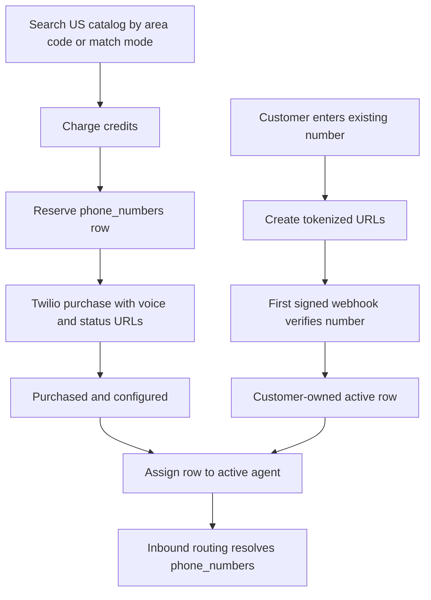

# PRD: Phone Number Management (Twilio + voice-ws)

**Feature ID:** F2
**Status:** Implemented v1 (platform purchase + customer-owned import)
**Last Updated:** 2026-08-12
**Owner:** Genie (AI Assistant)

**Related:** [Twilio call flow](../01_architecture/twilio_call_flow.md), [Outbound phone calls](../03_implementation/outbound_phone_calls.md) (planned)

---

## 1. Overview

### Summary
Enable users to purchase, manage, and use phone numbers directly from the VoiceAI platform. Twilio provides PSTN numbers and Media Streams; `voice-ws` handles the AI voice session over WebSocket.

### Current implementation contract

- `phone_numbers` is the source of truth for phone-to-agent routing. The
  legacy `voice_agents.phone_number` field is retained for compatibility but is
  not consulted by inbound Twilio routing.
- Platform-purchased numbers are charged monthly in credits and are configured
  with the platform voice and status callback URLs in the same Twilio purchase
  request.
- Customer-owned Twilio numbers can be connected without a Twilio account
  OAuth flow. The platform returns tokenized callback URLs and keeps the token
  encrypted only while verification is pending, so users can reopen setup
  details from the phone-number or agent view. The token is removed after the
  first valid verification callback. A future “Connect Twilio account” flow can
  replace this setup step.
- The customer-owned path is intentionally not branded as a Twilio product in
  the normal purchase experience; it is an advanced “Connect Existing Number”
  path for numbers the customer already owns.
- Agent settings use a dropdown backed by `phone_numbers`: users can choose an
  available organization number, clear the mapping without releasing the
  number, or choose “Connect a custom number.” The custom path opens a
  right-side help drawer, creates the mapping, and shows the exact tokenized
  voice and status URLs to paste into the provider console.
- The agent-creation wizard does not accept a raw legacy phone string. Number
  assignment happens after the agent exists so the mapping is created against a
  concrete agent and follows the same source-of-truth flow.
- Production migrations `20260812000006` through `20260812000009` backfill
  existing non-empty `voice_agents.phone_number` values, widen the lifecycle
  status column, add pending webhook-token encryption, and add lookup indexes
  before the application rollout. The backfill is fail-closed for invalid or
  conflicting data and is followed by a read-only deployment verifier.



### Target Users
- Small business owners wanting AI voice agents
- Sales teams needing dedicated phone numbers
- Customer support teams
- Any non-technical user wanting voice agents

---

## 2. Problem Statement

### Current State
- Users must manually set up Twilio accounts
- Technical configuration (TwiML, Webhooks, SIP Trunking) is confusing
- Users need to manage numbers separately from voice agents
- No unified view of phone numbers in the platform

### Pain Points
1. Twilio setup is technically challenging for non-technical users
2. Multiple dashboards to manage (platform + Twilio)
3. No visibility into number status within the platform
4. Difficult to cancel/discard numbers when not needed

---

## 3. Goals

1. **Purchase numbers** without leaving the platform
2. **Manage numbers** (assign to agents, activate, deactivate)
3. **Unified experience** - platform-purchased numbers are configured automatically;
   customer-owned numbers have a guided one-time URL setup until Connect Twilio
   account is available
4. **Cancel numbers** easily when no longer needed

---

## 4. User Stories

### US1: Browse Available Numbers
```
As a user,
I want to see available phone numbers for a specific country,
So that I can choose a number that fits my business needs

Acceptance Criteria:
- Frontend exposes United States only in v1; backend accepts country-aware
  provider search requests for future geography expansion
- System shows available numbers with pricing
- Search accepts digits or formatted input with `Contains`, `Begins with`, and
  `Ends with` match modes. Pressing Enter submits the search without requiring
  a second click.
- Search is disabled with a clear, high-contrast explanation when the balance
  is below the minimum monthly rental for the selected number type.
- Shows monthly cost in credits upfront and marks individual results that cost
  more than the current balance as unavailable for selection.
- Maximum 50 results per query (paginated)
```

### US2: Purchase a Number with Credits
```
As a user,
I want to purchase a phone number using my platform credits,
So that I can start receiving calls immediately

Acceptance Criteria:
- One-click purchase using existing credits
- Shows credit balance before and after purchase
- Number added to user's account immediately
- Confirmation shown with number details
- Number appears in dashboard
- Error shown if insufficient credits
- Clear communication about billing terms (no refund on cancel)
```

### US3: Assign Number to Agent
```
As a user,
I want to assign a purchased number to my voice agent,
So that the agent can receive calls on that number

Acceptance Criteria:
- Dropdown to select from owned numbers
- Number activates for agent within 60 seconds
- Visual indicator shows number is active
- Can change assignment anytime
- Validation: number must not already be assigned to another agent
```

### US4: Manage Number Settings
```
As a user,
I want to configure settings for my number,
So that I can control how calls are handled

Acceptance Criteria:
- Enable/disable incoming calls
- Configure voicemail handling
- View call history for number
```

### US5: Release or Disconnect Number
```
As a user,
I want to release a platform number or disconnect an existing number,
So that I can stop platform routing and, for platform numbers, future rental charges

Acceptance Criteria:
- One-click cancellation
- Explicit confirmation requires typing `Release` for a platform-owned number
  or `Disconnect` for a customer-owned number
- No refund for current billing period (clearly communicated)
- Platform-owned number is released immediately when the provider succeeds;
  provider failures move the row to `release_pending` for an automatic retry
- Customer-owned number is disconnected locally and is never released by the
  platform
- Warning shown if number is assigned to an active agent
- Confirmation screen explicitly warns that release is irreversible and the
  same number may not be available again
- Cannot assign to new agent after cancellation
- Clear communication that number will stop working immediately
```

### US6: Handle Agent Disconnection on Release or Disconnect
```
As a user,
I want to understand what happens when I release or disconnect a number assigned to an agent,
So that I don't lose calls unexpectedly

Acceptance Criteria:
- Warning shown if number is assigned to an active agent
- Option to reassign before confirming cancellation
- If a platform-owned number is released, calls stop and the current billing
  period is not refunded
- If a customer-owned number is disconnected, Twilio ownership and provider
  billing remain unchanged
- Explicit user acknowledgment required before cancellation completes
```

### US7: View Unassigned Numbers
```
As a user,
I want to see numbers I own that aren't assigned to any agent,
So that I can decide whether to use them or release them

Acceptance Criteria:
- Dashboard shows "used" vs "unused" state for each number
- Unused numbers highlighted or listed separately
- Display count of unused numbers on dashboard
- Same billing applies whether used or unused
```

---

## 5. User Experience

### Number Purchase Flow

```
┌─────────────────────────────────────────────────────────────┐
│  Buy Phone Number                                           │
├─────────────────────────────────────────────────────────────┤
│                                                              │
│  Country: [United States ▼]                                  │
│  Area Code: [Optional]                                       │
│  Search: [________________]                                 │
│                                                              │
│  ┌─────────────────────────────────────────────────────┐   │
│  │ Available Numbers (max 50 per page)                   │   │
│  │ ┌─────────────────────────────────────────────────┐ │   │
│  │ │ +1 (555) 123-4567    200 credits/mo  [Select] │ │   │
│  │ │ +1 (555) 987-6543    200 credits/mo  [Select] │ │   │
│  │ │ +1 (212) 555-0199    500 credits/mo  [Select]│ │   │
│  │ └─────────────────────────────────────────────────┘ │   │
│  │                                                      │   │
│  │ [< Previous]  Page 1 of 10  [Next >]                 │   │
│  └─────────────────────────────────────────────────────┘   │
│                                                              │
│  Your Balance: 1,500 credits                                │
│  Selected: +1 (555) 123-4567 (200 credits/month)           │
│                                                              │
│  ⚠️ By purchasing, you agree to being charged monthly.     │
│    If you cancel, the number will be released immediately  │
│    and you will not be refunded for the current period.   │
│                                                              │
│  [ Purchase Number ]  [Connect Existing]  [Close]           │
│                                                              │
└─────────────────────────────────────────────────────────────┘
```

### Dashboard - Numbers Tab
```
┌─────────────────────────────────────────────────────────────┐
│  My Phone Numbers             [+ Search & Purchase]        │
│                                    [Connect Existing]      │
│  ⚠️ You have 2 unused numbers                               │
├─────────────────────────────────────────────────────────────┤
│                                                              │
│  ┌──────────────────────────────────────────────────────┐  │
│  │ +1 (555) 123-4567        Status: Active (used)      │  │
│  │ Assigned to: Sales Agent                             │  │
│  │ Monthly: 200 credits                                 │  │
│  │ [Assign] [Release]                                  │  │
│  └──────────────────────────────────────────────────────┘  │
│                                                              │
│  ┌──────────────────────────────────────────────────────┐  │
│  │ +1 (555) 987-6543        Status: Unused             │  │
│  │ Not assigned to any agent                           │  │
│  │ Monthly: 200 credits                                 │  │
│  │ [Assign to Agent] [Release]                         │  │
│  └──────────────────────────────────────────────────────┘  │
│                                                              │
└─────────────────────────────────────────────────────────────┘
```

### Cancellation Flow
```
┌─────────────────────────────────────────────────────────────┐
│  Release or Disconnect Phone Number?                         │
├─────────────────────────────────────────────────────────────┤
│                                                              │
│  Number: +1 (555) 123-4567                                  │
│  Monthly Cost: 200 credits                                  │
│                                                              │
│  ⚠️ WARNING: This number is assigned to "Sales Agent"       │
│  Release is irreversible and the same number may not be      │
│  available again. Calls will stop working right away.        │
│                                                              │
│  ☐ Type RELEASE to confirm the irreversible release          │
│    with no refund for the current billing period.             │
│                                                              │
│  [Keep Number]          [Release Number]                      │
│                                                              │
└─────────────────────────────────────────────────────────────┘
```

---

## 6. Key Decisions (Finalized)

### D1: Cancellation and ownership policy ✓

- Platform-owned number: release is irreversible, no refund for the current
  billing period, and the UI warns that the same number may not be available
  again.
- Customer-owned number: “Disconnect” disables platform routing and never calls
  Twilio's release API. Twilio ownership and the customer's provider billing
  remain unchanged.
- If a platform release call fails, local state is `release_pending` and the
  daily configurable retry job attempts the provider release again.

### D2: Unassigned Numbers ✓
- Users can buy numbers without assigning to an agent
- Show "used" vs "unused" state in UI
- Display unused number count on dashboard
- Same pricing applies whether used or not
- No auto-release solely because a number is unused; unpaid platform rentals
  are disabled during the configurable grace period and released afterward.

### D3: Search/Display Limit ✓
- Maximum 50 results per query (pagination)
- Platform-purchased ownership remains subject to the organization's
  `max_phone_numbers` entitlement; customer-managed imports are excluded and
  the search result limit is separate from the platform ownership limit.
- The frontend is US-only for now. The backend forwards country-aware searches
  to Twilio and maps `contains`, `begins_with`, and `ends_with` to Twilio's
  `%pattern%`, `+pattern`, and `pattern$` search expressions.

### D4: No Local Pool ✓
- Direct integration with Twilio APIs; voice media via `voice-ws` Media Streams
- No local pool management
- Platform-owned numbers are released through Twilio; customer-owned numbers
  are only disconnected locally and are never released by the platform.

### D5: Agent Assignment Validation
- Prevent assigning same number to multiple agents
- Check number is not already assigned before linking

---

## 7. Out of Scope (for v1)

- Number porting (transferring existing numbers)
- SMS functionality
- International number purchasing in the frontend (backend search is country-aware)
- Bulk purchases
- Custom search filters beyond API capabilities

---

## 8. Success Criteria

- [x] User can purchase a number in < 2 minutes
- [x] Number is configured for voice callbacks during purchase
- [x] Release/disconnect uses clear irreversible or ownership-specific messaging
- [x] Customer-owned numbers can be connected without a platform Twilio account
- [x] Unused numbers prominently displayed on dashboard
- [ ] Live PSTN verification with a paid Twilio test number

---

## Appendix: Credits System Integration

### Pricing Tiers (in credits)
| Number Type | Monthly Cost |
|-------------|--------------|
| Local | 200 credits by default |
| Mobile | 200 credits by default |
| Toll-Free | 500 credits by default |

### Credit Purchase Flow
- Users buy credits via Stripe (existing)
- Platform-owned numbers consume the enabled monthly system-pricing event
  after the number has been purchased; customer-owned numbers do not consume
  platform rental credits.
- A failed platform purchase is refunded. Early release does not refund the
  current rental period.
- The backend uses the current system-pricing value at purchase and renewal;
  the frontend displays the value returned by the API rather than hard-coding
  it.

---

## 9. API Documentation

All phone number endpoints are prefixed with `/api/v1/phone-numbers` and require authentication.

### Authentication

All endpoints require a valid JWT token in the `Authorization` header:

```bash
Authorization: Bearer <jwt_token>
```

Search requires authentication. Purchase, import, list, assign, and release
endpoints require organization-scoped `phone_number:*` permissions. The
backend, not the frontend, is the authorization boundary.

Platform administrators can manage rental grace and scheduler retry settings
with `GET/PUT /api/v1/phone-numbers/admin/settings`; the settings page is
**Platform → Settings → Phone numbers**. The initial defaults are a seven-day
grace period and daily billing/release checks.

### Endpoints

#### 9.1 Search Available Phone Numbers

Search for phone numbers available for purchase from the provider.

**Endpoint:** `GET /api/v1/phone-numbers/available`

**Query Parameters:**

| Parameter | Type | Required | Description |
|-----------|------|----------|-------------|
| country_code | string | No | Country code (default: "US") |
| phone_number_type | string | No | Type: "local", "toll_free", "mobile" (default: "local") |
| area_code | string | No | Filter by area code |
| contains | string | No | Digits or formatted pattern to search for (2–16 provider characters) |
| search_mode | string | No | Match mode: `contains`, `begins_with`, or `ends_with` (default: `contains`) |
| page | integer | No | Page number (default: 1) |
| page_size | integer | No | Results per page, max 50 (default: 50) |

**Request Example:**

```bash
curl -X GET "http://localhost:8000/api/v1/phone-numbers/available?country_code=US&phone_number_type=local&area_code=555&contains=480&search_mode=begins_with" \
  -H "Authorization: Bearer <token>"
```

**Response (200 OK):**

```json
{
  "items": [
    {
      "phone_number": "+15551234567",
      "phone_number_type": "local",
      "country_code": "US",
      "area_code": "555",
      "monthly_cost_credits": 200,
      "capabilities": {
        "voice": true,
        "sms": false,
        "mms": false
      },
      "locality": "San Francisco",
      "postal_code": "94102"
    }
  ],
  "total_count": 1,
  "page": 1,
  "page_size": 50,
  "total_pages": 1
}
```

**Response Model:** `PhoneNumberSearchResponse`

| Field | Type | Description |
|-------|------|-------------|
| items | array | List of available phone numbers |
| total_count | integer | Total results matching query |
| page | integer | Current page number |
| page_size | integer | Results per page |
| total_pages | integer | Total pages available |

---

#### 9.2 Purchase Phone Number

Purchase a phone number using organization credits.

**Endpoint:** `POST /api/v1/phone-numbers/purchase`

**Headers:**

| Header | Required | Description |
|--------|----------|-------------|
| Authorization | Yes | Bearer token |
| organization_id | Yes | UUID of the organization (query parameter) |

**Request Body:**

```json
{
  "phone_number": "+15551234567",
  "country_code": "US",
  "phone_number_type": "local"
}
```

**Request Model:** `PhoneNumberPurchaseRequest`

| Field | Type | Required | Description |
|-------|------|----------|-------------|
| phone_number | string | Yes | Phone number to purchase in E.164 format |
| country_code | string | No | Country code (default: "US") |
| phone_number_type | string | No | Type: "local", "toll_free", "mobile" (default: "local") |

**Request Example:**

```bash
curl -X POST "http://localhost:8000/api/v1/phone-numbers/purchase?organization_id=<org_uuid>" \
  -H "Authorization: Bearer <token>" \
  -H "Content-Type: application/json" \
  -d '{"phone_number": "+15551234567", "country_code": "US", "phone_number_type": "local"}'
```

**Response (200 OK):**

```json
{
  "success": true,
  "phone_number": {
    "id": "123e4567-e89b-12d3-a456-426614174000",
    "phone_number": "+15551234567",
    "provider": "twilio",
    "provider_sid": "PN1234567890abcdef",
    "phone_number_type": "local",
    "country_code": "US",
    "area_code": "555",
    "monthly_cost_credits": 200,
    "status": "purchased",
    "assigned_agent_id": null,
    "is_incoming_enabled": true,
    "is_outgoing_enabled": false,
    "organization_id": "987fcdeb-51a2-3d45-6789-0abcdef12345",
    "purchased_at": "2026-03-01T10:30:00Z",
    "cancelled_at": null,
    "created_at": "2026-03-01T10:30:00Z",
    "updated_at": "2026-03-01T10:30:00Z"
  },
  "message": "Successfully purchased +15551234567",
  "credit_balance_after": 1300
}
```

**Response Model:** `PhoneNumberPurchaseResponse`

| Field | Type | Description |
|-------|------|-------------|
| success | boolean | Whether purchase was successful |
| phone_number | PhoneNumber | Purchased phone number details |
| message | string | Success message |
| credit_balance_after | integer | Organization credit balance after purchase |

**Error Responses:**

- **400 Bad Request:** Invalid request (e.g., number already taken)
- **402 Payment Required:** Insufficient credits
- **500 Internal Server Error:** Server error

---

#### 9.3 Connect an Existing Customer-Owned Number

Register a Twilio number that the customer already owns. This does not call
Twilio purchase or release APIs and does not create a platform rental. The
response contains tokenized URLs. The connection token is encrypted only while
verification is pending, so the URLs can be reopened from the phone-number or
agent view; it is removed after the first valid verification callback.

**Endpoint:** `POST /api/v1/phone-numbers/import?organization_id=<org_uuid>`

**Request Body:**

```json
{
  "phone_number": "+15551234567",
  "country_code": "US",
  "phone_number_type": "local",
  "agent_id": "abc12345-6789-0abc-def0-123456789abc"
}
```

`agent_id` is optional. The number starts as `verification_required`; the
first signed webhook with the returned token verifies it and makes it active.

**Response (200 OK):**

```json
{
  "success": true,
  "phone_number": { "status": "verification_required", "billing_mode": "none", "management_mode": "customer_managed" },
  "voice_url": "https://api.247ai.live/api/v1/voice/twilio/incoming?connection_token=<opaque-token>",
  "status_callback": "https://api.247ai.live/api/v1/voice/twilio/status?connection_token=<opaque-token>",
  "message": "Connect both URLs in Twilio, then place a test call to verify the number."
}
```

The current v1 flow requires the customer to paste the URLs into Twilio.
Automated configuration through a future “Connect Twilio account” flow is
explicitly deferred.

**Pending setup details:**

`GET /api/v1/phone-numbers/{phone_number_id}/verification-details?organization_id=<org_uuid>`

This endpoint is available only to users with phone-number read permission and
only while a customer-owned number is `verification_required`. It returns the
same tokenized `voice_url` and `status_callback` values shown during import.

**Current agent assignment:**

`GET /api/v1/phone-numbers/agent/{agent_id}?organization_id=<org_uuid>`

This permission-protected endpoint returns the single non-terminal number
currently assigned to the agent, or `null`. Agent settings use this lightweight
lookup on initial load and request the full organization list only when the
number selector is opened. Inbound Twilio routing performs its number and
active-agent resolution in one relational query.

---

#### 9.4 List Organization Phone Numbers

Get all phone numbers owned by an organization.

**Endpoint:** `GET /api/v1/phone-numbers`

**Headers:**

| Header | Required | Description |
|--------|----------|-------------|
| Authorization | Yes | Bearer token |
| organization_id | Yes | UUID of the organization (query param) |

**Request Example:**

```bash
curl -X GET "http://localhost:8000/api/v1/phone-numbers?organization_id=<org_uuid>" \
  -H "Authorization: Bearer <token>"
```

**Response (200 OK):**

```json
{
  "items": [
    {
      "id": "123e4567-e89b-12d3-a456-426614174000",
      "phone_number": "+15551234567",
      "provider": "twilio",
      "provider_sid": "PN1234567890abcdef",
      "phone_number_type": "local",
      "country_code": "US",
      "area_code": "555",
      "monthly_cost_credits": 200,
      "status": "active",
      "assigned_agent_id": "abc12345-6789-0abc-def0-123456789abc",
      "is_incoming_enabled": true,
      "is_outgoing_enabled": false,
      "organization_id": "987fcdeb-51a2-3d45-6789-0abcdef12345",
      "purchased_at": "2026-03-01T10:30:00Z",
      "cancelled_at": null,
      "created_at": "2026-03-01T10:30:00Z",
      "updated_at": "2026-03-01T10:30:00Z",
      "agent_name": "Sales Agent"
    },
    {
      "id": "223e4567-e89b-12d3-a456-426614174001",
      "phone_number": "+15559876543",
      "provider": "twilio",
      "provider_sid": "PN0987654321abcdef",
      "phone_number_type": "toll_free",
      "country_code": "US",
      "area_code": null,
      "monthly_cost_credits": 500,
      "status": "purchased",
      "assigned_agent_id": null,
      "is_incoming_enabled": true,
      "is_outgoing_enabled": false,
      "organization_id": "987fcdeb-51a2-3d45-6789-0abcdef12345",
      "purchased_at": "2026-02-15T14:20:00Z",
      "cancelled_at": null,
      "created_at": "2026-02-15T14:20:00Z",
      "updated_at": "2026-02-15T14:20:00Z",
      "agent_name": null
    }
  ],
  "total_count": 2,
  "unused_count": 1
}
```

**Response Model:** `PhoneNumberListResponse`

| Field | Type | Description |
|-------|------|-------------|
| items | array | List of phone numbers with agent details |
| total_count | integer | Total numbers owned |
| unused_count | integer | Numbers not assigned to any agent |

**Phone Number Status Values:**

| Status | Description |
|--------|-------------|
| available | Number is available for purchase |
| purchased | Number has been purchased |
| active | Number is active and assigned to agent |
| inactive | Number is inactive |
| provisioning | Provider purchase is in progress |
| verification_required | Customer-owned number awaits a signed webhook |
| release_pending | Provider release will be retried by the scheduler |
| disconnected | Customer-owned number is disconnected locally |
| cancelled | Number has been cancelled/released |

---

#### 9.5 Assign Phone Number to Agent

Assign a purchased phone number to a voice agent.

**Endpoint:** `POST /api/v1/phone-numbers/{phone_number_id}/assign`

**Headers:**

| Header | Required | Description |
|--------|----------|-------------|
| Authorization | Yes | Bearer token |
| organization_id | Yes | UUID of the organization (query param) |

**Path Parameters:**

| Parameter | Type | Description |
|-----------|------|-------------|
| phone_number_id | UUID | ID of the phone number to assign |

**Request Body:**

```json
{
  "agent_id": "abc12345-6789-0abc-def0-123456789abc"
}
```

**Request Model:** `PhoneNumberAssignRequest`

| Field | Type | Required | Description |
|-------|------|----------|-------------|
| agent_id | UUID | Yes | UUID of the agent to assign the number to |

**Request Example:**

```bash
curl -X POST "http://localhost:8000/api/v1/phone-numbers/123e4567-e89b-12d3-a456-426614174000/assign?organization_id=<org_uuid>" \
  -H "Authorization: Bearer <token>" \
  -H "Content-Type: application/json" \
  -d '{"agent_id": "abc12345-6789-0abc-def0-123456789abc"}'
```

**Response (200 OK):**

```json
{
  "success": true,
  "phone_number": {
    "id": "123e4567-e89b-12d3-a456-426614174000",
    "phone_number": "+15551234567",
    "provider": "twilio",
    "provider_sid": "PN1234567890abcdef",
    "phone_number_type": "local",
    "country_code": "US",
    "area_code": "555",
    "monthly_cost_credits": 200,
    "status": "active",
    "assigned_agent_id": "abc12345-6789-0abc-def0-123456789abc",
    "is_incoming_enabled": true,
    "is_outgoing_enabled": false,
    "organization_id": "987fcdeb-51a2-3d45-6789-0abcdef12345",
    "purchased_at": "2026-03-01T10:30:00Z",
    "cancelled_at": null,
    "created_at": "2026-03-01T10:30:00Z",
    "updated_at": "2026-03-01T10:35:00Z"
  }
}
```

**Error Responses:**

- **404 Not Found:** Phone number not found or not owned by organization
- **409 Conflict:** Phone number is already assigned to another agent
- **400 Bad Request:** Phone number cannot be assigned (e.g., cancelled)

---

#### 9.6 Unassign Phone Number Without Releasing It

Clear the agent mapping while keeping the organization-owned number available.
Platform-managed rows return to `purchased`; customer-managed rows remain
connected but stop inbound routing until assigned again.

**Endpoint:** `DELETE /api/v1/phone-numbers/{phone_number_id}/assignment?organization_id=<org_uuid>`

This endpoint requires `phone_number:update` permission and never calls
Twilio's release API.

---

#### 9.7 Release or Disconnect Phone Number

For a platform-owned number, release is irreversible and stops calls. For a
customer-owned number, this operation is a local disconnect only; the customer
continues to own and pay Twilio.

**Endpoint:** `DELETE /api/v1/phone-numbers/{phone_number_id}`

**Headers:**

| Header | Required | Description |
|--------|----------|-------------|
| Authorization | Yes | Bearer token |
| organization_id | Yes | UUID of the organization (query param) |

**Path Parameters:**

| Parameter | Type | Description |
|-----------|------|-------------|
| phone_number_id | UUID | ID of the phone number to cancel |

**Request Example:**

```bash
curl -X DELETE "http://localhost:8000/api/v1/phone-numbers/123e4567-e89b-12d3-a456-426614174000?organization_id=<org_uuid>" \
  -H "Authorization: Bearer <token>"
```

**Response (200 OK):**

```json
{
  "success": true,
  "message": "Phone number released or disconnected."
}
```

**Error Responses:**

- **404 Not Found:** Phone number not found or not owned by organization
- **400 Bad Request:** Phone number cannot be cancelled

**Warning for platform-owned numbers:** release may not be reversible, the same
number may not be available again, calls stop, and the current billing period
is not refunded. If Twilio release fails, the local row becomes
`release_pending` and the daily retry scheduler continues attempting release.

**Customer-owned numbers:** disconnect disables platform routing and does not
call Twilio's release API.

---

### Credit Pricing

The initial seeded defaults are 200 credits/month for local and mobile numbers
and 500 credits/month for toll-free numbers. Platform administrators can
change the enabled system-pricing values; search and purchase responses return
the authoritative current value. International number purchasing is not
exposed in the v1 frontend.

---

### Error Codes

| Code | HTTP Status | Description |
|------|-------------|-------------|
| PHONE_NUMBER_NOT_FOUND | 404 | Phone number not found |
| INSUFFICIENT_CREDITS | 402 | Organization has insufficient credits |
| ALREADY_ASSIGNED | 409 | Phone number is already assigned to an agent |
| INVALID_STATUS | 400 | Phone number status doesn't allow the operation |

---

*End of API Documentation v1.0*
