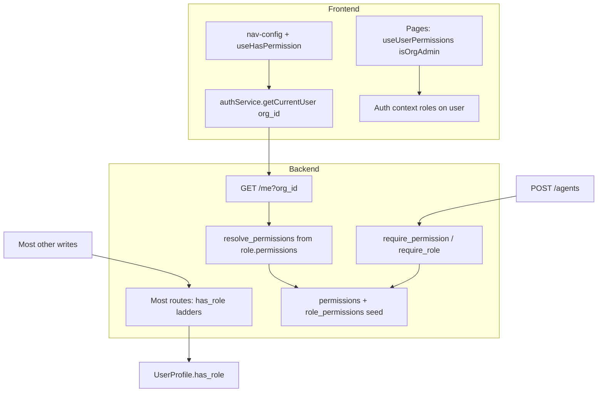

# N1 Navigation Redesign — Architecture & Engineering Review

**Status:** Review complete 2026-07-08; **findings implemented 2026-07-13** (Epics A–D shipped, Epic E deferred). See the [Implementation status addendum](#15-implementation-status-addendum-2026-07-13) at the bottom and the companion [`n1-review-implementation-report.md`](./n1-review-implementation-report.md).
**Date:** 2026-07-08 (review); filed 2026-07-11; status updated 2026-07-13
**Branch reviewed:** `feature/improved-mavigation` (implementation landed on `feature/improved-navigation`)
**Related design:** [`navigation-redesign.md`](./navigation-redesign.md)
**Sprint board:** `docs/SPRINT-BOARD.md` (N1 closed)
**Reviewer context:** Full-branch cross-check of commits + staged changes (not a PR line-by-line review)

> **Reading note (2026-07-13):** Sections 1–14 below are the *original* review
> as written on 2026-07-08 — they describe the transitional state observed at
> review time and the findings/recommendations that followed. They are kept
> verbatim for traceability. For the current as-implemented status (which
> findings are done, which remain open), jump to
> [§15 — Implementation status addendum](#15-implementation-status-addendum-2026-07-13).

---

## 1. Executive summary

### Verdict

**Directionally strong.** N1 is the right architectural move:

- Extract nav into data (`nav-config.ts`)
- Ship a permission string contract early so Phase 2 RBAC is mostly a backend swap
- Promote Phone Numbers / Skills to first-class routes
- Patch real security holes discovered along the way

**Not yet “clean architecture.”** The branch lands a **hybrid / transitional** state:

| Layer | Model used today |
|-------|------------------|
| Nav visibility | Permission strings via `useHasPermission` + `/me.permissions` |
| Page write gates | Role booleans via `useUserPermissions` (`isOrgAdmin` / `isPlatformAdmin`) |
| Most backend write routes | Imperative `has_role` ladders |
| One backend write path (`create_agent`) | Declarative `require_permission(...)` factory |

The risk is not “wrong design.” The risk is **letting dual models and permission-name drift live long enough that Phase 2 becomes a rewrite instead of a resolver swap.**

### Scope of this review

| In scope | Out of scope (separate track) |
|----------|-------------------------------|
| 5 unpushed commits on the feature branch | Full Stripe checkout E2E |
| Staged (uncommitted) skills `basePath` fix + docs | Bug #36 billing plans / local DB seed (investigated separately; see §12) |
| Permission contract, nav, page gates, security fixes | Custom roles UI (explicitly deferred) |

### Commits reviewed

| Commit | Summary |
|--------|---------|
| `5923bc4` | **feat(navigation):** N1 redesign + permission-aware UI + `GET /me` permissions |
| `360534c` | **fix(frontend):** gate per-card / per-row write actions on role |
| `009ff78` | **fix(backend):** close 4 tool_routes CRIT gaps (OAuth token rewrite) |
| `8767218` | **fix(backend):** invitation takeover, skill ownership, RBAC catalog, `member:create` typo |
| `756689c` | **refactor(backend):** `require_permission` / `require_role` factory; migrate `create_agent` |

### Staged (not yet committed) at review time

| Path | Change |
|------|--------|
| `frontend/.../organization-skills-tab.tsx` | Optional `basePath` for URL sync (bug #35) |
| `frontend/.../skills/page.tsx` | Passes `basePath="/skills"` |
| `frontend/.../organization-skills-tab.test.tsx` | Regression tests for basePath contract |
| `docs/tw-drafts/navigation-redesign.md` | N1 design draft |
| `docs/PRIORITY-LIST.md` / `docs/SPRINT-BOARD.md` | Deferred custom RBAC items |

---

## 2. What is good (keep)

### 2.1 Contract-first permission surface

Embedding resolved `permissions` on `GET /me` (scoped by `org_id`) plus pure helpers (`hasPermission` on the frontend) is a solid Phase 1 shape.

- **Backend:** `backend/src/auth/permissions_service.py` → `resolve_permissions(user, current_organization_id)`
- **Model:** `UserProfile.permissions: dict[str, list[str]]` and `current_organization_id`
- **Frontend:** `useMyPermissions` / `useHasPermission` / `useHasAnyPermission` in `frontend/src/hooks/use-has-permission.ts`

Phase 2 can replace the resolver body (or how grants are loaded) without rewiring nav or hooks **if** the string vocabulary stays stable.

### 2.2 Nav as data (`nav-config.ts`)

Single source of truth for left-rail items:

- Sections: `workspace` → `org_admin` → `platform_admin`
- Each item: `name`, `href`, `icon`, `requiredPermission`, `section`, optional `exact`
- Invariant tests in `nav-config.test.ts` (malformed permission should fail CI)

Far better than hard-coded `item.name === "Users"` filters in the layout.

### 2.3 Dual gate for sections (Option C)

Documented and intentional:

1. **Section-level role gate** (`SECTION_ROLES`) — hide whole “Org Admin” / “Platform Admin” headings unless the user holds the role (platform_admin inherits org_admin section).
2. **Item-level permission gate** (`requiredPermission` + `useHasPermission`) — hide individual links the user lacks.

Purpose: prevent “nav promises what the page denies,” especially once granular roles exist.

### 2.4 Security fixes are real, not cosmetic

| Fix | Severity if unfixed | What was done |
|-----|---------------------|---------------|
| Tool write routes had **zero** auth | Anyone authenticated could rewrite OAuth tokens / API keys / delete agent tools | `_assert_agent_tool_admin` + 14 role×endpoint tests |
| Invitation `user_id` not bound to caller | Account takeover via process-invitation | Body `user_id` must match authenticated caller |
| Skill file PUT/DELETE/refresh checked path org role but not row ownership | Cross-org mutation by UUID guess | Ownership check; platform_admin bypass |
| RBAC catalog GETs used `has_permission` without org | Any role-holder could read platform role/permission catalog | Restricted to `platform_admin` |
| `member:invite` checked where DB grants `member:create` | Legitimate invites 403’d | Aligned invite route to `member:create` |

### 2.5 Staged bug #35 fix (`basePath`)

Root cause: top-level `/skills` reuses `OrganizationSkillsTab`, which always `router.replace`’d to `/organization?…`, causing a page flash.

Fix:

- Optional `basePath` (default `/organization` for legacy)
- `/skills` page passes `basePath="/skills"`
- Unit tests lock default path, `/skills` path, file path, clear selection

**Assessment:** Correct reuse pattern; ship as a focused commit.

### 2.6 Deferring custom RBAC

Documenting **custom roles UI** and **Phase 2 real resolver** under “Deferred / Speculative” with **trigger conditions** is good product discipline. No paying customer need for middle-ground roles yet; data model already exists.

### 2.7 Org as primary actor + route promotion

- Org switcher in sidebar (not buried in avatar menu)
- Phone Numbers + Skills as top-level routes
- Org page collapsed toward settings; legacy `?tab=` redirects via `legacyTabRedirect`

Matches modern multi-tenant SaaS IA.

### 2.8 Frontend write-action cleanup (partial)

Follow-up commit gates:

- Agents: per-agent `canActOnAgent` (cross-org list aware)
- Members: per-row Actions dropdown on `canManageMembers`
- Skills: `canCreate` / `canEdit` admin-only
- Phone numbers: `canManage` passed into dashboard (follow-up noted in design for full button props)

Backend remains the security boundary; UI gates reduce intent leaks.

---

## 3. Architecture picture (as shipped)



**Main debt:** nav is permission-aware; pages and most APIs are still role-aware.

---

## 4. Findings by severity

### 4.1 🔴 High — Permission vocabulary is inconsistent

The design doc, migration, frontend hooks, backend checks, and tests disagree on action names.

#### Observed vocabulary matrix

| Place | Examples used |
|-------|----------------|
| Design doc §4 | `agent:write`, `member:invite`, `member:remove` |
| Migration `20260705000001_extend_org_admin_and_regular_user_grants.py` | `agent:create` / `agent:update` / `agent:delete`, `member:create` / `member:update` / `member:delete` |
| `require_permission` on `create_agent` | `agent:create` (matches migration) |
| `use-user-permissions.ts` | `member:manage`, `member:invite`, `settings:read`, `settings:update` |
| Org invite route (post-fix) | `member:create` (matches migration) |
| Billing routes | `billing:subscribe` (initial RBAC seed) |
| Nav / UI manage gate | `billing:manage` (N1 migration) |
| Tests (various) | still reference `agent:write`, `member:invite` |

#### Why this is high severity

- Phase 2 “swap the resolver” **fails** if callers check names that were never granted.
- Frontend `user.hasPermission("member:invite")` is **dead code** today; it only “works” because the OR with `isOrgAdmin` still saves the gate.
- New engineers will copy whichever string they see first → more drift.

#### Recommendation

1. Publish a **single canonical matrix** (resource × action × which roles get it).
2. Prefer **one style** end-to-end:
   - REST-style: `create | update | delete | read`, **or**
   - Collapsed: `read | write | delete`  
   Do **not** mix both without an explicit alias layer (aliases are worse than choosing once).
3. Enforce the matrix in:
   - Migration / seed names
   - `nav-config` / TypeScript unions
   - Backend `require_permission` call sites
   - Design doc + tests
4. Fix `use-user-permissions.ts` strings (`member:invite` → `member:create`, drop or map `member:manage` / `settings:*`).

---

### 4.2 🔴 High — Two frontend permission systems

| Hook | Source of truth | Used for |
|------|-----------------|----------|
| `useHasPermission` / `useMyPermissions` | Server-resolved `/me.permissions` map | Nav item visibility |
| `useUserPermissions` | Client `hasRole` + ad-hoc `hasPermission` strings | Page write gates, members, billing, skills, phone numbers |

Typical page gate still looks like:

```ts
const canManage = isPlatformAdmin || isOrgAdmin;
```

#### Consequences

- Design goal #4 (“permission-aware from day one”) is only **half** true (nav only).
- Custom roles in Phase 2 **will not** unlock create/edit buttons until pages move to permission strings (e.g. `useHasPermission("agent:create")`).
- `useUserPermissions` includes a **`NODE_ENV === "development"` fallback that grants almost everything on exception** — easy to misread as “dev always admin,” and dangerous if that path ever runs in a shared/staging env that sets `NODE_ENV=development`.

#### Recommendation

1. Treat `useHasPermission` as the **only long-term public API**.
2. Rewrite `useUserPermissions` as a thin facade over the permissions map (or deprecate it).
3. **Remove** the dev “grant all on error” fallback; fail closed and surface the error.
4. Track page-by-page migration: agents, skills, phone numbers, members, billing, create routes.

---

### 4.3 🟠 Medium — Backend auth still mostly role ladders

`require_permission` / `require_role` factories (`backend/src/auth/dependencies.py`) are well designed:

- Path or body org resolution
- Platform admin short-circuit
- Construction-time validation of `org_id_source`
- Returns `(user_id, user_profile)` for handlers

But **only `create_agent`** uses them as the reference consumer. Most of:

- `voice_agents/routes.py`
- `skill_routes.py`
- billing routes
- organization routes

still use imperative:

```python
if not user_profile.has_role("platform_admin"):
    if not user_profile.has_role("org_admin", str(org_id)):
        ...
```

Ownership checks exist only where recently fixed (skills files/refresh, agent tools).

#### Recommendation (auth migration epic)

1. Inventory all write (and sensitive read) endpoints.
2. Migrate to `require_permission` / `require_role` (or a shared `_assert_org_admin` helper that wraps the factory).
3. Standardize **resource ownership**: path/body `org_id` must own the mutated row (skill fix pattern).
4. Until this is done, “contract so Phase 2 is backend-only” is **optimistic** — UI can move to permissions while APIs only understand three roles.

---

### 4.4 🟠 Medium — Design doc / product rules drifted from implementation

| Design doc claim | Actual shipped behavior |
|------------------|-------------------------|
| Phase 1 members get `agent:write`, `phone_number:write`, `skill:write` for zero regression | Migration grants **regular_user = read only** on those resources |
| Non-goal: hide create/edit buttons (Phase 2) | Later section + commits **do** gate write UI on org/platform admin |
| Goal #5: zero behavior regression for members | False if members previously saw create/delete UI (backend may already have been admin-only for some paths) |
| Resolver described as pure “stub” | Already buckets **role.permissions** from the loaded profile; not a hardcoded map of three roles only |

Admin-only writes are a **better multi-tenant default**, but docs must match reality.

#### Recommendation

Update `navigation-redesign.md` to **as-implemented**:

- Workspace **read** for members; **write** for `org_admin` / `platform_admin`
- Explicitly abandon “members keep full CRUD”
- Clarify Phase 2 = custom roles UI + optional richer resolution + page/API permission alignment — not “first time we resolve from DB”

---

### 4.5 🟠 Medium — `OrganizationSkillsTab` dual-mount & URL noise

`basePath` fix is correct. Residual smells:

1. **Always writes `tab=skills`** even when `basePath="/skills"` — harmless but misleading (legacy tab param on a non-tab route).
2. **Default `basePath="/organization"`** implies skills still live on the org page; org page now **redirects** `?tab=skills` → `/skills`. Prefer default `"/skills"` if nothing mounts the legacy path.
3. Component name `OrganizationSkillsTab` is a “tab” that is no longer a tab — rename later (`OrganizationSkillsEditor` / `OrgSkillsPanel`).

**Priority:** cleanup after #35 lands; not a blocker.

---

### 4.6 🟡 Lower — Layout / product polish still open

| Item | Notes |
|------|--------|
| Sidebar brand still **“NeuraSaaS”** | Already on sprint board; should be config-driven (`NEXT_PUBLIC_APP_NAME` / CogniNets) |
| Platform Skills nav icon is `CreditCard` | Wrong metaphor; use book / layers / sparkles, etc. |
| Avatar dropdown still duplicates Members / Billing / Overview | Design non-goal for day one; remove soon to avoid two IA stories |
| Breadcrumbs are a large pathname hard-code | Will rot; could derive from `nav-config` + path segments |
| `PermissionString = \`${string}:${string}\`` | Not a real type constraint; pair with `PERMISSION_RESOURCES` / `PERMISSION_ACTIONS` const unions |

---

### 4.7 🟡 Lower — Phase 2 framing / deferred items wording

Deferred table lists:

1. Define roles & permissions UI (custom roles)
2. Phase 2 RBAC “real resolver”

`resolve_permissions` already joins permissions from roles on the profile. What’s actually deferred:

- Custom roles management UI
- Possibly DB-side resolution without loading full role graphs every time
- **Page-level and API-level** write gates on permission strings (not just nav)
- Product decisions: who can manage roles, org-scoped custom roles, conflict resolution

**Recommendation:** Rename deferred items so “stub” doesn’t understate current work or overstate remaining work.

---

### 4.8 Staged changes assessment (bug #35 + docs)

| Item | Assessment |
|------|------------|
| `basePath` on skills tab | **Ship** — correct fix for #35 |
| Unit tests | **Good** — covers default, `/skills`, file path, clear selection |
| Design draft in `docs/tw-drafts/` | **Useful**; needs pass to match shipped behavior / vocabulary |
| Deferred RBAC in PRIORITY / SPRINT | **Good** product call |
| Still setting `tab=skills` on `/skills` | **Nit** — omit when `basePath !== "/organization"` |

---

## 5. Security deep-dive (keep in mind for audits)

### 5.1 Tool routes (`009ff78`)

- Four write endpoints had no permission checks.
- Fix resolves `agent_tool_id` → agent → `organization_id`, then requires platform_admin or org_admin on that org.
- Pattern is good; consider reusing for other UUID-only write paths.

### 5.2 Invitation process (`8767218`)

- Caller’s identity must equal body `user_id`.
- Prevents inviting/joining as another user.

### 5.3 Cross-org skill attacks (`8767218`)

- Path `org_id` role check alone is insufficient when body/path also carries skill/file IDs.
- Always verify the resource’s `organization_id` matches the authorized org (unless platform_admin).

### 5.4 What is still only UX (not security)

Frontend hiding of trash / create buttons is **not** a security boundary. Backend must keep enforcing independently. The design doc correctly notes a **backend write-endpoint audit** as follow-up.

---

## 6. Testing posture

### Strengths

- N1 landed with substantial frontend unit tests (nav, layout, pages, hooks).
- Backend tests for permissions service, `/me` permissions, grants migration, tool route permissions, dependency factory.
- TDD red→green called out in design doc and commit messages.

### Gaps / risks

- Permission **string** tests still use outdated names (`agent:write`, `member:invite`) in places — tests may pass while production grants differ.
- E2E coverage for role matrix (platform_admin / org_admin / regular_user) across new routes should stay green after vocabulary lock-in.
- `useUserPermissions` development fallback is hard to catch in CI if NODE_ENV is production in tests only.

---

## 7. Recommended follow-up work (implementation backlog)

Use this as the implementation checklist when the team picks up the findings. Order is intentional.

### Epic A — Vocabulary lock-in (do first)

- [ ] Write canonical permission matrix (resource × action × role) matching migration `20260705000001` (or migrate DB if product chooses collapsed names).
- [ ] Update design doc §4 to match.
- [ ] Fix `use-user-permissions.ts` dead/wrong strings.
- [ ] Fix tests that assert old names.
- [ ] Align billing: `billing:manage` (nav) vs `billing:subscribe` (API) — document composite vs granular or unify.
- [ ] Optionally export shared constants (backend Python + frontend TS) or generate one from the other.

### Epic B — Single frontend permission API

- [ ] Make page write gates use `useHasPermission("…")` (or a derived facade).
- [ ] Deprecate role-only gates except where product truly is role-gated (e.g. platform-only pages).
- [ ] Remove `NODE_ENV === "development"` grant-all fallback.
- [ ] Invalidate `/me` permissions query on org switch (verify current `queryKey` already does).

### Epic C — Backend auth migration

- [ ] Inventory write endpoints (agents, skills, phone numbers, tools, billing, org members).
- [ ] Migrate to `require_permission` / `require_role`.
- [ ] Apply ownership checks on every ID-based mutation.
- [ ] Keep platform_admin short-circuit consistent with factory.

### Epic D — Doc & IA cleanup

- [ ] Mark `navigation-redesign.md` as **as-implemented**; fix non-goals vs write gates.
- [ ] Rename deferred Phase 2 wording.
- [ ] Replace NeuraSaaS branding.
- [ ] Fix Platform Skills icon.
- [ ] Remove duplicate avatar-menu org admin links after one release.
- [ ] Skills: drop `tab=skills` when on `/skills`; consider rename of `OrganizationSkillsTab`.

### Epic E — Do **not** start yet

- [ ] Custom roles UI
- [ ] Speculative Phase 2 resolver rewrite  

**Gate:** Epics A–C should complete first so custom roles don’t force a second rewrite of nav + pages + APIs.

---

## 8. Suggested review feedback to the team (short form)

1. **Approve N1 + security commits** as the right foundation.
2. **Must-follow ticket:** single permission vocabulary + fix dead frontend strings + align docs/tests.
3. **Follow-up epic:** migrate page write gates + backend routes from role ladders → permission factories/hooks.
4. **Do not start custom-role UI** until (2) and (3) are done.
5. **Ship staged skills `basePath` fix** as a small focused commit.
6. **Doc hygiene:** as-implemented design doc; abandon “members keep write.”

---

## 9. Bottom line

These are **good engineering changes** with clear product value and real security wins. The architecture is **intentionally transitional**, not finished.

| Dimension | Score (qualitative) |
|-----------|---------------------|
| Product / IA direction | Excellent |
| Permission contract idea | Excellent |
| Consistency of permission strings | Poor (needs lock-in) |
| Frontend dual systems | Transitional debt (High if left long) |
| Backend factory adoption | Started well; incomplete |
| Security hardening in branch | Strong |
| Docs match reality | Partial drift |
| Staged #35 fix | Ship |

**Primary risk:** dual models + name drift make Phase 2 a rewrite.  
**Primary mitigation:** Epics A → B → C before custom RBAC.

---

## 10. Key file map

| Area | Paths |
|------|--------|
| Design | `docs/tw-drafts/navigation-redesign.md` |
| This review | `docs/tw-drafts/n1-architecture-review.md` |
| Nav config | `frontend/src/components/layout/nav-config.ts` |
| Layout | `frontend/src/components/layout/dashboard-layout.tsx` |
| Org switcher | `frontend/src/components/layout/organization-switcher.tsx` |
| Permission hooks | `frontend/src/hooks/use-has-permission.ts` |
| Legacy role facade | `frontend/src/hooks/use-user-permissions.ts` |
| Skills basePath | `frontend/src/components/skills/organization-skills-tab.tsx` |
| Permissions resolver | `backend/src/auth/permissions_service.py` |
| Auth factories | `backend/src/auth/dependencies.py` |
| Grants migration | `backend/alembic/versions/20260705000001_extend_org_admin_and_regular_user_grants.py` |
| Deferred product notes | `docs/PRIORITY-LIST.md`, `docs/SPRINT-BOARD.md` |

---

## 11. Open questions for product / eng (if reopened)

1. **Canonical action names:** REST (`create/update/delete`) vs collapsed (`write`)? Migration currently uses REST-style for N1 resources.
2. **Members who can edit agents but not billing:** Is that a near-term customer need? If yes, Epic B/C priority increases; if no, deferred custom roles stays correct.
3. **Regular member write access:** Confirm product permanently wants read-only workspace for `regular_user` (recommended).
4. **Billing permission model:** Keep both `billing:manage` (UI) and `billing:subscribe` (API), or collapse?

---

## 12. Related investigation note — Bug #36 (billing plans)

Not part of the N1 architecture review proper; captured so findings stay in one place.

### Hypothesis (user)

After switching from cloud Supabase → local Supabase, **plan details are missing** — database configuration / seed gap, not application code.

### Preliminary confirmation (2026-07-08 investigation)

Queried local Supabase (`127.0.0.1:54322`):

| Table | Count |
|-------|-------|
| `subscription_plans` | **0** |
| `credit_products` | **0** |
| `credit_events` | **0** |

- Billing **tables exist** (migration `b1c2d3e4f5g6` creates schema only; **no plan seed in migration**).
- Production/cloud data was never copied to local.
- Intended local/dev population path: `backend/scripts/stripe_manager.py seed` (reads Stripe products/prices → upserts `subscription_plans` / `credit_products` + seeds `credit_events`).
- Docs: `docs/05_operations/STRIPE_SETUP_AND_MANAGEMENT.md`.

### Implication

User understanding is **correct**: fix is primarily **seed local DB from Stripe** (or a checked-in seed SQL for offline dev), not a frontend bug. Full fix/verification was deferred when this review doc was requested.

### Suggested fix path (when picked up)

1. `cd backend && python scripts/stripe_manager.py diagnostic`
2. `python scripts/stripe_manager.py seed --dry-run`
3. `python scripts/stripe_manager.py seed` (against local Supabase env)
4. Verify rows in `subscription_plans` / `credit_products` / `credit_events`
5. Hit Billing UI Plans tab and `/api/v1/billing/plans`
6. Longer term: document seed in local setup guide; optionally add idempotent seed step to `./start.sh` or demo guide so local never ships empty plans again

---

## 13. Document history

| Date | Change |
|------|--------|
| 2026-07-08 | Architecture review performed on `feature/improved-mavigation` (commits + staged) |
| 2026-07-11 | Findings written to this markdown file for implementation tracking |
| — | Findings accepted by product owner; implementation deferred to soon-follow-up |

---

## 14. Acceptance criteria for “review findings done”

The review findings are considered **implemented** when:

1. One canonical permission matrix is documented and matches DB grants + all call sites.
2. Frontend page gates no longer depend on a parallel ad-hoc string set in `useUserPermissions` (or that hook is a pure facade over `/me.permissions`).
3. Dev grant-all fallback is removed.
4. Majority of write endpoints use `require_permission` / `require_role` (or equivalent shared guard) with ownership checks.
5. Design doc is as-implemented; deferred Phase 2 wording is accurate.
6. Bug #35 `basePath` is committed; optional URL nit cleaned.
7. (Optional but recommended) Local billing seed path is documented and verified for bug #36.

---

## 15. Implementation status addendum (2026-07-13)

This addendum records the as-implemented status of the §14 acceptance criteria
and the Epic A–E backlog from §7, written after the follow-up work landed on
`feature/improved-navigation`. The companion report
[`n1-review-implementation-report.md`](./n1-review-implementation-report.md)
contains the file-level evidence; this section is the short-form reconciliation.

### 15.1 Acceptance criteria (§14) — status

| # | Criterion (§14) | Status | Evidence |
|---|-----------------|--------|----------|
| 1 | One canonical permission matrix matches DB + call sites | ✅ Done | [`permission-matrix.md`](../02_features/authentication_rbac/permission-matrix.md) + [`frontend/src/lib/permissions.ts`](../../frontend/src/lib/permissions.ts) + migration `20260705000001` |
| 2 | Page gates use `/me.permissions` (not ad-hoc strings) | ✅ Mostly done | `useUserPermissions` is a facade over the permissions map; page gates use derived `canCreate*`/`canManage*` flags. Two intentional role-gate exceptions remain (`/agents/create`, `/organization/billing`) — see §15.3 |
| 3 | Dev grant-all fallback removed | ✅ Done | Fail-closed; pinned by `use-user-permissions.test.tsx` (`does NOT grant-all when NODE_ENV is development`) |
| 4 | Majority of write endpoints use the factory / helpers + ownership | ✅ Done | Epic C migrated all 5 route files to `require_permission` / `assert_has_permission` / `assert_has_role` / `assert_platform_role` / `assert_billing_access`; see [`backend-endpoint-permission-audit.md`](../02_features/authentication_rbac/backend-endpoint-permission-audit.md) (2026-07-13 sweep) |
| 5 | Design doc as-implemented; Phase 2 wording accurate | ✅ Done | [`navigation-redesign.md`](./navigation-redesign.md) status flipped to "Shipped 2026-07-11"; Phase 2 wording clarified |
| 6 | Bug #35 `basePath` fixed + URL nit | ✅ Done | `tab=skills` dropped on `/skills`; default `basePath` is `/skills` |
| 7 | Bug #36 local billing seed documented/verified | ❌ Deferred | Still a hypothesis in §12; not part of this round |

**Overall:** 6/7 met; criterion 7 (Bug #36) deferred per product call.

### 15.2 Epic backlog (§7) — status

| Epic | §7 scope | Status | Notes |
|------|----------|--------|-------|
| **A — Vocabulary lock-in** | Canonical matrix; fix dead strings; align billing | ✅ Done | `permission-matrix.md` is the source of truth; `use-user-permissions.ts` uses `P.*` constants; forbidden strings only in negative tests |
| **B — Single FE permission API** | Page gates → `useHasPermission`; remove dev grant-all; invalidate `/me` on org switch | ✅ Mostly done | `useUserPermissions` is a facade over `useMyPermissions`; dev grant-all removed; `queryKey` includes `orgId`. Two page gates still role-only (see §15.3) |
| **C — Backend auth migration** | Inventory + migrate write endpoints; ownership checks; consistent platform_admin short-circuit | ✅ Done | All 5 route files migrated to the typed helpers; 3-way OR ladders collapse to single `assert_has_permission` because the matrix encodes per-role grants. See the audit doc (2026-07-13 sweep) |
| **D — Doc & IA cleanup** | As-implemented design doc; rename deferred Phase 2; replace branding; fix Platform Skills icon; avatar dedup; skills tab nit | ✅ Mostly done | Design doc as-implemented; branding → CogniNets; Platform Skills icon → `Layers`; `tab=skills` dropped. Avatar-menu dedup + `OrganizationSkillsTab` rename + breadcrumb derivation from `nav-config` remain as low-priority polish |
| **E — Custom roles / Phase 2 resolver** | Do not start | ✅ Correctly deferred | Blocked on Epics A–C, which are now done; the gate is cleared but no customer need yet |

### 15.3 Known residuals (open, not blocking)

These are tracked as follow-ups, not regressions:

1. **Two role-only page gates.** `/agents/create` and `/organization/billing`
   still gate on `isPlatformAdmin || isOrgAdmin` instead of `canCreateAgent` /
   `canManageBilling`. For the three current roles this is equivalent; the gap
   only matters for a Phase 2 custom role with `agent:create`-only or
   `billing:manage`-only grants. One-line fixes when Phase 2 lands.
2. **Nav dual-gate model.** Nav uses section-role + item-permission (Option C,
   intentional). Phase 2 custom roles need both layers updated — documented in
   `navigation-redesign.md`.
3. **Epic D polish.** Avatar-menu org-link dedup, `OrganizationSkillsTab` →
   `OrgSkillsEditor` rename, and breadcrumbs derived from `nav-config`
   (instead of pathname hard-codes) are deferred low-priority.
4. **Bug #36.** Local `subscription_plans` seed path not yet verified; see §12.
5. **No shared Python permission constants.** The canonical vocabulary lives in
   TS (`permissions.ts`) + the migration + the matrix doc; there is no generated
   Python mirror module. Acceptable while the resolver is a stub; revisit with
   the Phase 2 real resolver.
6. **Dead `seed_built_in_skills` call in `complete_onboarding`.** The route
   calls `skill_service.seed_built_in_skills(org_id)`, but `SkillService` only
   defines `seed_platform_skills()` (platform-level, no `org_id` arg, run on
   app startup). The `AttributeError` is swallowed by the route's
   `except Exception`, so onboarding silently never seeds org skills — dead
   code. Flagged with a TODO at the call site; fix is either delete the block
   (the platform model is "orgs fork what they need") or implement a real
   org-scoped seed. Surfaced 2026-07-13 by the `complete_onboarding`
   permission tests.

### 15.4 Test posture (2026-07-13)

- **Backend:** full suite green (**734 passed, 11 skipped**). New/extended
  route-level permission coverage added this pass:
  - `tests/billing/test_routes.py` (25 tests) — plan CRUD, credit consume,
    subscription cancel/reactivate, customer portal, checkout; surfaced + fixed
    a real 403→500 masking bug (6 routes swallowed `assert_billing_access` /
    `assert_platform_role` 403s inside `try/except Exception` and re-raised 500).
  - `tests/organization/test_routes.py` (24 tests) — invite/create/delete/update
    plus the previously-uncovered read/onboarding gates: `get_organization_members`,
    `get_organization`, `complete_onboarding`, `get_all_organizations`
    (platform_admin read-scope vs. member scope).
  - `tests/phone_numbers/test_routes.py` (11 tests) — Epic C §6 behavior.
  - `tests/auth/test_dependencies.py` — helper factories + `assert_billing_access`
    (4-way OR).
  - `tests/phone_numbers/test_service.py::test_cancel_number_success` — fixed
    a pre-existing environment-dependent failure: the test hit the real Twilio
    API (HTTP 401) because it didn't mock `twilio_service`; the service binds the
    client in `__init__`, so the module-level `mock_twilio_service` fixture didn't
    reach the instance. Now patches `phone_number_service.twilio_service` inline
    (matching the purchase/search tests) and is deterministic.
- **Frontend (vitest, host, Node 22):** fully green — **44 test files, 417
  tests passed**, including the permission contract tests
  (`permissions.test.ts`, `use-user-permissions.test.tsx`,
  `use-has-permission.test.tsx`), the page tests, and 3 new
  `legacy-tab-redirect` cases guarding deep-link param forwarding.
- **E2E:** `./scripts/run-e2e.sh` — **30 passed, 0 failed** (isolated Docker
  stack). A 2026-07-13 pass fixed four issues that had been breaking the suite:
  1. A real `react-hooks/rules-of-hooks` violation in `platform/skills/page.tsx`
     (hooks after an early return) — moved the authz guard after all hooks.
  2. Test-file `react/display-name` + `no-explicit-any` errors blocking the
     `next build` lint gate — excluded test files from the production lint pass
     (`eslint.config.mjs` ignores); tests are covered by `tsc --noEmit` + vitest.
  3. Stale `SkillEditor` selectors in `test_skill_workflow.py` after the
     `se-` id-prefix refactor — updated `#import-url` → `#se-import-url`, the
     refresh dialog copy ("replace all content and files" → "reference files
     will be replaced"), the refresh button ("Refresh Now" → "Refresh & overwrite"),
     and the success toast ("Skill refreshed successfully" → "Skill refreshed");
     also widened the platform-skills mock glob (`/api/v1/platform/skills` →
     `…/skills*`) so it intercepts the `?statuses=active` query the service now
     sends by default.
  4. Two real N1 regressions surfaced by `test_url_bookmarks_skill_and_file`:
     - **`legacy-tab-redirect` dropped deep-link params.** The redirect
       `/organization?tab=skills&skill=…&file=…` → `/skills?org_id=…` discarded
       `skill`/`file`, so the SkillEditor never received the deep link. Fixed:
       `legacyTabRedirect` now forwards every param except `tab` (re-emitting
       `org_id`), guarded by 3 new unit tests.
     - **`SkillEditor` did not restore the file from a deep link.** The
       URL-restore effect restored the skill but never the file
       (`initialSelection.filePath` was read-only). Fixed: the effect now
       `selectFile`s the matching file by `file_path` when a `filePath` is
       present, guarded by the existing SkillEditor vitest suite staying green.

### 15.5 Document history (updated)

| Date | Change |
|------|--------|
| 2026-07-08 | Architecture review performed on `feature/improved-mavigation` (commits + staged) |
| 2026-07-11 | Findings written to this markdown file for implementation tracking |
| 2026-07-13 | Epics A–D implemented on `feature/improved-navigation`; this §15 addendum added; header status updated. Evidence in [`n1-review-implementation-report.md`](./n1-review-implementation-report.md) and [`backend-endpoint-permission-audit.md`](../02_features/authentication_rbac/backend-endpoint-permission-audit.md) |
| 2026-07-13 | Test sweep: backend 734 passed/11 skipped, frontend vitest 417 passed, e2e 30 passed. Added org read/onboarding gate tests + billing route tests (fixed 403→500 masking in 6 routes); fixed env-dependent Twilio cancel test; fixed 4 e2e skill-workflow failures incl. two N1 regressions (legacy-tab-redirect dropping deep-link `skill`/`file` params, SkillEditor not restoring file from URL deep link); flagged dead `seed_built_in_skills` call (residual #6). |
