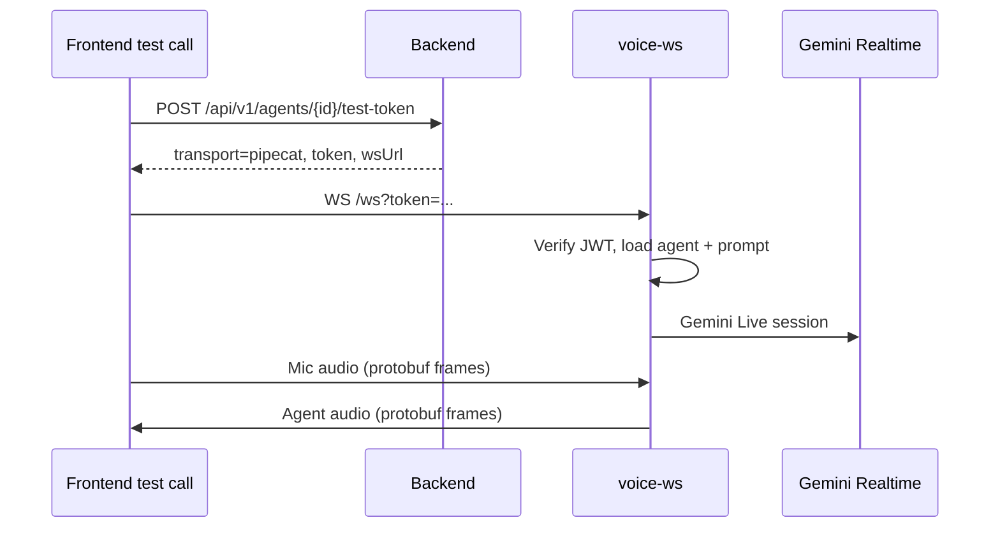

# voice-ws — Pipecat WebSocket voice worker

Phase 1 replacement for the LiveKit worker on the **active** call path.
Handles browser test calls over a WebSocket using **Gemini Realtime** via Pipecat.

The LiveKit `worker/` package is intentionally left untouched for rollback
(`VOICE_TRANSPORT=livekit`).

## Architecture (Phase 1)



## Local run (Docker)

```bash
# From repo root (starts backend, frontend, voice-ws-dev, …)
./start.sh start dev

# Or just the voice worker
docker compose -f docker-compose.dev.yml up -d voice-ws-dev
curl http://localhost:7860/health
```

## Env

| Variable | Purpose |
|----------|---------|
| `JWT_SECRET_KEY` | Must match backend (session JWT) |
| `SUPABASE_URL` / `SUPABASE_SERVICE_KEY` | Agent/org/prompt loading |
| `GEMINI_API_KEY` | Platform Gemini key fallback |
| `AGENT_DEFAULT_TIMEZONE` | Prompt datetime section |
| `VOICE_RECORDING_TEE` | `true` to log tee activity (no storage yet) |

## Phases

1. **Done here:** Web test call + Gemini Realtime
2. Twilio Media Streams (phone) → same container
3. STT→LLM→TTS pipeline + tools/MCP/skills

## Recording (future)

`src/recording.py` defines a pass-through tee in the pipeline so bidirectional
audio capture can be added later without reshaping the graph.
