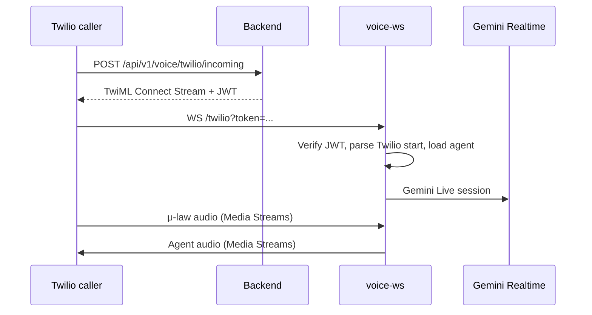

# voice-ws — Pipecat WebSocket voice worker

Active call path for **browser test calls**, **embed**, **public org page**, and
**Twilio Media Streams** phone calls, using Pipecat. Agent presets select either
**Gemini Realtime** or a modular Deepgram → OpenAI/Cerebras/OpenRouter →
Cartesia/Fish pipeline (direct providers only).

The legacy LiveKit **`worker/`** package was removed from the repo; git history
retains it for reference only.

At call teardown, this worker rounds connected duration up to whole minutes and
settles the complete charge through the atomic billing RPC. An admitted call is
allowed to finish even if the final settlement creates a temporary negative
balance; the backend then blocks new calls until credits are restored.

## Architecture



Browser test calls use `WS /ws` with protobuf frames (see Phase 1 notes).
Pipeline presets use `BrowserWebSocketFrameSerializer` (`src/serialization/`)
because the JS `@pipecat-ai/websocket-transport` client only decodes **audio**
and **message** protobuf kinds — STT/LLM text, transcription, and interruption
frames are dropped (including protobuf field 5, which the JS decoder ignores and
surfaces as `Unknown frame kind`). TTS audio subclasses are normalized before send.
Realtime Gemini is unchanged.

## Local run (Docker)

```bash
# From repo root (starts backend, frontend, voice-ws-dev, …)
./start.sh start dev

# Or just the voice worker
docker compose -f docker-compose.dev.yml up -d voice-ws-dev
curl http://localhost:7860/health
```

## Env

| Variable | Purpose |
|----------|---------|
| `JWT_SECRET_KEY` | Must match backend (session JWT) |
| `SUPABASE_URL` / `SUPABASE_SERVICE_KEY` | Agent/org/prompt loading |
| `GEMINI_API_KEY` | Platform Gemini key fallback |
| `DEEPGRAM_API_KEY` / `OPENAI_API_KEY` / `CARTESIA_API_KEY` / `CEREBRAS_API_KEY` / `OPENROUTER_API_KEY` / `FISH_API_KEY` | Pipeline provider key fallbacks |
| `AGENT_DEFAULT_TIMEZONE` | Prompt datetime section |
| `RESEND_API_KEY` / `RESEND_FROM_EMAIL` / `RESEND_FROM_NAME` | Platform-owned notification sender configuration; the native `Resend_email` follow-up tool uses the organization's encrypted Resend key and attachment sender configuration |
| `VOICE_RECORDING_ENABLED` | Platform gate for mixed audio persistence (default `false`); the agent must also opt in |
| `RECORDING_STORAGE_BACKEND` | `local` for development or `r2` for staging/production |
| `RECORDING_ENCRYPTION_MODE` | `provider_managed` (customer-managed is reserved) |
| `RECORDING_R2_*` | Bucket-scoped R2 endpoint, bucket, credentials, and URL TTL |
| `TWILIO_ACCOUNT_SID` / `TWILIO_AUTH_TOKEN` | Optional; enables Media Streams auto hang-up |

Backend (not this container) also needs `VOICE_WS_TWILIO_URL=wss://…` for phone
calls so Twilio can reach `/twilio`.

## Phases

1. **Done:** Web test call + Gemini Realtime (`/ws`)
2. **Done:** Twilio Media Streams (phone) → `/twilio`
3. **Done:** STT→LLM→TTS pipeline + shared tools, MCP, and skills

## Recording

`src/recording.py` captures mixed audio with Pipecat's `AudioBufferProcessor`,
uploads it on teardown, and records status/retention metadata in
`call_artifacts`. Recording is best-effort and never masks call billing. Org
admins and platform admins can listen from the Call Log UI through the
authenticated backend playback endpoint.

Native tool contracts live in `shared/voice_agents/tools/implementations/` and
are assembled here with a trusted per-call `ToolContext`. See the [Resend
Agent Email Tool](../docs/03_implementation/resend_email_agent_tool.md) for
route configuration, provider acceptance semantics, and error handling.
